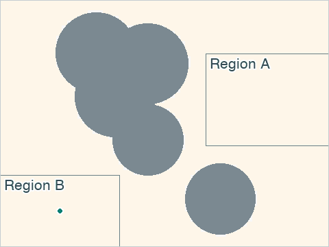

# Disturbance-Aware Informative Planning in Spatiotemporal Environments




[Project webpage](https://kalebbennaveed.github.io/dist-aware-ipp/)

## Clone and run

Install [uv](https://docs.astral.sh/uv/getting-started/installation/), then run the following on Linux or macOS.

```sh
git clone --depth 1 https://github.com/kalebbennaveed/voi-diffusion-ipp.git
cd voi-diffusion-ipp
uv python install 3.11
uv sync --locked
uv run python scripts/run_scenario.py --scenario 1 --method proposed
```

Use `--scenario` to select 1–4 and `--method` to select `proposed`, `global`, `aware`, `filtered`, or `unfiltered`. Scenario 1 runs for 532 simulated seconds by default. The runner writes its trajectory and summary to `runs/scenario-1-proposed/`. Use `--seconds` for a shorter run or `--output` for a new results directory.

## Repository tree

```text
data/scenario{1,2,3,4}/   Geometry and stationary CFD wind fields
media/                   Method and Scenario 1 GIFs
scripts/run_scenario.py  Simulation entry point
scripts/airflow/         Wind learning, planning, and execution
src/voi_diffusion_ipp/   Robot dynamics, clarity, POAM, MBD, and RPCBF
tests/                   Numerical and planner checks
vendor/                  Third-party license notices
pyproject.toml           Python package and dependencies
uv.lock                  Pinned dependency versions
LICENSE                  MIT license
```

## License

[MIT](LICENSE). Third-party notices are in [vendor/](vendor/).
