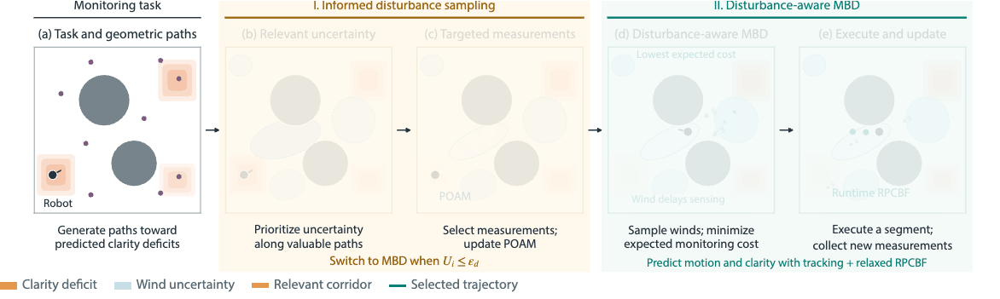

# Disturbance-Aware Informative Planning in Spatiotemporal Environments



[Project webpage](https://kalebbennaveed.github.io/dist-aware-ipp/)

## Clone and run

Install [uv](https://docs.astral.sh/uv/getting-started/installation/), then run the following on Linux or macOS.

```sh
git clone --depth 1 https://github.com/kalebbennaveed/voi-diffusion-ipp.git
cd voi-diffusion-ipp
uv python install 3.11
uv sync --locked
uv run python scripts/run_scenario.py --method proposed
```

Use `--scenario` to select 1–4 and `--method` to select `proposed`, `global`, `aware`, `filtered`, or `unfiltered`. The runner writes the trajectory and summary under `runs/`. Use `--seconds` for a shorter run or `--output` for a new results directory.

## Repository Structure

| Path | Contents |
| --- | --- |
| `data/` | Geometry and stationary CFD wind fields for the four scenarios |
| `media/` | Method animation and simulation recordings in GIF format |
| `scripts/run_scenario.py` | Command-line entry point for running a scenario and selecting a method |
| `scripts/airflow/` | Wind learning, geometric path generation, trajectory planning, and execution |
| `src/voi_diffusion_ipp/` | Robot and clarity dynamics, POAM wind estimation, MBD trajectory optimization, and RPCBF safety filtering |
| `tests/` | Numerical checks for clarity, wind uncertainty, and planning |
| `pyproject.toml`, `uv.lock` | Package configuration and pinned Python dependencies |
| `LICENSE`, `vendor/` | MIT license and third-party license notices |

## License

[MIT](LICENSE). Third-party notices are in [vendor/](vendor/).
