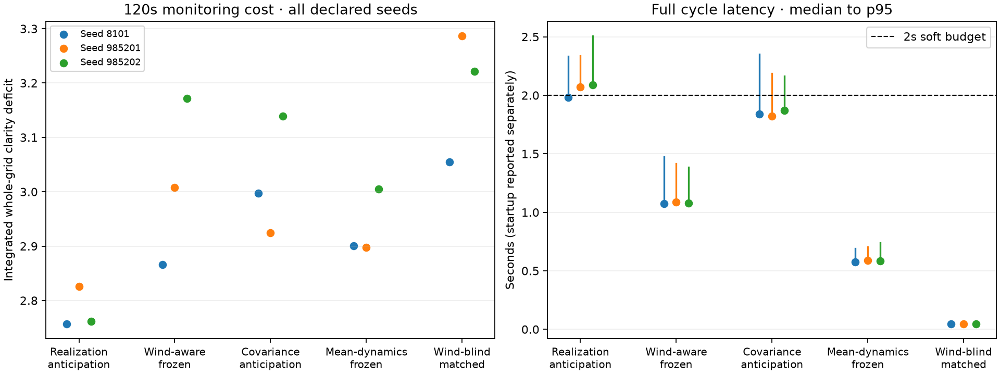
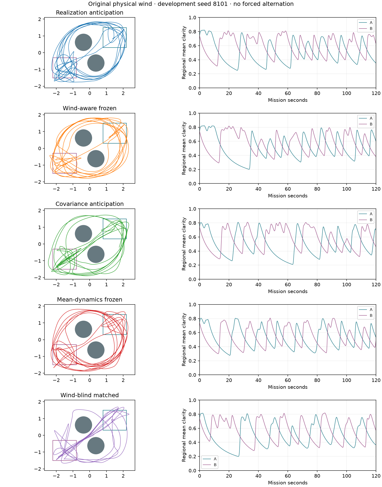
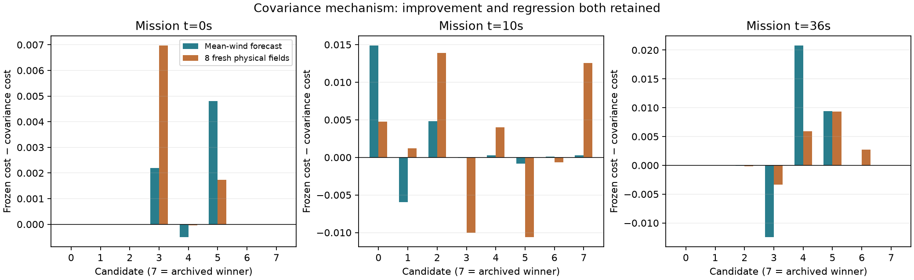
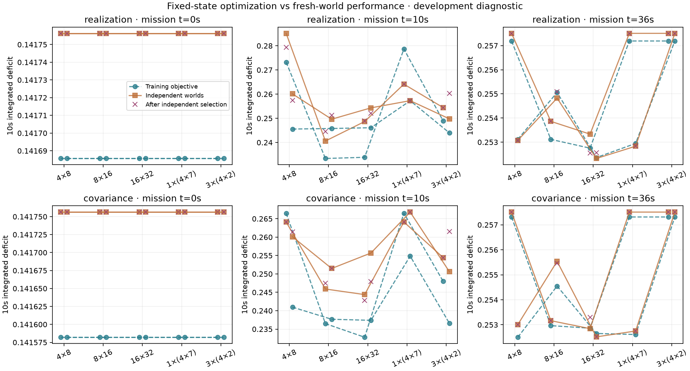

# Covariance-anticipated MBD + RPCBF: development results

The separate covariance planner is implemented and tested. These are development comparisons, not a general learning-benefit or safety validation. Original scenarios, methods, recordings and 3D demo are preserved. No information reward was introduced.

## What the completed study establishes

The covariance variant does **not** improve monitoring in this study: it costs 0.94–4.44% more than its matched mean-dynamics frozen control, in all three seeds (mean paired regret 2.90%). It makes 10–12 A/B transfers versus 13–17 for that control. Although covariance reduction changes RPCBF, that mechanism alone is insufficient to improve this compact policy's persistent mission.

The retained realization-anticipated method has 3.81–12.93% lower cost than wind-aware frozen (mean paired reduction 7.59%), and 9.76–14.30% lower cost than wind-blind matched (mean paired reduction 12.69%). Wind-aware frozen itself beats wind-blind matched by 1.57–8.50%. These are all three declared development seeds with **one shared physical wind field**, not independent environment trials or held-out statistical confirmation.

Covariance anticipation averages 1.84s across the three per-mission steady-cycle medians, versus 2.05s for realization anticipation. Their two-second miss fractions across equally sized missions are 19.0% and 75.9%; covariance p95 is 2.16–2.35s, realization p95 2.33–2.51s. This is a modest latency reduction, not the hoped-for large speedup or a hard real-time guarantee. Mean-dynamics frozen is 0.58s and wind-aware frozen 1.08s by the same median summary. Startup and real POAM preparation are separate below/in the numeric report.

All fifteen missions are contact-free under the independent dense physical checks. This does not negate the contacts in the separate independent-posterior-field mechanism stress test or establish general safety. Independent NumPy float64 whole-grid clarity reconstruction differs by at most 5.37e-7; unobserved clarity decays under Q=0.16 and regional recovery follows revisits.

Decision: retain the new mode as an experimental approximation, keep the original realization method as the reference, and do not run an expensive confirmation sweep or promote extra search based on these development results. The remaining research questions are predictive-GP versus future-POAM consistency, the mean-wind dynamics approximation, and continuation-policy expressivity. Improve those in separately declared tests before new persistent missions; do not tune against held-out wind or add an uncertainty reward.

## Persistent missions

Fifteen 120-second missions, three sensor/optimizer seeds, the same original physical wind. Every method uses the proper finite-domain target, 10-second forecast, two-second execution, 4×8 MBD, full real POAM and the same wind-aware execution controller/RPCBF. The primary isolated covariance comparison is against `mean_frozen`. Comparing to the original realization method also changes physical forecast assumptions.

All controls were independently reintegrated with 32 substeps per execution interval. Physical contact is separate from QP slack. A raw cost after contact cannot be interpreted as successful monitoring. First two planning cycles are excluded from steady timing and saved separately in mission_summary.json. Timing was measured during a continuous serial development study on the M3; brief browser QA overlapped the first seed, and no other heavy JAX worker ran.

| Seed | Method | Deficit cost ↓ | Contacts (intervals) | Transfers | Median / p95 cycle (s) | >2s |
|---|---|---:|---:|---:|---:|---:|
| 8101 | Covariance anticipation | 2.9973 | 0 | 12 | 1.840 / 2.351 | 15.5% |
| 8101 | Mean-dynamics frozen | 2.9007 | 0 | 17 | 0.575 / 0.692 | 0.0% |
| 8101 | Realization anticipation | 2.7567 | 0 | 15 | 1.984 / 2.335 | 44.8% |
| 8101 | Wind-aware frozen | 2.8658 | 0 | 16 | 1.072 / 1.473 | 0.0% |
| 8101 | Wind-blind matched | 3.0547 | 0 | 13 | 0.045 / 0.052 | 0.0% |
| 985201 | Covariance anticipation | 2.9247 | 0 | 12 | 1.823 / 2.185 | 15.5% |
| 985201 | Mean-dynamics frozen | 2.8976 | 0 | 15 | 0.587 / 0.706 | 0.0% |
| 985201 | Realization anticipation | 2.8262 | 0 | 14 | 2.069 / 2.340 | 86.2% |
| 985201 | Wind-aware frozen | 3.0075 | 0 | 13 | 1.089 / 1.416 | 0.0% |
| 985201 | Wind-blind matched | 3.2869 | 0 | 12 | 0.047 / 0.055 | 0.0% |
| 985202 | Covariance anticipation | 3.1389 | 0 | 10 | 1.869 / 2.165 | 25.9% |
| 985202 | Mean-dynamics frozen | 3.0053 | 0 | 13 | 0.585 / 0.740 | 0.0% |
| 985202 | Realization anticipation | 2.7612 | 0 | 16 | 2.091 / 2.509 | 96.6% |
| 985202 | Wind-aware frozen | 3.1712 | 0 | 16 | 1.080 / 1.385 | 0.0% |
| 985202 | Wind-blind matched | 3.2219 | 0 | 12 | 0.046 / 0.050 | 0.0% |

## Paired task comparisons

Positive percentages mean lower raw monitoring cost. Every pairing is listed; no best seed is selected. Three seeds do not establish the requested held-out confidence targets.

| Seed | Method | Comparator | Cost reduction | Both contact-free |
|---|---|---|---:|---|
| 8101 | covariance_anticipated | mean_frozen | -3.33% | True |
| 8101 | proposed | current_belief | +3.81% | True |
| 8101 | covariance_anticipated | proposed | -8.73% | True |
| 8101 | proposed | wind_blind_matched | +9.76% | True |
| 8101 | current_belief | wind_blind_matched | +6.19% | True |
| 8101 | covariance_anticipated | wind_blind_matched | +1.88% | True |
| 985201 | covariance_anticipated | mean_frozen | -0.94% | True |
| 985201 | proposed | current_belief | +6.03% | True |
| 985201 | covariance_anticipated | proposed | -3.49% | True |
| 985201 | proposed | wind_blind_matched | +14.02% | True |
| 985201 | current_belief | wind_blind_matched | +8.50% | True |
| 985201 | covariance_anticipated | wind_blind_matched | +11.02% | True |
| 985202 | covariance_anticipated | mean_frozen | -4.44% | True |
| 985202 | proposed | current_belief | +12.93% | True |
| 985202 | covariance_anticipated | proposed | -13.68% | True |
| 985202 | proposed | wind_blind_matched | +14.30% | True |
| 985202 | current_belief | wind_blind_matched | +1.57% | True |
| 985202 | covariance_anticipated | wind_blind_matched | +2.58% | True |

## What the robot actually does

The physical jet points A→B. Across the three missions, the original realization planner uses the middle passage for 7/23 A→B transfers but only 2/22 return transfers. Wind-blind planning uses it for 12/19 outbound and 11/18 return transfers. This supports the intended direction-dependent route behavior, without claiming the selected route is globally optimal. Route labels use the recorded crossing nearest the separating midplane; the exact thresholds and all individual transfers are in the [dense audit archives](mission_audits/) and summary JSON.

The covariance variant uses the middle for 9/17 A→B transfers and 0/17 returns, yet its overall monitoring cost is worse than the matched control. Favoring the wind-assisted passage more often is not by itself evidence of improved persistent monitoring. Wind-blind execution also acquires accurate passage estimates while repeatedly trying the middle; its final passage component-RMSE is 0.114–0.143 versus 0.123–0.159 for realization anticipation, despite higher task cost. Learning wind accurately and using that knowledge effectively for the task are distinct.

## Mechanism and search diagnostics

Twenty-four fixed policies at three saved states were evaluated with and without covariance conditioning. First-stage motion was identical; later RPCBF interventions and monitoring costs changed in both directions. The best candidate in the common bank did not change at any of these three states. Central-probe covariance changed little even when local filter interventions changed, exposing a limitation of the compact continuation policy. Full predictive spatial residuals were retained. Conditioning the current POAM predictive GP is not identical to future variational refitting/relocation or kernel training.

Sixty optimizer calls compare 4×8, 8×16, 16×32 and equal-37-evaluation single/multiple chains. Training worlds are fixed; shortlist selection uses four fresh worlds and final reporting eight additional worlds. The independent evaluator includes causal random posterior-mean updates. These are posterior-model checks, not independent evidence of physical calibration.

The 16×32 setting improved fresh-world mean cost in 8/12 paired comparisons (four initial-state ties), although training cost slightly regressed in two. Median optimizer-only time was 19.59s for realization and 18.46s for covariance, versus 1.48s and 1.35s at 4×8. Multiple chains helped at one state and hurt at another. Independent reranking changed 17 selections: the separate test bank improved in seven and regressed in ten; contact incidences across these repeated checks changed from four to two. These are correlated candidate checks, not independent safety trials. Neither larger search nor reranking was promoted to the online planner.

## Forecast versus real-estimator consistency

A post-hoc check at declared periods 0, 5 and 18 conditions every forecast operator on identical actual next-period positions, giving it perfectly known locations for this diagnostic only. With zero-innovation measurements and frozen kernel, full predictive-GP conditioning reduces mean grid variance by 0.00290 / 0.00296 / 0.00229, while a relocated POAM variational refit reduces it by 0.00174 / 0.00131 / 0.00019. The refit can also move the mean even for those pseudo-values, because sparse variational projection is not exact Gaussian conditioning of the current predictive process.

The actual next online POAM update, including real values and kernel training, has lower spatially averaged variance than the GP forecast in these three snapshots, yet 19.6–37.8% of cells remain more uncertain than the forecast. The mismatch is spatially mixed, not uniform optimism. This identifies a modeling limitation; it does not prove the cause of the mission regression, certify calibration, or justify discarding residual covariance. See [declared operator comparison](estimator_consistency_01/protocol.json) and [all results](estimator_consistency_01/results.json).

## Reproducibility and limits

36 component/regression tests pass, including full Gaussian conditioning, residual/cross-covariance preservation, conditional sample moments/derivatives, causal rollout boundaries, bounded target weights against quadrature, and the unchanged original schedule. Original unbounded first-12-second states, controls, clarity and POAM maps reproduce exactly. Initial failed diagnostics and the repaired test failure are retained in the worklog and results logs.

The covariance approximation freezes expected mean, kernel and inducing representation in planning. It cannot anticipate discoveries of strongly favorable/adverse wind or all observation-dependent route changes. Full real online POAM still learns those quantities. Finite inner RPCBF samples do not certify safety; covariance prediction does not establish posterior calibration. Finite warm-started MBD is an optimizer approximation, not an exact trajectory-distribution sampler.

Replay verification checks all 900 selected policy vectors, weights, original uncached final curves and all real execution/POAM snapshots against their numeric archives. Cached candidate curves can differ from that final check: the worst selected-policy path discrepancy is 0.959m at the ten-second forecast endpoint (realization, seed 985201, period 6), growing from 0.00358m within the first two seconds. Its cached/full costs are 0.25343/0.25211. For the new covariance variant the largest discrepancy is 0.0918m. These forecast sensitivities are retained, not silently replaced by smoothed animation, and motivate an interpolation/sensitivity check before stronger optimizer-quality claims. They are not physical execution errors. See [all export checks](export_verification.json) and [every mission's worst cache discrepancy](cache_path_diagnostic.json).

Exact protocols: [persistent missions](persistent_protocol_01.json), [optimizer study](budgets_01/protocol.json). All numeric summaries: [missions](mission_summary.json), [budgets](budget_summary.json), [mechanism](mechanism_summary.json). Implementation and equations: [method note](../covariance_anticipated_method.md). Raw mission checkpoints, complete denoising vectors and observations remain under results/budgeted_missions/covariance_mission_01_* inside this repository.

Interactive side-by-side execution, whole-grid clarity, regional decay/recovery, POAM wind/error and genuine MBD denoising: [new 2D covariance study](http://127.0.0.1:8766/covariance/). Start the local server with `JAX_PLATFORMS=cpu uv run python -m voi_diffusion_ipp.viz.demo_server --port 8766`. Run selectors pair identical configurations and seeds; all five methods and all three seeds are retained. Original 2D/3D demos remain available at their original paths.
