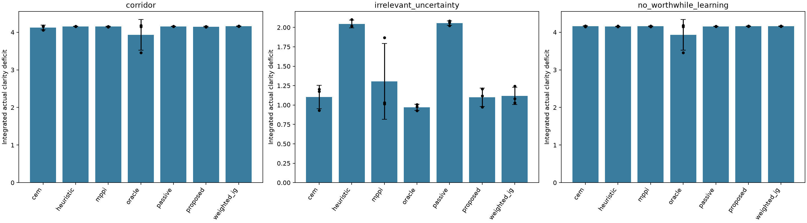
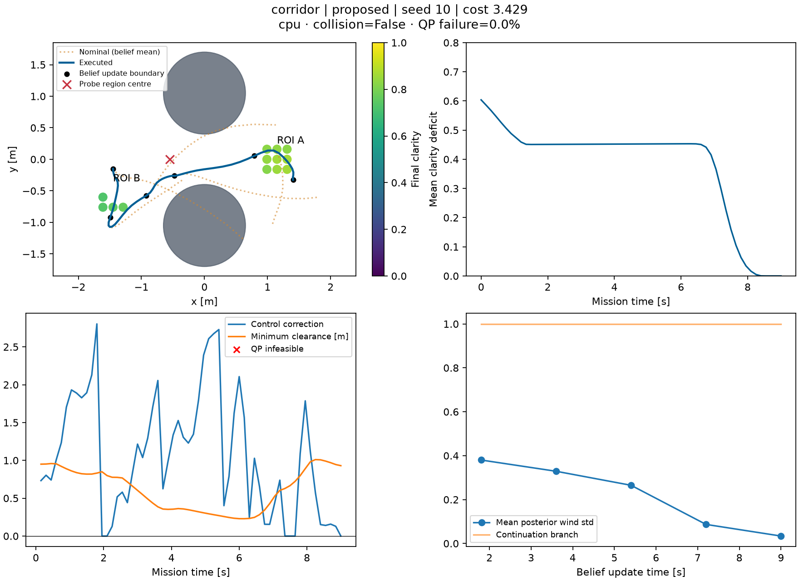

# Measured findings on the M3 Mac

The causal two-stage planner, paper-equation MBD optimizer and sampled spline
RPCBF are implemented and run end to end. Learning changes the posterior and
the admissible controls, and one larger-budget paired mission benefits from
learning. **A reliable mission-level advantage from deliberate VoI planning has
not been established.** The broad comparison does not support claiming that MBD
beats CEM/MPPI or that two branches improve performance. Collisions and optimizer
failures occurred and are included below.

## Protocol and evidence

The primary comparison uses ten methods on three scenarios, with paired physical
wind seeds 10, 11 and 12: 90 missions. Six ablations add 18 corridor missions.
Three larger-budget exploratory missions use seed 10. A prospective longer-mission
check adds nine paired missions on fresh seeds 13–15, for **120 archived missions**.
Raw JSON, NPZ, plots and
offline HTML replays are in `results/`. Committed evidence includes every final
mission's configuration and metrics in [missions.json](validation/missions.json),
a [CSV](validation/missions.csv), the [complete grouped table](validation/summary.md),
and [source/result hashes](validation/manifest.json). Superseded attempts are
retained locally and excluded from the final comparison.

All missions use the real safety-filtered dynamics and unsmoothed integrated
clarity deficit; lower cost is better. Episode fields are held fixed and are
independent of the fields sampled inside optimization. Paired methods share
physical-field, observation-noise and filter-noise key namespaces. Different
trajectories collect observations at different positions. The controller never
receives the physical field, except in the explicitly labeled oracle.

The broad suite has 9 seconds of simulated mission time, 0.15-second control
steps, 1.8-second first periods, 4.8-second continuations, three control knots,
two shared branches, four outer worlds and four inner fields. Backup rollouts
use ten steps of 0.192 seconds and the full cubic spline. MBD, CEM and MPPI each
use 50 objective evaluations per replan: four levels/iterations, twelve proposals,
plus initial and final evaluations. These are deliberately small computational
budgets, not converged research-scale optimization. Error bars are sample
standard deviations across three seeds, not confidence intervals.

## Broad comparison

| Method | Corridor cost, mean ± SD | Irrelevant uncertainty | Very noisy measurements |
|---|---:|---:|---:|
| Proposed joint MBD | 4.1490 ± 0.0081 | 1.1003 ± 0.1178 | 4.1602 ± 0.0056 |
| CEM, same objective/budget | 4.1250 ± 0.0622 | 1.1030 ± 0.1505 | 4.1623 ± 0.0111 |
| MPPI, same objective/budget | 4.1501 ± 0.0086 | 1.3040 ± 0.4885 | 4.1590 ± 0.0115 |
| Passive learning | 4.1552 ± 0.0032 | 2.0563 ± 0.0295 | 4.1558 ± 0.0031 |
| Weighted information gain | 4.1608 ± 0.0070 | 1.1180 ± 0.1125 | 4.1602 ± 0.0056 |
| Direct reset/replay heuristic | 4.1552 ± 0.0032 | 2.0446 ± 0.0490 | 4.1553 ± 0.0088 |
| Draft selection, MBD candidates | 4.1552 ± 0.0032 | 2.0563 ± 0.0295 | 4.1558 ± 0.0031 |
| Frozen future belief | 4.1592 ± 0.0043 | 1.1047 ± 0.1346 | 4.1602 ± 0.0056 |
| Fixed clarity continuation | 4.1586 ± 0.0041 | 1.4255 ± 0.3468 | 3.9365 ± 0.3873 |
| Known-wind oracle, finite search | 3.9292 ± 0.4077 | 0.9698 ± 0.0396 | 3.9292 ± 0.4077 |

The plot shows the primary seven-method subset. Black dots are individual seeds;
error bars are sample SD. The three additional comparators are included in the table.

In the corridor, proposed MBD reaches ROI A in one of three trials, as do CEM and
the oracle; most methods remain near ROI B. The oracle has the true wind but the
same limited numerical optimizer, so it is not an optimal-cost lower bound.
The proposed mean improvement over passive learning is only about 0.15%.

The irrelevant-uncertainty scenario puts useful monitoring on the initially
accessible side and high wind uncertainty on the other side. Proposed MBD
reaches the relevant ROI in all three trials and spends no time in the designated
probe region. Its cost is very similar to frozen-future-belief planning and
weighted IG. This supports task-focused behavior here, but does not establish an
advantage of anticipating learning. Better cost than the short-horizon passive
baseline is confounded by the longer planning window.

The no-worthwhile-learning scenario raises direct observation noise to 10 m/s².
Proposed MBD again spends no time in the designated probe region, but its cost
does not improve over passive learning. It has one colliding mission out of three,
13.89% infeasible executed QPs, and six all-invalid optimization events over
fifteen replans. Across all ten methods, the noisy scenario has ten colliding
missions out of thirty. The corridor and irrelevant-uncertainty baseline suites
have none. These results rule out a blanket empirical safety claim.

An all-invalid optimization executes the fixed clarity controller through the
same RPCBF and is labeled as a fallback. It is never omitted from mission
statistics or presented as a successful optimized plan. Physical collision checks
sample four intermediate times per control interval; they do not certify
continuous-time clearance. The simulator continues after a collision to retain
diagnostics, so costs from colliding episodes must be read alongside safety.

## Longer missions on fresh seeds

After inspecting the nine-second results, the diagnostic was specified as an
18-second mission on three previously unused physical-field seeds (13–15),
with the **same geometry, planning horizons and small per-replan budget**.
Only total mission duration and the test seeds change. All three variants are
paired. This is a follow-up diagnostic, not a replacement for the first suite.

| Variant, n = 3 | Cost mean ± SD | ROI A access | Collisions | Infeasible QPs | Optimizer fallbacks |
|---|---:|---:|---:|---:|---:|
| Proposed | 5.5680 ± 1.0068 | 3/3 | 0/3 | 3.61% | 1 |
| Frozen future belief, real learning | 5.3869 ± 1.2441 | 3/3 | 0/3 | 1.39% | 2 |
| Proposed, no measurements | 7.4404 ± 1.0340 | 1/3 | 2/3 | 17.78% | 12 |

With learning, proposed first-access times are 10.80, 8.55 and 13.80 seconds;
the frozen-future-belief comparator reaches at 10.65, 8.70 and 14.10 seconds.
Proposed MBD costs 3.36% more on average than that comparator and loses on two
of the three paired seeds. Its mean cost is 25.16% lower than disabling all
measurements, but that control also has two collisions. Thus learning is useful,
and the short episode did hide later access, while **anticipating future learning
still has no consistent demonstrated advantage over ordinary online learning**.

## Larger-budget exploratory case

This is a **single-seed diagnostic**, not part of the broad paired aggregate.
It uses a wider corridor (obstacle radius 0.65 instead of 0.79), five knots,
six worlds, six inner fields, twelve diffusion levels and 48 proposals, with
three task-only warm-start candidates. All compared methods use the same setup
and 581 objective evaluations per replan. No probe bonus or hidden wind is used.

| Variant, seed 10 | Actual cost | ROI A first access | Probe occupancy | Collision | Infeasible QPs |
|---|---:|---:|---:|---:|---:|
| Proposed, learning | 3.4288 | 7.20 s | 1.80 s | No | 0% |
| Frozen future belief, real learning | 4.1450 | Never | 0 s | No | 0% |
| Proposed, measurements disabled | 4.1450 | Never | 0 s | No | 20% |

The learning run has 17.28% lower mission cost. Its first period costs 0.0206
more than frozen-future-belief planning; subsequent periods recover about 0.7368.
Minimum observed physical clearance is 0.2293 m. Mean wind uncertainty at
monitoring cells ends at 0.0339 m/s² and RMSE is 0.0331 m/s²; without measurements,
uncertainty stays at 0.55 and RMSE is 0.7608.

This establishes an example in which the coupled implementation benefits from
learning and eventually reaches the distant task. It does **not** isolate the
cause as deliberate probing: ordinary task motion also acquires wind information,
and increased search budget, initialization and geometry all differ from the
broad suite. The matched no-information continuation has benefits
`[0, 0, 0, -0.01086, -0.00125]` at the five boundaries. Those signed diagnostics
therefore do not support a positive incremental benefit of the latest measurements
at these particular states. They hold the same candidate continuation library
fixed and are not independently optimized VoI bounds.

## Component mechanism and ablations

Conditioning on repeated calm-wind measurements near the corridor changes the
RPCBF at an identical physical state. At position x = −0.9 m, velocity
(0.2, 0) m/s and nominal input (0.65, 0) m/s², correction decreases from 0.9281
to zero; the 7×7 grid estimate of admissible control fraction increases from
0.2653 to 0.4490. This uses posterior-derived fields and no ground-truth input
to the filter. [Raw diagnostic](validation/learning_mechanism.json).

In the small corridor mission, seed 10 has a positive matched continuation
benefit of 0.78965 at the fourth boundary; seed 12 has 0.19917 there followed
by −0.03672 at the last boundary. The benefit can have either sign and is never
clipped or added to the proposed objective. The mission may end before a
predicted future benefit is fully realized.

| Corridor variant, n = 3 | Cost mean ± SD | ROI A access | Collisions |
|---|---:|---:|---:|
| Full proposed | 4.1490 ± 0.0081 | 1/3 | 0/3 |
| No measurements | 4.1607 ± 0.0064 | 0/3 | 1/3 |
| One shared future route | 4.0026 ± 0.2798 | 0/3 | 0/3 |
| Independent-cell belief | 4.1535 ± 0.0051 | 0/3 | 0/3 |
| Terminal deficit × 3 seconds | 4.1649 ± 0.0125 | 0/3 | 0/3 |
| Half-length first period, same mission duration | 4.1025 ± 0.0918 | 1/3 | 0/3 |
| Local-window spline | 4.1493 ± 0.0085 | 1/3 | 0/3 |

The independent-cell ablation changes the controller's spatial belief while
retaining the same correlated physical wind. The shorter-period ablation doubles
the number of replans; it is not a matched total-compute comparison. A terminal
penalty did not help. Shared-future planning sometimes performed better, so no
branching advantage is established. Every realized proposed-policy boundary in
the primary and exploratory missions chose branch 1. Unit tests show that calm
and windy observations can select distinct branches, but the actual tested
posteriors did not exercise both branches.
The longer fresh-seed mission 14 does switch to branch 0 at 12.6 seconds, after
already accessing ROI A; it still costs more than frozen-future-belief planning.

The fast spline retains sampled policy-value/QP logic and restricts interpolation
to seven points around the discrete maximum. Against the full spline on 64 prior
and 64 posterior states, maximum value discrepancy was 3.58e−7, maximum gradient
discrepancy 1.45e−5, and maximum filtered-control discrepancy 1.02e−5, with no
feasibility disagreements. This is local numerical evidence, not an error bound;
all principal experiments use the full spline.

## Solver, backend and software validation

The separate nonconvex trajectory optimizer test uses 770 objective evaluations
per method and ten seeds. MBD cost is 0.7495 ± 0.2049, CEM 0.7812 ± 0.1323,
and MPPI 0.5532 ± 0.0088. MPPI wins this test. Its soft obstacle cost is purely
an optimizer benchmark; it is not substituted for RPCBF in any mission.

All **19 CPU tests pass**. They cover GP conditioning, coherent fields, executed clarity, not-a-knot
spline maxima against SciPy, RPCBF finite-difference gradients, QP projection
against SLSQP, explicit infeasibility, one/two-dimensional analytic diffusion
scores, nonanticipativity, terminal-state continuity, true-field separation,
POAM statistics/kernel adaptation, branch response to observation values, and
safe experiment resume. See [test log](validation/tests_cpu.log) and
[routing test](validation/tests_routing.log). The complete smoke script also
passed environment checks, tests, a two-horizon mission, and rendering.

All numerical missions ran on native ARM64 JAX 0.4.38 CPU. Broad-suite replans
averaged roughly 0.5–3.2 seconds depending on method and host load; the larger
case averaged 59–80 seconds. These are offline simulation results, not real-time
control. The isolated small full two-stage kernel compiled in 2.047 seconds and
executed in 2.12–2.66 ms, with peak process RSS 376.6 MB. This is one objective
kernel at smaller shapes, not a full optimization. Mission JSON separately
records compile time, per-plan time, evaluations and process peak RSS. The largest
primary-suite process reached 2.87 GB peak RSS, including accumulated compilation caches;
the larger-budget paired process peaked at 0.80 GB. These are process measurements,
not total machine memory. Several
processes ran concurrently, so solver wall-time differences are not controlled
speed comparisons.

Official `jax-metal` selected Apple M3/METAL but failed to compile Cholesky.
The separately tested third-party `metaljax` failed because its shader library
requires a language version unsupported by this OS. No GPU planner or speedup
is claimed. [Backend evidence](backend_report.md), [Linux portability](linux_gpu.md).

The POAM adapter passes sufficient-statistic and integration tests and ran a
two-horizon smoke mission. Its finite-anchor planning snapshot omits conditional
residual variance between anchors; maximum omitted monitoring-cell variance was
0.07321 in that smoke run. The broad mission results use the explicitly labeled
finite-feature GP, not POAM. POAM mission performance remains unvalidated.

## Diagnosis and remaining scientific work

The GP and posterior-to-filter mechanism work; lack of learning cannot explain
every failed mission. The more plausible limitations supported by these tests
are limited search, a short realized mission window, frequently unused branch
capacity, and conservative or occasionally insufficient sampled safety filters.
The very noisy proposed trials reject approximately 38–62% of proposals and
trigger frequent all-invalid recovery. Even the known-wind oracle often fails
to reach the distant ROI under the small search budget.

The current evidence does not justify a publication-level claim that deliberate
VoI sensing reliably emerges, that MBD is the best solver, or that finite-sample
RPCBF guarantees safety. A larger preregistered held-out comparison, better
validated branch partition, longer planning/mission horizons, and sensitivity
to inner-field counts are still needed. Those investigations must preserve the
causal objective and report the same safety/fallback metrics.
The fresh-seed longer missions specifically weaken the claim that episode length
alone explains the missing advantage over frozen-future-belief planning.

## Reproduction and corrections

Follow the [README](../README.md) for UV setup and runnable commands. `configs/evaluation.yaml`
matches the broad suite. `configs/extended.yaml` reproduces the two larger-budget
methods; replacing `measurements` with false reproduces its no-measurement case.
`scripts/long_mission_diagnostic.py` reproduces all nine fresh-seed duration checks.
`scripts/archive_validation.py` verifies complete mission counts, recomputes
period costs from saved clarity, and archives the final evidence.

During evaluation, CEM was corrected to exclude infinite-cost samples from elite
statistics; all nine primary CEM missions were rerun. Initially aborted
all-invalid missions were rerun with explicit logged fallback rather than
discarded. A later correction makes nominal replay use the actually recorded
nominal controls during fallback and makes the fixed-feedback baseline's matched
diagnostic use its feedback continuation; all nine fixed-baseline missions were
rerun. Those diagnostic changes do not alter the proposed planner's successful
physical trajectories. Older successful results have finite incumbent traces;
the archive verifies this when normalizing their missing fallback flags. Early
ablation replay predictions during fallback may predate the nominal-display fix;
their executed trajectories and reported costs remain valid.
