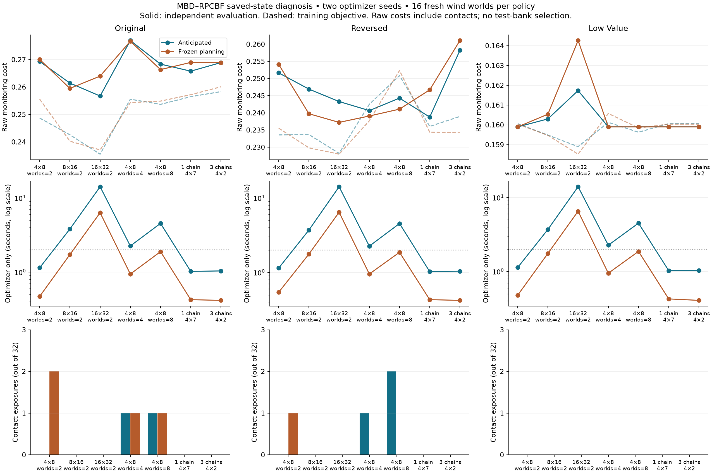
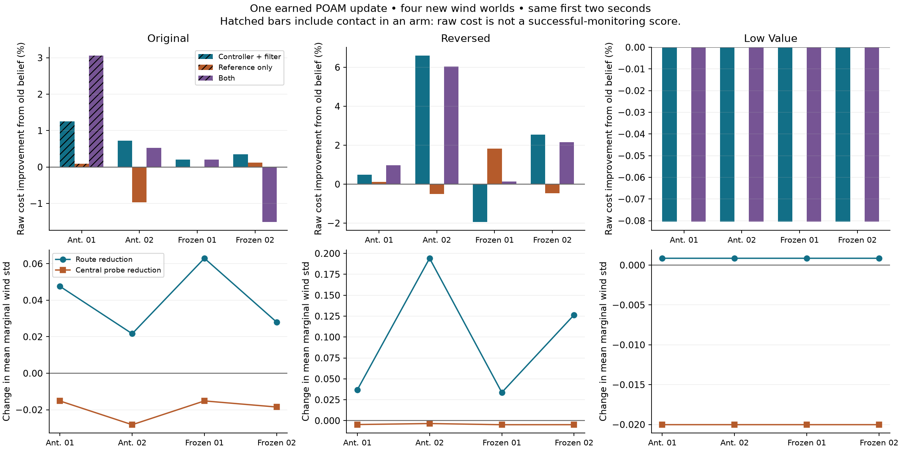

# Original MBD–RPCBF reliability investigation

This continues the user-approved plan without replacing the original scenarios,
realization-based planner, covariance experiment, or archived demos. Scheduled
research remains paused. One foreground heavy JAX worker runs at a time.

**Conclusion:** earned wind information can change RPCBF-filtered monitoring,
but anticipated learning's advantage over wind-aware frozen planning is not
robust to the optimizer budget and independent wind draws in these tests. More
worlds, equal-budget multiple chains and the tested route-local feature do not
provide a consistent improvement. The only production repair is explicit
all-invalid MBD handling; optional route features remain experimental. The next
confirmatory mission sweep has not passed its method-freezing gate.

## Mathematical audit and tested repair

The decision variable is the nominal feedback-policy vector theta. MBD scores
its RPCBF-filtered monitoring cost, including coherent physical wind, earned
measurements, future POAM updates and continuous robot/clarity states. It does
not average scenario-specific executed controls or require an invertible filter.
The objective averages costs before exponentiation.

The deployed experimental target is more precisely

`p(theta | S) proportional to 1_box(theta) 1_valid,S(theta) exp(-Jhat_S(theta)/T)`.

The box is [-6,6]^18 in new tests. `valid,S` excludes nonfinite and sampled-contact
forecasts when rejection is enabled. It is a proper density when its finite-cost
valid subset has positive volume. The sampled admissibility set itself depends
on the outer and inner banks. Increasing world count therefore changes both
cost-estimation accuracy and which sampled contacts are discovered. Report both;
do not interpret it as only a reduction in Monte Carlo variance. This is not an
empirical-safety guarantee. The historical zero-bound default remains available
for archival reproduction, without a normalizable unbounded-target claim.

The all-invalid diffusion branch previously returned zero weights but still
rescaled the noisy iterate, and reported effective sample size near 1e30. The
new explicit branch holds that iterate and reports zero effective samples. The
incumbent objective remains infinity if no valid candidate exists. A failing
regression was recorded before the repair; 19 MBD, causal-budgeted and runtime
cache tests pass afterward. This is a failure-handling correction, not evidence
of improved monitoring. Finite warm-started reverse diffusion remains an
approximate optimizer; no finite-compute convergence guarantee is claimed.

## Completed numerical audit

Nine event-selected states cover departure and first outbound/return midplane
crossings in original, reversed and open-passage low-value development missions.
Each checks the stored selected policy and three distinct next-ranked finite
proposals. Two separately labeled historical numerical failures are stress tests.
Selection uses recorded geometry and events, not favorable method outcomes.

For both anticipated and frozen forecasts, compare the original 129-wide cache,
the same cache with exact outer physical fields, a 257-wide cache, and uncached
evaluation. The physical-field override is only a simulator input: it never
supplies the controller or inner RPCBF bank.

At all nine event-selected states, the cached and uncached evaluations select
the same shortlist winner for both belief modes. Yet anticipated forecast paths
differ by up to 0.433m across the four policies and two sampled worlds. Replacing
only the physical interpolation does not remove that discrepancy. The finer
cache reduces the maximum to 0.386m, with nonuniform improvement. Maximum
anticipated mean-cost errors are 0.002144 (129) and 0.000698 (257). These small
shortlists do not establish global ranking stability.

The previous worst selected-path stress case reproduces about 0.959m divergence,
reduced to 0.027m with the finer cache. In the separate rejected-forecast case,
the coarse cache predicts +0.0291m clearance while uncached evaluation finds
approximately -0.00073m. The 257-wide cache still misses the sign (+0.00143m).
The next-ranked proposal passes the uncached check (+0.0397m). Keep final
uncached verification; merely increasing cache width is not a sufficient repair.
Median warm cache-build time here is 0.077s (129) versus 0.294s (257), excluding
the rollout, replanning and real POAM work.

Two diagnostic failures are retained. The first driver did not decode archived
JSON null costs as invalid floats and failed before any evaluator ran. The second
completed ten states, then detected up to 0.000232 state difference in its batched,
reduced-grid uncached evaluation of a historical rejection. The original full-grid
single-policy evaluation reproduces that archive exactly (zero difference).
Verification now uses the original evaluation shape with the original tolerance;
batching drift is reported separately. No archived values or tolerance were edited.
All three executed driver versions are preserved with matching protocol hashes.

Evidence: `numerical_summary.json`, `numerical_protocol_01/02/03.json`, and numeric
arrays under `numerical_02/` and `numerical_03/`. The last directory completes the
one failed state; it does not replace the earlier ten outcomes.

## Completed search and sampling experiment

`search_protocol_03.json` freezes 84 optimizer calls at the first outbound
midplane state in each of the three environments, paired anticipation/frozen
objectives and two optimizer seeds. It compares 4x8, 8x16, 16x32; 2/4/8 nested
outer worlds; and equal-37-evaluation one versus three chains. Initial/final
diffusion scales, temperature and shared starts are held fixed. Counts of outer
rollouts and wall-clock cost are reported as well as objective-call counts.

Each chosen policy is evaluated under 16 independent posterior physical worlds,
first holding the inner bank fixed and then using independent inner banks with
the same outer worlds/noise. Evaluation uses original uncached fields and causal
hypothetical POAM updates for every selected policy: frozen describes planning,
not disabling real learning. These test banks do not rerank or choose the method.
Contact incidences remain separate from raw post-contact costs. They assess the
posterior model, not calibration to independent physical environments.

All 84 optimizer calls and 2,688 selected-policy/world evaluations completed
(84 policies x 16 worlds x two inner-bank settings). These are paired exposures,
not 2,688 independent experiments: policies share physical worlds, and some
configurations select identical policies. JSON metrics exactly match every saved
NPZ cost and clearance. See [numeric summary](search_summary.json), the complete
checkpoints in `search_01/`, and the reproducible reporting script
`scripts/report_mbd_reliability.py`.

The table gives mean **raw independent cost** across two optimizer seeds and
16 fresh posterior physical worlds per policy, using fresh inner samples.
Lower is better. Each entry is anticipated / frozen-planning cost. Every policy
receives causal earned belief updates during this evaluation.

| Search configuration | Original state | Reversed state | Low-value state | Anticipated optimizer time |
|---|---:|---:|---:|---:|
| 4x8, two worlds | 0.26933 / 0.27005* | 0.25164 / 0.25411* | 0.15990 / 0.15990 | 1.13–1.15s |
| 8x16, two worlds | 0.26144 / 0.25949 | 0.24692 / 0.23974 | 0.16030 / 0.16054 | 3.70–3.82s |
| 16x32, two worlds | 0.25672 / 0.26398 | 0.24329 / 0.23722 | 0.16173 / 0.16426 | 13.94–14.15s |

`*` The frozen-planning selections have 2/32 contact exposures at the original
state and 1/32 at the reversed state. These costs include post-contact motion;
they are not successful-monitoring scores. None of the other entries in this
table has a contact in this test. This does not establish physical safety.

Increasing anticipated search from 4x8 to 16x32 improves independent cost by
4.68% at the original state and 3.32% at the reversed state, but worsens it by
1.15% at the low-value state despite improving its training cost. Frozen planning
also improves with more computation. Anticipation's ranking against frozen
planning changes with budget: at the reversed state its raw cost is 0.97% lower
at 4x8, then 2.99% and 2.56% higher at 8x16 and 16x32. The small-budget advantage
is therefore not robust in this diagnostic. The 16x32 result is a larger-budget
reference, not a known global optimum.

The 4/8-world configurations do not consistently improve independent performance.
They produce seven fresh-inner contact exposures across all their selections,
in addition to the three marked above. More scenarios cannot be assumed to
repair either optimization or empirical safety. Their anticipated optimizer
times are about 2.25s / 4.52s before real POAM work or final verification.

At an equal 37 objective evaluations, the three-chain anticipated method has
1.18% higher independent mean cost at the original state, 8.15% higher at the
reversed state, and identical cost at the low-value state compared with one
chain. None of these chain comparisons contacts an obstacle in the fresh-inner
bank. This particular budget allocation does not justify promoting multiple
chains. It does not establish that every multichain design is worse.

The compact 4x8 method is retained as the runtime reference, with its limitations
stated. No tested larger budget satisfies the two-second full-cycle requirement;
the figure reports optimizer time only. No extra chains, fresh-bank reranking,
Gaussian reference prior or covariance-only anticipation is promoted. A single
saved state per environment and two optimizer seeds are insufficient to establish
a mission-level advantage or negative-control noninferiority.

## Relocated-inducing-point cache diagnostic

`conditioning_protocol_01.json` tests exact values of the unchanged prior draws
at relocated POAM inducing points, while preserving the 129-wide query table.
It uses the three outbound states above and the two separately marked numerical
stress cases. This tests one possible source of inverse-kernel amplification.

The hypothesis is not supported as a sufficient repair. The maximum path error
changes from 0.257 to 0.303m at the original state, 0.433 to 0.429m at the reversed
state, and 0.135 to 0.137m at the low-value state. At the previous worst selected
path it changes from 0.959 to 0.983m. The rejected-forecast case still has the
wrong clearance sign: approximately +0.0289m instead of the uncached -0.00073m.
All outcomes remain in `conditioning_01/results.json`; the production cache is
unchanged. Four-policy batch timings rise slightly, from roughly 0.093–0.095s to
0.097–0.100s. These are numerical evaluator timings, not full planning cycles.

All five scientific evaluations completed. The surrounding macOS `time -l`
wrapper then failed to access `kern.clockrate` in the sandbox and exited 1.
This is recorded in `conditioning_01/process_status.json`; peak memory is
unavailable, while synchronized Python timings and all scientific outputs are
present. No result was discarded or rerun to suppress that failure.

## Controlled mechanism diagnostic

`mechanism_protocol_01.json` declares all four base 4x8 selections at each of the
three saved states, with four further independent posterior worlds. Starting
from identical first-stage terminal robot and clarity states, it isolates one
earned POAM update in an eight-second continuation: old versus updated
controller/RPCBF and old versus updated reference, forming four paired arms.
The posterior is deliberately held fixed after that one update. This is a
mechanism experiment, not the production four-update planning objective.

The first driver failed its production-parity check before saving any scientific
outcome: dynamic inputs/reduced clarity grid in the diagnostic were compared
with constant inputs in the production call, causing a maximum first-stage state
difference of 0.000432. Protocol 02 uses the full grid and dynamic inputs in both
calls, retaining the original tolerances. **All 24 endpoint comparisons now have
exactly zero maximum state error.** The failed driver, protocol and log remain.

All 12 policies x four new worlds x four arms completed. Updating both controller
and reference lowers the mean continuation's total cost by 0.53% for the
contact-free original anticipated policy, and by 0.97% / 6.03% for the two
reversed anticipated policies. The other original anticipated policy includes
contacts (2/4 old-belief exposures, 1/4 updated exposures); its raw improvement
is not successful-monitoring evidence. Among frozen-planning selections, the
same update also has both benefits and a 1.51% regression. The low-value state
selects the same policy in all four optimizer arms and shows a 0.0804% cost
increase from updating. Those duplicates are not independent replications.

The controller/filter update alone can help while changing the reference alone
hurts. For one reversed anticipated policy, controller/filter updating improves
mean cost by 6.60%, reference adaptation alone worsens it by 0.50%, and their
combination improves it by 6.03%. These interventions isolate nominal wind
compensation and RPCBF together; they do not attribute every change solely to
RPCBF. They confirm a causal response to earned information, not that the
optimizer chose an optimal probing maneuver or that learning always pays.

The central-probe feature is a weak summary in these states. Route-average
marginal standard deviation decreases after the first update for every selection,
while the central-probe standard deviation increases. This is possible for
variational POAM refitting/inducing relocation; it is not the monotone covariance
conditioning identity of an unchanged exact GP. The future reference moves by
about 0.045–0.160m on average for nonzero-gain selected policies. These observations
motivate testing a spatially relevant feature, without asserting it will improve
performance. Evidence: [numeric summary](mechanism_summary.json), all raw arrays
in `mechanism_02/`, and [executed protocol](mechanism_protocol_02.json).

## Separate route-feature experiment

The optional `budgeted_feedback_features="route_knots"` replaces only the three
central-probe features with posterior mean x/y wind and average marginal standard
deviation at the four unshifted nominal future knots. It keeps 18 nominal policy
parameters, six feedback gains, the same bounded geometric shift, 4x8 MBD and
the same executed clarity objective. These are queries of the available belief,
not assumed future observations. Real sensing and POAM updates still use executed
locations. The default remains `probe`; branch policies reject the unsupported
feature combination. No original recording, environment or demo is overwritten.

The spatial-response test changes route-local wind estimates while keeping the
central probe identical. The new reference responds, preserves the initial
position/velocity, and its multi-period causality test passes. Together with MBD,
target and cache regressions, 22 tests pass. `route_features_protocol_01.json`
declares 24 paired optimizer calls and 16 further independent posterior worlds
per selected policy. The probe arm must reproduce the previous trained vectors
and costs within the predeclared strict tolerances. All 24 optimizer calls and
384 paired policy/world evaluations finished. All twelve probe-arm policy vectors
and training costs reproduce the earlier run **exactly**, not merely within
tolerance. Saved JSON and NPZ cost/clearance metrics also match exactly.

| Saved state | Route-feature anticipated raw cost versus probe | Contact exposures, probe → route | Frozen-planning raw cost change |
|---|---:|---:|---:|
| Original | 4.51% higher | 1/32 → 2/32 | 0.35% higher |
| Reversed | 0.67% higher | 1/32 → 4/32 | 3.93% higher |
| Low value | Identical | 0/32 → 0/32 | Identical |

The reversed frozen-planning selections also change from zero to one contact
exposure; the other frozen-planning groups have none. Raw costs include those
failed motions. Anticipated optimizer time stays about 1.14s, but runtime parity
does not compensate for the cost/contact regressions. **Do not promote this
feature.** Spatial relevance of a statistic alone does not establish a useful
feedback representation. No further feature or scale tuning used these test
banks. Full evidence: [summary](route_features_summary.json),
`route_features_01/`, and `scripts/report_route_features.py`.

## Status of the approved plan and research claims

| Work item | Evidence and decision |
|---|---|
| Policy-space formulation and proper target | Audited; bounded latent target and sampled validity are explicit. Preserve RPCBF composition. |
| Finite-score failure handling | Repaired and regression-tested; no mission-benefit claim. |
| Cached versus uncached behavior | Nine event states plus two failure-selected stress cases; retain uncached verification. Tested inducing-point repair rejected. |
| Larger MBD budgets and outer banks | 84 declared optimization runs completed, including separate independent evaluation; no consistent anticipation advantage or runtime-feasible larger budget. |
| Multiple route initializations | Equal 37-call one/three-chain comparison completed; tested three-chain allocation not promoted. |
| Earned-learning mechanism | All 192 paired arm/world exposures completed with exact endpoint parity; causal responses include gains, regressions and contacts. |
| Policy feature diagnosis | 24 further optimizer runs and 384 fresh paired exposures completed; tested route feature not promoted. |
| New frozen-method 120s confirmation missions | **Not run:** no new candidate passed the development gate. Existing 15 covariance-study missions and original/reversed/control missions are preserved as development evidence. |
| Demo/report | Scientific figures inspected; numeric reports reproducible. Existing 2D/3D recordings are unchanged. No new mission replay is presented as validated. |

This work completes the declared diagnostics, not the broader scientific
acceptance criteria. It does not establish global optimality, a hard two-second
deadline, calibrated posterior safety, or an anticipated-learning advantage
across independent physical environments. The strongest supported distinction
remains between **using wind in control/planning** and **successfully predicting
the value of future learning**; demonstrating the former does not prove the
latter. The prior [covariance study](../covariance_study/README.md) and
[wind-route study](../wind_route_study/README.md) retain their separate limitations.

A next research phase should address the observed failures directly: evaluate
posterior calibration near contact-prone routes, distinguish mean-estimation
benefits from representation-limited route adaptation, and develop a continuation
policy that can adapt without relying on a single pooled statistic. Any such
change needs a new declared development protocol, followed by genuinely held-out
physical-wind missions only after a method is frozen. None of the diagnostic
test banks here may be relabeled as untouched confirmation data.
