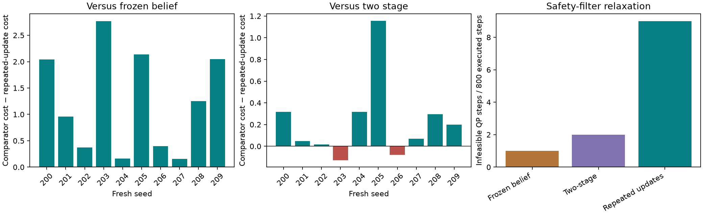

# Repeated belief updates and an inspectable diffusion demo

**Subsequent scope clarification:** safety relaxation is allowed. References below
to QP failures mean infeasibility of the *unrelaxed* inequalities, not failure of
the soft-constraint method or physical collision. Numerical evidence is unchanged;
see [the revised interpretation and slack magnitudes](soft_constraint_interpretation.md).

The refined planner produces a repeatable monitoring benefit in the controlled
localized-wind scenario. Across ten fresh paired seeds, it reduced mean executed
clarity cost by **28.07%** relative to frozen-future-belief planning and **6.57%**
relative to the preceding two-stage variant. It also required more safety-QP
relaxations. This supports a useful approximation in this scenario family,
not a general safety, optimality, or diffusion-superiority result.

## What changed

`future_updates: true` divides the simulated continuation into observation periods.
Each period executes with its current belief, obtains measurements at executed
positions, conditions the GP, and uses that posterior in the following period.
The physical wind realization stays fixed. Posterior-predictive branch selection
uses independent simulated worlds; it cannot select a branch using hidden outer
truth. The same finite waypoint-feedback policy parameters span the continuation.
This is repeated inference within a finite recourse policy, not a full scenario
tree with recursively reoptimized future actions.

Pan MBD's score and reverse updates and the complete sampled spline RPCBF/QP
remain unchanged. The cost is integrated executed clarity deficit, without an
information bonus. Frozen-future-belief planning still receives real measurements
and replans during execution; only its simulated future inference is disabled.

The first six development runs exposed a comparator bug: its warm-start branch
choice still anticipated later updates. The corrected comparator now disables
that behavior in both objective and warm start. A regression test checks both.
Those six runs remain explicitly superseded in the archive; all three paired
development seeds were rerun before freezing the validation protocol.

## Fresh-seed comparison

The protocol and numerical-source hashes were frozen before seeds 200–209.
Each of the three arms used the same physical seeds, configuration, policy class,
MBD proposal budget and real online inference. Each mission executed 80 control
steps across five planning periods. The small inner and outer Monte Carlo
budgets are stated in the archived configuration.

| Arm | Mean actual cost | ROI access | Collisions | Infeasible QP steps / 800 | Optimizer fallbacks |
|---|---:|---:|---:|---:|---:|
| Frozen future belief | 4.3803 | 8/10 | 0 | 1 | 1 |
| Previous two-stage variant | 3.3722 | 10/10 | 0 | 2 | 0 |
| Repeated belief updates | 3.1507 | 10/10 | 0 | 9 | 0 |

Repeated updates won all ten paired comparisons against frozen future belief.
The mean absolute benefit was 1.2297, with paired percentile-bootstrap 95%
interval [0.6868, 1.7957]. All ten runs paid a higher first-period clarity cost
and recovered more later, consistent with the intended information-investment
behavior. This supports the mechanism but does not uniquely attribute every
trajectory difference to information rather than finite-budget optimization.

Against the previous two-stage variant, repeated updates won eight times and
lost twice. The mean benefit was 0.2215, interval [0.0444, 0.4643]. These intervals
use 10,000 paired bootstrap resamples with RNG seed 2026. Ten seeds in a selected
family provide limited evidence; seeds 200–209 are now validation data and must
not be described as untouched data in later tuning.

The M3 CPU recorded approximately 4.5–5.3 seconds per planning call in these
arms, excluding initial compilation. Concurrent diagnostic jobs affected timing,
and repeated inference changes work per objective evaluation. These are not
matched-wall-time optimizer rankings or real-time control claims.

## Failures investigated rather than removed

Eight repeated-update QP failures occurred on seed 204 and one on seed 206.
Independent SciPy HiGHS linear programs reconstructed each failed constraint
set and confirmed positive minimum common slack. Float32/JIT reconstruction and
the QP's feasibility tolerance produce small numerical differences: the largest
saved-versus-tolerance-adjusted LP slack difference was about 6.6e-5. Full values
are retained; numerical identity is not claimed.

For seed 204, the sampled backup value remained negative during these events
while the bounded-input derivative inequalities were infeasible. The realized
localized-wind coefficients were near the posterior mean and inside the convex
hull of the four inner samples. Thus a missed posterior draw alone does not
explain this failure. The peak x-wind coefficient was about 2.387 versus an input
component limit of 1.6; this and the saturated corrections motivate examining
backup feasibility, discretization and robust derivative constraints together.
They do not prove a unique cause. For seed 206, the realized coefficient vector
was outside the four-sample hull, showing that limited sample coverage is also
a plausible contributor in a different run. Truth is used only in this post-hoc
diagnosis, never in the planner or safety controller.

An optional `require_feasible_candidates` rule rejects any candidate whose
sampled rollout uses an infeasible QP. Four development runs and two targeted
failure reruns were retained. It removed the single failure on seed 206 but
left all eight on seed 204; on development seed 21 it increased cost from 4.1247
to 5.4929. It therefore remains optional, not a claimed safety fix. The targeted
204/206 reruns were chosen after inspecting validation failures and are diagnostic,
not fresh validation. Zero observed collisions does not erase these failures.

## Interactive verification

The [local demo](interactive_demo.md) plays actual MBD proposals, importance
weights, score/reverse updates, denoised means and the final selected policy.
Recorded vectors are replayed through the same causal evaluator to draw paths.
Each path shows one planning world; the displayed objective and weight use all
outer worlds. Execution then shows the actual robot, clarity, posterior changes,
safety interventions and paired comparator. Eight bundled recordings include
a successful pair, a losing pair, a no-measurement run, a repeated-update pair
and seed 204's QP failures. New browser-requested experiments run the Python/JAX
planner locally and preserve their results.

Validation includes **30 passing Python tests** and **4 passing frontend tests**.
The frontend checks every bundled recording, recomputes mission cost from saved
clarity, verifies belief indexing, and checks candidate weights and pairing.
Browser testing covered diffusion/mission scrubbing, sequential playback,
paired comparisons, the losing case, the QP failure at 3.6 seconds, diagnostic
layers, and a completed live no-measurement JAX run. No browser errors or warnings
were observed. The CPU is the validated backend; prior Metal limitations and
untested Linux/CUDA execution remain documented.

## Evidence and next research gate

All **49 refinement missions** are archived, including the six superseded runs:
[complete table](multistage_validation/summary.md),
[pre-run protocol](multistage_validation/protocol.json),
[raw-file hashes](multistage_validation/manifest.json),
[constraint diagnostics](multistage_validation/failure_diagnostics.json), and
[sampling diagnostics](multistage_validation/sampling_diagnostics.json).
The original 120 missions and the earlier 37 recourse missions remain separate.

Reproduction entry points are `scripts/refine_multistage.py`,
`scripts/report_multistage.py`, `scripts/diagnose_recourse_failures.py` and
`scripts/diagnose_sampling.py`; numerical configuration is
`configs/recourse_multistage.yaml`. Existing validation directories are immutable
evidence: use a new directory for changed configurations or source.

The next gate is an operating-region and safety study, before any broad method
claim: vary wind strength, observation noise, corridor geometry, integration
step and backup horizon; increase inner/outer/recourse samples; and evaluate
matched-work MBD/CEM/MPPI on the improved objective. Select settings using
development data, then freeze a new untouched seed set. More aggressive
information seeking is useful here, but its extra QP infeasibility must remain
an explicit part of the tradeoff.
