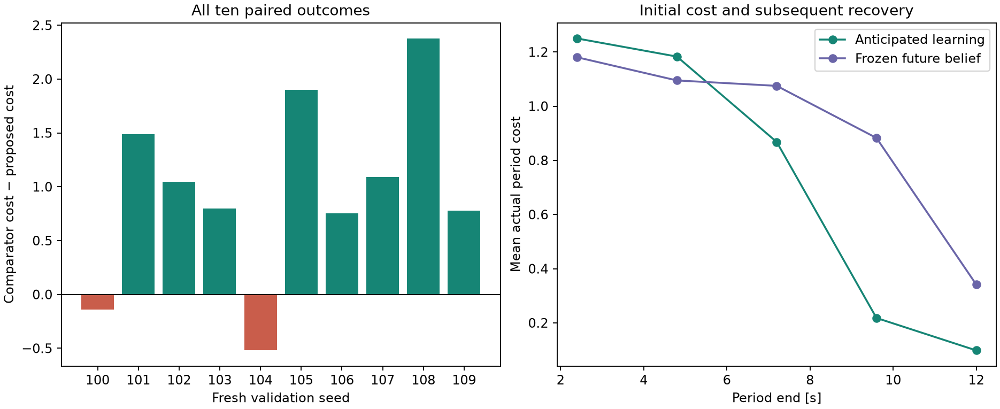

# Task-valued feedback recourse: first research iteration

This study follows the [research workflow](research_workflow.md). It preserves
the original 120-run implementation and evidence, and investigates an explicitly
revised policy class and continuation decision. It is a controlled mechanism
study of a localized disturbance with known spatial shape, not a broad spatial
wind benchmark. All numerical code was frozen at commit `cfa1820` before the ten
fresh validation seeds were evaluated.

## Changes and their rationale

MBD now optionally optimizes waypoint parameters of a state-feedback controller.
The actual spline RPCBF filters every input. The continuation router optionally
compares safety-filtered task costs under independent posterior-predictive fields,
instead of applying a fixed crosswind threshold. Both changes preserve causal
belief updates and a fixed physical wind field within each scenario. No reward
for information is added. The [method description](method.md) gives the equations.

The localized Gaussian plume makes measurements near the passage more informative
than measurements at the remote ROI. This creates a tractable opportunity to study
the value of approaching uncertain dynamics. Its rank-one spatial kernel per
wind component is a deliberate limitation; generalization must be evaluated.

## Frozen validation outcome

On fresh seeds 100–109, mean actual cost was **3.6169 proposed versus 4.5743
frozen-future-belief comparator: a 20.93% reduction**. Proposed won eight pairs
and lost two. The mean paired benefit was 0.9574 deficit-seconds, with a
descriptive paired percentile-bootstrap 95% interval [0.4434, 1.4560]. Ten seeds
are a small sample and this interval does not account for selecting the scenario
family during development. Both planners used identical settings and real updates.

Mean first-period cost increased by 0.0694; subsequent periods recovered 1.0268.
The proposed method reached ROI A in 10/10 missions, versus 9/10. This is a
repeatable example of useful anticipation of learning under the tested model;
it does not establish a universal advantage or superiority of diffusion itself.

There were no collisions or optimizer fallbacks in either validation arm.
Proposed had **one infeasible QP among 800 executed steps**; the comparator had
none. On seed 101 at 3.15 seconds, the relaxed filter applied approximately
`[-1.5998, 0.6409]`, with common slack 0.01018 and measured clearance 0.1608 m.
Thus the observed cost benefit is not accompanied by uniformly feasible safety
constraints. The open-loop task-router ablation also had one infeasible step,
at 5.7 seconds on seed 20, with slack 0.09991 and clearance 0.0230 m.
Both constraint sets were reconstructed from the saved observations and random
keys. An independent SciPy/HiGHS linear program confirmed their positive minimum
common slack to within 5e-5, so these events are genuine bounded-constraint
infeasibility rather than a false failure from the custom QP solver. See the
[replayed constraints and LP results](recourse_validation/failure_diagnostics.json).

The two validation losses are retained. On seed 100, proposed reached ROI A
earlier (6.45 versus 7.95 seconds) but had higher total monitoring cost (3.9147
versus 3.7738): access time alone does not measure persistent monitoring quality.
On seed 104, proposed reached it later (9.0 versus 6.45 seconds) and cost 4.2327
versus 3.7127. Neither loss involved infeasible QPs or collisions. A large positive
matched continuation diagnostic on seed 104 still failed to predict mission-level
superiority, demonstrating why that diagnostic cannot substitute for paired runs.

## Development and component separation

On development seeds 20–22, the revised proposed planner had mean actual integrated
deficit 4.4458, compared with 4.8158 for the same feedback/recourse planner that
freezes its future belief during prediction. This is a 7.68% mean reduction:
two wins and one loss. Both planners receive real online measurement updates.
The proposed method reached ROI A in all three missions; the comparator did so
in two. Neither had a collision, infeasible QP, or optimizer fallback.

Development-only ablations show that the new pieces are not independently
established improvements:

| Proposed-objective policy variant | Mean cost | ROI A access |
|---|---:|---:|
| Task router, feedback policy | 4.4458 | 3/3 |
| Threshold router, feedback policy | 4.1289 | 2/3 |
| Task router, open-loop acceleration | 4.3685 | 3/3 |
| Threshold router, open-loop acceleration | 5.0204 | 1/3 |

All ablation runs are retained. Nested task routing costs more than threshold
routing, so these rows do not establish equal-compute solver superiority. The
small predictive sample set and finite continuation library remain plausible
sources of poor routing decisions. The simple first-waypoint grid screen also
failed to show a compelling probing advantage; its full output is archived.

With measurements disabled, proposed and frozen-belief planners produce exactly
equal state, clarity, branch, control-correction and QP-feasibility arrays on
seed 20. This rules out an artificial learning advantage in that negative control.

## Reproduction and limits

The [complete study archive](recourse_validation/summary.md) includes all 37
missions: six development, twenty frozen validation, nine ablations, and two
no-measurement controls. It contains every paired outcome, actual period costs,
resolved configurations, raw-output hashes, source hashes, the pre-run protocol,
and the development screen. Full trajectories and offline replays remain in
`results/recourse_*`. The source-hash check prevents accidental attribution of
these results to changed numerical code.

All 23 CPU tests pass. The paired planners use the same six outer worlds, four
inner safety fields, two predictive recourse fields per branch, and 53 objective
evaluations per plan. These are small development budgets, not convergence-tested
settings. CPU timings include some concurrent host load. The existing Metal and
CUDA limitations remain unchanged. A zero-collision finite experiment does not
establish a safety guarantee.
The mean 4.4-second planning time exceeds the 2.4-second execution period; these
are offline simulated missions, not a real-time demonstration on the laptop.

The future continuation still freezes its posterior for the full 7.2-second
window, while actual execution updates every 2.4 seconds. The next useful change
is to test the accuracy of continuation decisions, then allow additional belief
update boundaries if their value survives a controlled policy-library check.
Check backup horizon, control discretization and inner-sample sensitivity around
the infeasible event before presenting safety-sensitive deployment claims.
After that, increase sampling budgets, sweep scenario parameters and compare
MBD/CEM/MPPI under both matched rollout work and wall time. Reserve new untouched
seeds for any variant selected using this study.
