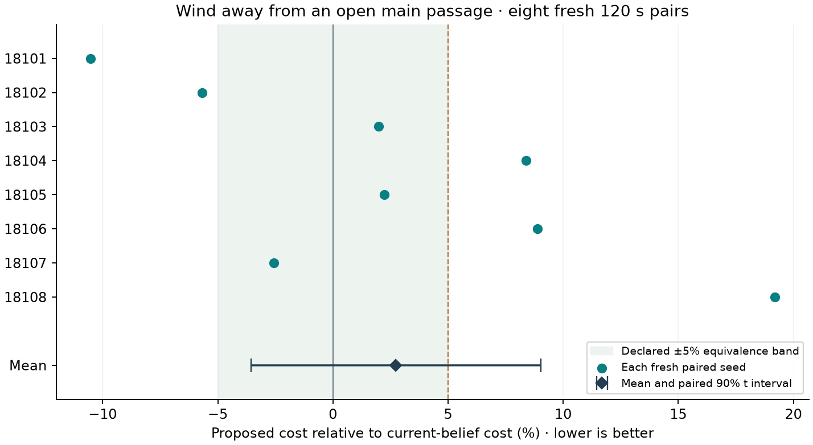

# Wind-route development study

The original two-region scenario and all earlier recordings are retained. This
study changes and verifies the **2D** demo only. Research automations remain paused.
All comparisons below use 120-second missions, 10-second forecasts, 2-second
planning intervals, full online POAM, actual MBD, and sampled spline RPCBF.
The playable development cases use seed 8101. A separate eight-fresh-seed
confirmation is reported below; its declared low-value criterion did not pass.

## Executed results

| Physical field / common initial information | Proposed cost | Current-belief cost | Proposed reduction | Physical contact |
|---|---:|---:|---:|---|
| Original passage wind; outer survey | 2.83933 | 2.95491 | 3.91% | Neither |
| Exact reversed wind; outer survey | 3.02046 | 3.05978 | 1.28% | Neither |
| Crosswind in passage; outer survey | 3.04879 | 2.85073 | −6.95% raw cost | Comparator at 75.90 s |
| Wind away from main route; outer survey | 2.64237 | 2.86059 | 7.63% | Neither |
| Same off-route wind; outer + main-route survey | 2.43553 | 2.67378 | 8.91% | Neither |

Cost is the integrated mean positive clarity deficit across all 1,353 cells.
The crosswind comparator penetrates an obstacle by 0.06261 m in the independent
32-substep audit. Its trajectory after contact is integrated without impact
response: the raw full-duration cost is **not** a successful mission outcome.
The demo discloses this and pauses at the first contact. It can be resumed to
inspect the retained diagnostic continuation. This comparator is wind aware;
it is not the separate ablation that removes wind from safety.

The wind-blind nominal planner plus wind-aware execution safety has reversed-field
cost 3.82642; proposed cost is 21.06% lower than that comparator. This contrast
combines wind-aware planning, nominal wind compensation and anticipation. The
wind-blind comparator uses wind only in its execution safety filter. It does not
establish the isolated value of anticipating learning.

In the original proposed run, one of sixteen transfers uses the middle, toward B.
Under reversed wind, one of sixteen uses the middle, toward A. The other fifteen
transfers remain bypasses. Thus the direction flips, but systematic exploitation
of the favorable passage is not established. The restricted, privileged
rest-to-rest route-family calculation also reverses its favored direction:
3.855 s through the favorable middle versus an 8.600 s bypass in the opposite
direction. These family timings are not globally optimal trajectories and are
not directly comparable to the robot's region-boundary-to-boundary transit times.

The anticipated low-value control did **not** establish near parity. The extra
21 noisy main-route survey observations reduce initial passage mean sigma from
0.489 to 0.183 m/s², but substantial uncertainty remains around the route. A calm
physical passage is not equivalent to a belief that the passage is known. Both
negative-control attempts and their outcomes remain available; no claim of
negligible learning value is made from these results.

Reversed proposed planning cycles: median 1.59 s, p95 1.67 s, no 2 s misses.
Crosswind p95 is 2.35 s and the unsurveyed off-route p95 is 2.83 s; the surveyed
case has median 1.47 s and p95 1.52 s. These measurements include prior real POAM
work, input preparation and the full selected-plan check. Startup is reported
separately in every audit. They were measured sequentially on the same M3 under
ongoing desktop use, not a controlled thermal benchmark; a universal two-second
deadline has not been demonstrated.

## Mechanism and failure diagnosis

`reversed_causal_01` and `offroute_causal_01` reconstruct exactly earned POAM
histories at 0, 30 and 60 s. Four independent banks of four worlds evaluate the
same 40 original candidates plus 14 geometry-only round-trip initializations.
First-stage states agree between the two objectives. Five of six states have
the same best averaged candidate with and without anticipated future learning.
The remaining state does not show a robust advantage on held-out banks: two
held-bank differences are zero, and two favor the frozen-objective choice.
One reversed-field held-bank comparison is infeasible and retained as such.
No added round-trip seed wins either averaged objective or the privileged oracle
at these states. These particular seeds are therefore **not promoted**.
The executed single-seed gains cannot yet be attributed to a robust route-choice
VoI mechanism rather than sampling and closed-loop optimizer effects.

The crosswind contact begins 1.9 seconds after the filter's last belief update.
The nearby grid estimate understates the downward acceleration. A same-state
74–80 s diagnostic in `observation_latency_02` reproduces the original trajectory
exactly. Providing earned 5 Hz observations between the existing 2 s full POAM
adaptation boundaries changes minimum clearance from −0.06261 to +0.04241 m,
with no contact in that local replay. Both nominal wind compensation and RPCBF
use the updated belief; only the archived nominal reference policies are held
fixed. This is not an isolated RPCBF effect or a replanned mission. Independent
physical reintegration error is below 6.1e-8. The initial unjitted-snapshot
reproduction failure and its driver remain in `observation_latency_01`; using the
original jitted snapshot path fixes it without changing the tolerance.

Separating fast posterior inference from slower hyperparameter adaptation is
consistent with POAM's incremental variational updates and variational-EM
organization. The paper also discusses delaying hyperparameter adaptation when
early data is not representative. Neither observation establishes safety or
validates a new controller here. See [POAM, Sections IV-C and IV-D](https://arxiv.org/html/2406.03669v1).

A remaining policy-representation concern is the compact future feedback: it
moves its position knots by at most 0.6 m on each coordinate. The normal-component
knot displacement is bounded by approximately 0.823 m in this geometry, while
the common bypass initializations use a 1.5 m offset. This is a bound on knot
motion, not on a spline's complete trajectory or the safety filter's deflection.
It motivates checking a policy with separately parameterized middle/bypass
continuations, selected only from earned posterior information, rather than
increasing an arbitrary information reward or adding more of the failed seeds.

## Further bounded tests

The optional `budgeted_policy: branches` representation optimizes two independent
future routes and a four-coefficient affine gate on the passage posterior's mean
and standard deviation. Its first-stage controls remain common across worlds;
only earned hypothetical observations can change the gate. A switch changes the
reference curve, never the physical state or clarity. Full POAM, actual MBD and
sampled spline RPCBF are retained. The original compact policy remains default.
Twenty-three component tests passed, including causal observation timing.

On the reversed 120 s development mission, this representation costs **3.08719
versus 2.89869**, or **6.50% regret** from anticipation, with no dense contacts.
It is not promoted. Its paired arms share initializations; comparison with the
older compact experiment additionally changes the parameter dimension and seed
representation, so it is not an isolated parameter-count comparison. The
independent four-bank check again finds the same best averaged candidate at all
three tested states. One held-bank selection at 30 s favors anticipation, while
the other eleven comparisons are equal. All numerical outputs are retained in
`branch_causal_01` and `branch_policy_results_01`.

An additional open-passage control keeps the large regions, rapid Q decay,
off-route wind and common noisy route survey, but changes the obstacle radius
to 0.25 m and normal offset to 0.95 m. The middle half-gap is 0.70 m; the
historical outer survey still has at least 0.298 m geometric clearance. The
development pair costs **2.04599 versus 1.99606**, or **2.50% regret**. Proposed
uses the middle on all 18 transfers; the comparator uses it on 18 of 19. Neither
contacts an obstacle. Proposed cycle median/p95 are 1.48/1.51 s, with no steady
2 s misses. This is a candidate low-value case, not a statistical conclusion.

The first open-passage audit retained the original fixed route thresholds; it
misclassified one middle crossing as "other" and used the original narrow
passage for local wind summaries. The audit now derives these thresholds from
the archived geometry. Its previous output and driver are preserved in
`open_passage_classification_correction`. Physical clearance, contacts, executed
trajectories and all-grid cost were unaffected. The 2D replay was refreshed.

`low_value_confirmation_protocol_01.json` declares eight fresh paired seeds
18101–18108, excluding the development seed, before execution. The primary
criterion is a one-sided 95% paired-t upper regret bound below 5%, with all pairs
complete and no dense contacts; secondary equivalence requires the 90% interval
within ±5%. This tests randomness in one fixed physical environment and prior.
It does not establish equivalence over arbitrary wind fields or environments.

The privileged fully informed reversed-wind planner costs **2.71153**, with no
contacts. It knows the complete wind for planning, compensation and safety, so
it is a finite-budget information reference, not a deployable method, optimal
cost bound, or demonstration of what POAM will learn.

The ten-second horizon is shorter than the approximately 12.45 s favorable-
crossing/opposing-bypass round trip in the restricted rest-to-rest family. A
prospective 10 versus 14 s sensitivity at earned states in `horizon_diagnosis_01`
finds a round-trip seed becomes best at 60 s with the longer forecast—but for
**both** anticipated and frozen-belief objectives. No robust isolated learning
advantage emerges. Actual MBD with 21 common initializations takes about 1.80 s
for 10 s lookahead and 2.54 s for 14 s at the tested warm state; startup is about
19 s. These are saved-state measurements, not mission latency guarantees. The
longer horizon and extra seeds remain diagnostic options, not promoted defaults.

## Fresh-seed confirmation and additional diagnoses

All eight prospectively declared low-value pairs completed: **16 × 120 seconds**,
with no contact in the independent dense audit. Mean paired relative regret is
**+2.736%**, with paired 90% t interval **[−3.549%, +9.022%]**. The same upper
endpoint is the one-sided 95% bound, exceeding the declared +5% margin. Thus
neither noninferiority nor equivalence was established. Individual paired regrets
range from −10.534% to +19.189%; reporting only the mean would hide instability.
In the worst-regret seed, proposed takes five bypasses in eighteen transfers,
versus one bypass in twenty for current belief. This is a post hoc description
of a retained failure, not a seed-selection rule for future testing.
Every outcome is in `low_value_confirmation_results_01.json`, with raw input
hashes, numerical clarity replay checks, route records and timing. The first
fresh seed is not substituted for the development demonstration.

Every proposed arm's steady cycle was below 2 seconds; medians range from 1.453
to 1.483 s, generating a 10 s forecast. The first two startup cycles are reported
separately. This is offline closed-loop simulation with measured computation,
not a controller that compensates for asynchronous computation delay in flight.

The predeclared early-decision check evaluates earned states at **2, 4, 6 and
8 seconds**, rather than just the earlier 0/30/60 s snapshots. The original
selected uncached objective and trajectory reproduce exactly at every state.
Reversed wind changes the averaged candidate at 2 s only; its held-bank benefit
is small and mixed. At 4/6/8 s the averaged selections agree. In contrast, the
**surveyed narrow passage with wind elsewhere** changes the averaged selection
at 2, 4 and 8 s. Of sixteen leave-one-bank-out checks across the four states,
nine favor the anticipation-selected policy and seven are equal; none favors
the frozen choice under the independently sampled anticipated objective.
This is a development causal signal, not independent experimental trials or
proof of lower realized cost: the shared candidate pool contains that mission's
MBD candidates and geometric alternatives, and scoring uses the fitted model.
This narrow gap can retain value of reducing wind uncertainty even when actual
wind on the main route is small. Consequently it is not a clean low-value control.
Numerical details are in `early_reversed_01` and `early_surveyed_offroute_01`.

Full-POAM adaptation sensitivity reconstructs the same earned observations with
baseline learning rate 0.001, slower 0.0001, and minibatch 128 instead of 32.
Slower adaptation improves next-batch RMSE slightly and widens uncertainty, but
worsens average next-batch marginal negative log likelihood in all three frozen
histories. In reversed wind the final passage's marginal 95% coverage rises
from 52.4% to 97.6%, while passage RMSE worsens from 0.152 to 0.218 m/s². Before
the crosswind contact, coverage rises from 41.0% to 75.2%, still inadequate.
A larger minibatch does not solve the issue. Grid coverage is spatially correlated
descriptive data, not a binomial confidence interval. No variant was promoted
by selecting the most favorable hidden-truth result. See `adaptation_diagnosis_01`.

A further approximation conditions once after the first 2 s and holds the
posterior fixed over the remaining exploitation stage. This is motivated by
finite dual/exploitation-stage planning, as in
[Arcari et al.](https://arxiv.org/abs/1911.03728); it does not reproduce that paper's
entire algorithm. Actual MBD with all 21 common initializations takes about
1.19–1.24 s for a 10 s forecast and 1.54–1.63 s for 14 s at one saved state.
Startup is about 18 s. Omitting later learning opportunities can overvalue early
learning; this approximation is not silently substituted into the method.
Both objectives still choose the same averaged candidate at all six examined
state/horizon combinations. See `dual_split_diagnosis_01`.

These tests leave a concrete limitation: the current two-second method shows
only a small isolated anticipation gain in reversed wind; fitting and calibrating
wind, Monte Carlo selection, and useful future policy choices still need joint
validation. The 21.06% reversed-field gain against the user-requested wind-blind
nominal planner remains a valid development contrast with a broader interpretation.

## Sampling stability

`sampling_protocol_01.json` declares a
saved-state test that actually runs both MBD objectives on the **same** earned
state, training draws, proposal noise and geometry starts. Four optimizer runs
at each of two states produce eight paired choices. Six pairs choose exactly
the same policy; the other two active choices have lower cost on twelve independent
IID evaluation banks under the anticipated objective. This reinforces the need
to distinguish weak differences in expected decisions from large path-dependent
variation in executed monitoring cost.

The same diagnostic compares ordinary IID outer fields with antithetic pairs
(ε, −ε), pairing hypothetical measurement noise similarly. Each outer world
retains its correct Gaussian marginal. Inner RPCBF samples remain independent
and exactly unchanged; actual observation noise is untouched. Antithetic pairing
is unbiased for each fixed candidate's expectation but does not generally
reduce nonlinear-integrand variance or remove optimizer-selection bias.
Here, mean fixed-candidate variance is 0.297 and 0.266 of IID at the two states;
median per-candidate ratios are 0.321 and 0.572. These summaries cover 11/15 and
13/15 candidates finite in all banks; all infeasible outputs remain in the NPZs.
Candidates share samples, so these ratios are descriptive, not independent trials.

`--outer-sampling antithetic` is an opt-in setting; IID remains the default.
Twenty-six component tests pass. `antithetic_protocol_01.json` prospectively
declares two 120-second development pairs with the original reversed passage and
the open off-route control, before their results are inspected. Do not pool this
new exploratory setting with the completed fresh-seed confirmation.

## Antithetic mission outcomes and numerical verification

Both new 120 s pairs are complete and published separately in 2D:

| Development case | Proposed | Current belief | Proposed relative cost | Dense contacts |
|---|---:|---:|---:|---|
| Reversed wind, antithetic outer samples | 3.05430 | 3.03479 | +0.643% | Neither |
| Open passage, off-route wind, antithetic outer samples | 1.95237 | 2.03353 | −3.991% | Neither |

Against its original IID run, proposed costs 1.12% more in reversed wind and
4.58% less in the open passage. These are two development examples, not a
confirmation that variance reduction improves closed-loop performance. Both
proposed runs remain below 2 seconds after startup; median/p95 are 1.488/1.552 s
and 1.465/1.498 s. Full clarity, matching-input and dense collision audits are
in `antithetic_results_01.json`. IID remains the default.

The reversed proposed run uses its backup once: at 16 s the cached selected
forecast is finite, but the uncached forecast predicts a −0.000717 m minimum
clearance in a sampled world. The checker rejects it; actual execution remains
clear of obstacles. This is **forecast contact**, not physical contact in the
mission. `cache_rejection_01` reproduces the same observation history, objective
and selected full trajectory. The 129-wide cache predicts +0.02912 m clearance;
257 and 513-wide caches give +0.00143 and +0.00038 m, still missing the sign.
The largest warm cache build alone takes 2.46 s. Simply enlarging the cache is
therefore not a justified budget-compatible fix, and removing the uncached check
would conceal a real numerical limitation. No clearance tolerance was relaxed.

`rejection_alternatives_01` checks the next three distinct, finite MBD proposals
in cached-cost order at this one failed state. All three pass continuous
verification. The first has +0.03969 m forecast clearance and cost 0.28021; its
warm verification takes 0.292 s. Adding this to the originally recorded cycle
gives **1.837 s**. This is a sum of saved-state measurements, not a new controller
latency benchmark. A sensible next bounded refinement is to verify one alternate
MBD proposal before backing up. It has not been enabled or tested in a replanned
mission, and no original output was replaced.

## Reproduction and interactive records

The first screen is declared in `protocol_01.json`; subsequent historical-survey
and causal checks have separate protocols. `results_01.json` contains dense
collision/clarity audits and data hashes. `overview_01.png` displays the paths
and cost curves, with post-contact cost dashed. `route_physics_01.json` retains
all restricted-family calculations and the temporal-resolution refinement.

The 2D homepage now has separate buttons for every completed wind case, physical
wind or POAM-estimate arrows, direction-specific route counts, genuine paired
MBD denoising, whole-field clarity and the original scenario. All new replay
means and standard deviations are checked against their original POAM snapshots.
The raw numeric archives remain under `results/budgeted_missions/`; published
replays remain under `results/demo/live/`. No 3D files were modified.

Direct 2D links: [original](http://127.0.0.1:8765/?run=budgeted_persistent_two_region_2s_01_proposed_8101&baseline=wind_blind_planner),
[reversed](http://127.0.0.1:8765/?run=budgeted_reversed_wind_01_proposed_8101&baseline=current_belief),
[open passage](http://127.0.0.1:8765/?run=budgeted_open_passage_wind_01_proposed_8101&baseline=current_belief).
The homepage also exposes the separate experimental sampling settings and every
fresh-seed outcome. Core tests: 26 passed; 2D playback/model tests: 11 passed.
