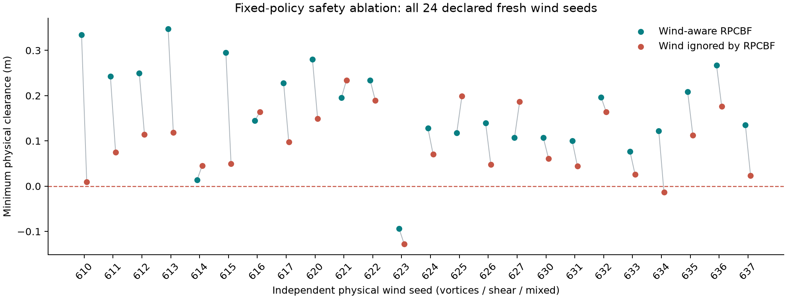

# Wind in the safety filter: completed fixed-policy study

The declared 24 fresh physical wind seeds produced **one collision with
wind-aware RPCBF and two with wind ignored by RPCBF**. There is only one
discordant pair; the two-sided exact paired test is p = 1.0. This study does
**not** establish a collision-rate advantage. It does supply an independently
sampled example where ignoring wind causes contact, and exposes a failure of
the approximate, soft-constrained wind-aware filter.

| Case | Wind-aware minimum clearance | Wind-ignored minimum clearance | Interpretation |
| --- | ---: | ---: | --- |
| Mixed, fresh seed 634 | +0.121764 m | −0.013547 m | Only the filter that ignores wind collides |
| Shear, fresh seed 623 | −0.093677 m | −0.127964 m | Both filters collide; retain and investigate |
| Mixed, original seed 302 | +0.163541 m | −0.002356 m | Exploratory positive control, excluded from fresh-seed inference |



Both arms use the same fixed waypoint schedule from an earlier MBD recording.
They execute under the same independent physical field and observation-noise
sequence, and each assimilates observations from its own trajectory using full
POAM. Nominal waypoint feedback retains POAM wind compensation in both arms.
Only the genuine spline RPCBF calculation differs: the ablated filter uses zero
wind mean and zero sampled wind coefficients. Its spline construction, design
policy, autodifferentiation, bounded soft QP and physical simulator remain intact.
There is **no replanning** in this isolation study, so its result is not an
independent comparison of MBD planning methods.

The three original-seed wind-aware controls reproduced the source recording's
states, clarity and task cost within 2e−4. Physical collision checks independently
integrate each held control with 32 RK4 substeps; their endpoints agree with the
simulation to less than 1e−4. Negative clearance, rather than QP slack, defines
contact. First-contact times in the recordings identify the end of the first
control interval containing contact, with 0.15 s resolution. Trajectories after
contact are diagnostic continuation without collision-response physics. These
checks support the recorded geometric contacts; they are not safety guarantees.

The local demo's **Wind in the safety filter** panel contains all 27 paired
replays, including all fresh seeds and the three excluded original controls.
It plays both trajectories, stops at first contact, and shows the full clearance
histories. The aggregate result is displayed above the selector, including the
absence of a statistically established collision-rate advantage.

Reproduce with the UV environment:

```sh
JAX_PLATFORMS=cpu uv run --no-sync python scripts/run_safety_suite.py
MPLCONFIGDIR=.mplconfig uv run --no-sync python scripts/report_wind_safety.py
```

The frozen protocol includes source and original-policy hashes. `summary.json`
contains every result; `raw_manifest.json` hashes the raw files under
`results/wind_safety/`. Byte-identical replays are preserved under
`demo/data/safety_*.json`. The two safety-isolation tests passed, and publication
recomputed executed clarity cost, checked belief-update counts and validated all
27 records. Investigation of seed 623 and a subsequent fully replanned safety
ablation remain necessary before making broader claims.

Initial failure diagnosis for shear623: contact occurs in the first 3.6-second
period, before either arm's first real POAM update. Wind-aware controls saturate
at ±1.6 at 0.75–1.20 s, and the sampled QP needs slack as high as 0.594 before
contact. This is not a plotting artifact or the result of a late posterior
update. The physical field has grid maxima of about 1.75 and 1.54 per component;
the configured prior standard deviation is 0.55. Larger inner-sample/backup
horizon sensitivity checks and a viability assessment are needed to separate
limited sampling, controller authority and the relaxed barrier. The data do not
justify attributing the failure to any one of those causes yet.
