## {.cover data-section="Introduction"}

Disturbance-aware informative planning

Predicting executed monitoring performance with optimistic planning and real online learning

<strong>Kaleb Ben Naveed</strong> Department of Robotics · University of Michigan Model-based diffusion with a learned disturbance model

::: {.notes}
Current implementation review, 21 October 2026. This deck separates the generic method from numerical choices and code. The current score is favorable-tail monitoring plus a mean soft-constraint penalty. Actual observations update the disturbance belief; predicted beliefs remain fixed. The final archive contains the earlier anticipated-learning method and historical results.
:::

## An informative plan can lose its value in execution {data-section="1 · Introduction"}

The central issue is that a nominally informative trajectory may not deliver its predicted monitoring performance when executed under uncertain disturbances.

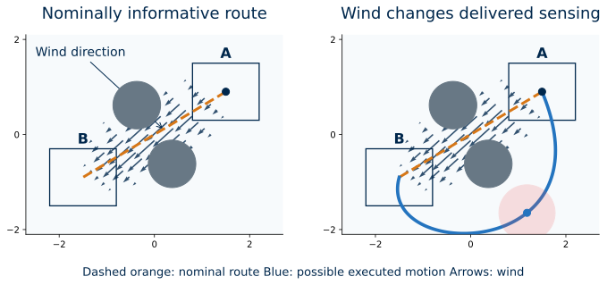

<b>1. Wind-aware planning</b> Predict how wind and controller intervention change motion, arrival time and sensing.

<b>2. Optimistic planning with online learning</b> Try favorable plausible alternatives and learn from actual execution.

::: {.notes}
The paths are conceptual illustrations on the recorded A/B geometry, not measured comparisons or a new experiment. Wind arrows use the archived physical field for explanation. The planner only has its estimated wind belief. The first question is whether the robot can deliver the sensing predicted by a nominal route. The second is whether optimism encourages useful early experience that improves later monitoring. This is a hypothesis for the revised method. Uncertainty reduction is not the task objective.
:::

## Robot state, control and spatial disturbance {data-section="1 · Introduction"}

::: {.columns}
::: {.column width="52%"}
**Generic nominal robot model**

$$\dot x=f(x,u)$$

**Execution under spatial wind**

$$\dot x=f_d(x,u,\bar d(r)),\qquad r=\Psi(x)$$

The planner must predict motion under the unknown disturbance.

:::
::: {.column width="48%"}
| Symbol | Meaning |
|---|---|
| $x\in\mathcal X\subset\mathbb R^n$ | Robot state |
| $u\in\mathcal U\subset\mathbb R^m$ | Admissible control input |
| $r\in\mathcal P$ | Robot position in the coverage space |
| $\Psi$ | Map from state to position |
| $f$ | Nominal dynamics |
| $f_d$ | Dynamics including the disturbance |
| $\bar d(r)$ | Fixed, unknown physical wind field |
:::
:::

Paper notation: Eq. (4) writes the disturbance-dependent dynamics as $f(x,u,\bar d(r))$; here the subscript distinguishes it from the nominal model.

::: {.notes}
This slide uses f for the nominal model and f_d for the wind-augmented version, with f_d(x,u,0)=f(x,u) by definition of the nominal model. The supplied manuscript uses f for the three-argument model. No particular drag law or vehicle class is assumed here. A particular vehicle model is not needed to state the method; simulation choices are collected in the appendix.
:::

## Presentation structure {data-section="1 · Introduction"}

<b>1</b><strong>Introduction</strong> Why nominal informativeness can differ from delivered monitoring.

<b>2</b><strong>Preliminaries</strong> Clarity, POAM, robust policy values and model-based diffusion.

<b>3</b><strong>Problem formulation</strong> Disturbance-aware monitoring and optimistic performance preference.

<b>4</b><strong>Method</strong> Algorithm first, then execution prediction, scoring, sampling, and real learning.

<b>5</b><strong>MBD comparison</strong> The target, importance correction and retained reverse update.

<b>6</b><strong>Implementation and compute time</strong> Exact settings, measured costs, expensive components, and source files.

## Preliminaries {.section-break data-section="2 · Preliminaries"}

2

Models and numerical tools used by the planner.

Clarity → POAM → robust policy values → model-based diffusion

## Clarity measures how well a cell is known {data-section="2 · Preliminaries"}

::: {.columns}
::: {.column width="48%"}
Divide the coverage space into $N_p$ cells.

For cell $j$, estimate a time-varying quantity $m_j$ with normalized variance $P_j$.

$$q_j=\frac{1}{1+P_j},\qquad 0<q_j\leq1$$

- $q_j\approx1$: the quantity is well known.
- $q_j\approx0$: large estimation uncertainty.
- $\bar q_j$: the desired clarity for that cell.
:::
::: {.column width="52%"}
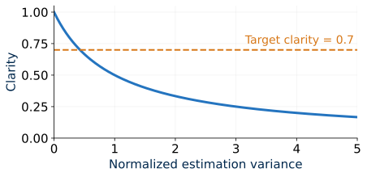

Clarity concerns the monitored quantity. Wind uncertainty is a separate belief.

:::
:::

Supplied paper: Appendix I, Gaussian clarity. The simulations use scalar independent cell estimates.

::: {.notes}
For a Gaussian scalar estimate, the paper's entropy-derived clarity reduces to 1/(1+P). For a multivariate Gaussian the paper uses the determinant of covariance. We only need the scalar cell case in this presentation. P is normalized before forming the dimensionless clarity. The simulation target is 0.7 in the monitored A/B cells and zero elsewhere. The robot monitors environmental quantities while separately estimating wind.
:::

## Monitoring quality evolves along the executed path {data-section="2 · Preliminaries"}

$$\dot q_j=\frac{C_j(x)^2}{R}(1-q_j)^2-Q_jq_j^2$$

<b>Sensing improves clarity:</b> $C_j(x)$ is the measurement quality at robot state $x$; $R>0$ is measurement-noise intensity.

<b>Change degrades clarity:</b> $Q_j\geq0$ is the process-noise intensity of the monitored quantity in cell $j$.

$$q_d(q)=\frac{1}{N_p}\sum_{j=1}^{N_p}[\bar q_j-q_j]_+,
\qquad J=\int_0^Tq_d(q(\tau))\,d\tau$$

$[a]_+=\max(0,a)$; $q_d$ is mean shortfall below target clarity.

$\tau\in[0,T]$ is elapsed prediction time; $T>0$ is the planning horizon. Lower $J$ means better monitoring.

Wind changes the executed state $x$, which changes sensing $C_j(x)$ and the task cost $J$.

::: {.notes}
These are Eqs. (2) and (3) of the supplied paper and the finite-horizon cumulative cost. q is the vector of all cell clarities; N_p is the number of cells. The footprint C_j is Gaussian in the planar implementation. The reported results average positive deficits over all 1353 cells, including zero-target cells, and use the trapezoidal time integral. No information-gain reward or controller-correction penalty is inserted into this objective.
:::

## Represent the wind that the robot currently knows {.notation-slide data-section="2 · Preliminaries"}

At physical time $t$, the robot has noisy observations of the unknown physical wind field $\bar d$:

$$y_m^d=\bar d(r_m)+\varepsilon_m^d,\qquad
\varepsilon_m^d\sim\mathcal N(0,R_d).$$

$m$: observation index; $r_m$: its position. $y_m^d$: observed wind vector. $\varepsilon_m^d$: zero-mean measurement noise.

$\mathcal N(\mu,\Sigma)$: Gaussian distribution with mean $\mu$ and covariance $\Sigma$. $R_d$: measurement-noise covariance.

The **wind belief** $\mathcal B_t^d$ summarizes what those observations imply:

$$\mathcal B_t^d=\{\mu_d(\cdot,t),\Sigma_d(\cdot,\cdot,t)\}.$$

$\mu_d(r,t)$: predicted wind mean at position $r$. $\Sigma_d(r,r',t)$: covariance between wind at $r$ and $r'$.

$r'$: a second position; $\cdot$: a position argument. The label $d$ denotes wind; it is not a power. Covariance expresses remaining uncertainty.

POAM — Probabilistic Online Attentive Mapping — updates this spatial belief as observations arrive.

Chen, Liu and Khardon, POAM, RSS 2024. The next slides explain one scalar wind component; vector components are modeled separately here.

## POAM uses spatial correlation to connect observations {.notation-slide data-section="2 · Preliminaries"}

For one scalar wind component, use a **Gaussian process (GP)**: any finite collection of wind values has a joint Gaussian distribution.

$$d(r)\sim\mathcal{GP}\!\left(0,k_\vartheta(r,r')\right).$$

$d(r)$: uncertain wind component at $r$. $0$: prior mean, before observations. $k_\vartheta(r,r')$: prior covariance between positions.

$\vartheta$: kernel parameters. The kernel controls how an observation at one position influences predictions elsewhere.

The **attentive kernel** combines spatial correlation lengths:

$$k_\vartheta(r,r')=\sigma_f^2\,[\bar w(r)^{\mathsf T}\bar w(r')]
\sum_{b=1}^{B}\bar w_b(r)\bar w_b(r')\,
\exp\!\left(-\frac{\|r-r'\|_2^2}{2\ell_b^2}\right).$$

$B$: number of kernel components; $b$: component index. $\ell_b>0$: correlation length of component $b$. $\sigma_f^2$: prior variance scale.

$\bar w_b(r)$: normalized component weight at $r$. $\mathsf T$: transpose; $\|\cdot\|_2$: Euclidean norm. Larger $\ell_b$ links more distant positions.

Chen, Liu and Khardon, POAM, Sec. III-B. The following slide defines the location-dependent weights.

## What the attentive weights mean {.notation-slide data-section="2 · Preliminaries"}

At each position, a neural network produces a nonnegative vector $w_\vartheta(r)\in\mathbb R^B$. Normalize it to obtain

$$\bar w(r)=\frac{w_\vartheta(r)}{\|w_\vartheta(r)\|_2},\qquad
\bar w_b(r)=\text{component }b\text{ of }\bar w(r).$$

<b>Which length scales apply here?</b> Large $\bar w_b(r)$ gives component $b$ more influence at position $r$.

<b>How similar are the two regions?</b> $\bar w(r)^{\mathsf T}\bar w(r')$ reduces correlation when their weight vectors differ.

**Example with two components:** one long correlation length describes smooth wind; a shorter one describes more rapid spatial variation. The weights can favor different components in different regions.

These are kernel weights over spatial length scales. Later, MBD uses different weights over sampled decisions.

$\mathbb R^B$: vectors with $B$ real entries. $\vartheta$ includes the network and kernel parameters. The numerical visual uses specified illustrative weights.

## POAM predicts wind through a sparse Gaussian posterior {.notation-slide data-section="2 · Preliminaries"}

Choose $M$ representative **inducing positions** $Z=(z_1,\ldots,z_M)$. They are model locations, not additional observations. Collect their wind values in $d_Z=[d(z_1),\ldots,d(z_M)]^{\mathsf T}$.

$$d_Z\sim\mathcal N(m_Z,S_Z),\qquad K_{ZZ}=k_\vartheta(Z,Z),\qquad
\beta(r)=K_{ZZ}^{-1}k_\vartheta(Z,r).$$

$m_Z$: mean vector of the $M$ inducing values. $S_Z$: their $M\times M$ posterior covariance. $K_{ZZ}$: prior covariance matrix at $Z$.

$k_\vartheta(Z,r)$: vector of covariances from $Z$ to $r$. $\beta(r)$: interpolation-coefficient vector. $K_{ZZ}^{-1}$: matrix inverse (computed by a solve).

$$\mu_d(r)=\beta(r)^{\mathsf T}m_Z$$
$$\Sigma_d(r,r')=\underbrace{k_\vartheta(r,r')-\beta(r)^{\mathsf T}K_{ZZ}\beta(r')}_{\text{conditional residual}}+\beta(r)^{\mathsf T}S_Z\beta(r').$$

The residual retains uncertainty that the finite inducing values cannot represent. Local wind standard deviation is $\sigma_d(r)=\sqrt{\Sigma_d(r,r)}$.

POAM, Eq. (4). Time $t$ is suppressed on these slides: every posterior is the current one.

## How a new observation changes the POAM posterior {.notation-slide data-section="2 · Preliminaries"}

At $r_m$, observe $y_m^d$. For this scalar component, the measurement-noise variance is $\sigma_n^2>0$ (the scalar counterpart of $R_d$). Hold the kernel and inducing positions fixed.

$$\beta_m=\beta(r_m),\qquad
g_m=\frac{S_Z\beta_m}{\sigma_n^2+\beta_m^{\mathsf T}S_Z\beta_m}.$$

$\beta_m$: interpolation coefficients at the observation. $g_m$: gain vector, determining how much each inducing mean responds.

$y_m^d-\beta_m^{\mathsf T}m_Z$: <b>innovation</b>, the measured wind minus its predicted mean. Superscript $+$ means after this observation.

$$m_Z^+=m_Z+g_m\big(y_m^d-\beta_m^{\mathsf T}m_Z\big),\qquad
S_Z^+=S_Z-g_m\beta_m^{\mathsf T}S_Z.$$

<b>Mean</b> A nonzero innovation changes the wind estimate. A zero innovation leaves it unchanged.

<b>Covariance</b> Uncertainty decreases in correlated inducing values. Recompute $\mu_d$ and $\Sigma_d$ from $m_Z^+,S_Z^+$.

Fixed-representation sparse variational Gaussian update; POAM Eqs. (7)–(8), (19)–(21). Full online POAM can also refit its kernel and relocate inducing positions.

::: {.notes}
This is the fixed-representation Gaussian-likelihood variational update, not exact conditioning of the entire predictive GP. The conditional residual remains in prediction and is not inserted into this variational gain denominator. With independent identically noisy wind components, R_d = sigma_n^2 I, where I is the identity. Kernel refitting and inducing relocation are separate changes of representation; pointwise variance monotonicity is only asserted with that representation fixed.
:::

## Watch POAM learn a spatial wind model {.walk-slide #poam-visual data-section="2 · Preliminaries"}

<svg class="walk-stage" viewBox="0 0 880 430" role="img" aria-label="poam visual walkthrough"></svg><ol class="walk-algorithm"><li class="walk-step">1<b>Start from a spatial prior</b></li><li class="walk-step">2<b>Receive one wind observation</b></li><li class="walk-step">3<b>Update the sparse posterior</b></li><li class="walk-step">4<b>Predict at an unobserved position</b></li><li class="walk-step">5<b>Assimilate a second observation</b></li><li class="walk-step">6<b>Assimilate a third observation</b></li></ol>

<button type="button" data-action="reset">Restart</button><button type="button" data-action="prev">Previous</button><button type="button" data-action="play" aria-pressed="false">Play</button><button type="button" data-action="next">Next step</button>
<input type="range" min="0" max="5" value="0" step="1" aria-label="Walkthrough step"/><output aria-live="polite"></output>

$\mathcal B_n^d$: belief after $n$ observations; $\sigma_d(r)$: wind standard deviation. The numerical example fixes the kernel and inducing positions; wind uses normalized units.

::: {.notes}
This is a computed sparse variational Gaussian update using the equations immediately preceding it. The 13 inducing positions cover [0,10]. The attentive kernel combines length scales 2.4 and 0.8 with specified, normalized logistic weights; the weights are illustrative, not learned from a real dataset. Observation noise standard deviation is 0.1. Three observed values are assimilated sequentially. Blue bands show pointwise mean plus/minus two predictive standard deviations. Purple circles are observations; diamonds denote inducing positions, which are not additional observations. The final state retains the conditional residual. With this fixed representation, covariance decreases with each observation; adaptive POAM can also move inducing positions or refit its kernel, so the pointwise monotonicity illustrated here is not a general claim for every online adaptation. All numerical arrays are saved in assets/poam_teaching_data.json. Starts paused; controls work independently of slide navigation.
:::

## Why position alone is not enough {data-section="2 · Preliminaries"}

**To predict a future constraint violation, we must specify both the dynamics and the future control inputs.**

Consider a robot moving toward a wall. Let $p$ be its position, with the wall at $p=0$.

$$h(x)=p,\qquad h(x)\leq0\ \text{is the permitted side.}$$

Two robots at $p=-1$ have the same $h$, but a faster robot needs more distance to stop.

<b>A geometric constraint</b> $h(x)$ tests the current state.

<b>A policy value</b> Tests the largest future value of $h$ when a specified control law is followed.

That specified control law is the <b>design policy</b>, denoted $\pi_D$. It makes the future-motion test well defined.

Policy-value construction: Knoedler et al., <i>Safety on the Fly</i>, Sec. III-A.

## Example: evaluate the policy “brake until stopped” {data-section="2 · Preliminaries"}

**Illustrative model:** $x=(p,v)$, $\dot p=v$, $\dot v=u$, initially $v\geq0$.
Use $u=-a_b$ until $v=0$, then $u=0$, where $a_b>0$ is braking acceleration.

$$V(x)=\max_{\tau\geq0}p(\tau)=p+\frac{v^2}{2a_b}$$

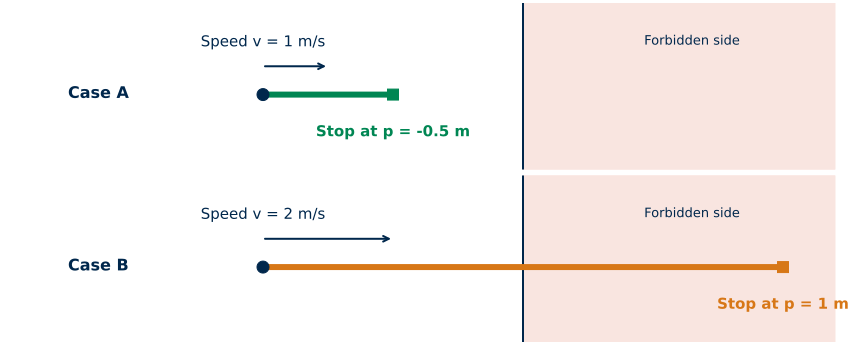

<b>Case A:</b> $p=-1$, $v=1$, $a_b=1$. $V=-0.5$: braking stops before the wall.

<b>Case B:</b> $p=-1$, $v=2$, $a_b=1$. $V=1$: the braking trajectory crosses the wall.

The value depends on the chosen policy. Wind, actuator limits or a different braking law change this prediction.

::: {.notes}
Units are metres, seconds and metres per second squared. This is an analytic teaching example, not the planar simulation model and not a claim about all possible control policies. The maximum includes the stopping state and remains there afterward. A positive value means this specific design-policy trajectory violates h<=0; it does not prove that every possible policy fails.
:::

## From the example to a robust policy value {data-section="2 · Preliminaries"}

Let $\phi_D(\tau;x,d)$ be the state reached from $x$ after time $\tau$ when following $\pi_D$ under disturbance signal $d$.

$$V_a(x)=\sup_{d\in\mathscr D}\;\sup_{\tau\geq0}
 h_a\!\left(\phi_D(\tau;x,d)\right)$$

$h_a$: constraint function for constraint $a$; violation means $h_a>0$. $\mathscr D$: disturbance signals considered in the source formulation.

<b>Inner supremum:</b> largest constraint value over time. <b>Outer supremum:</b> largest such value over disturbances.

<b>$V_a(x)\leq0$</b> All trajectories included in this test satisfy constraint $a$.

<b>$V_a(x)>0$</b> At least one trajectory in the test violates the constraint under this policy.

RPCBF = robust policy control barrier function. Knoedler et al., Eqs. (6), (10). Their numerical construction uses a finite horizon, sampled disturbances and spline maxima; guarantees require additional conditions.

## A policy value can guide the applied input {data-section="2 · Preliminaries"}

The task policy requests $u_{\mathrm{nom}}$. The execution controller chooses the input $u$ closest to it while meeting a value-rate condition:

$$\min_{u\in\mathcal U}\ \frac12\|u-u_{\mathrm{nom}}\|^2
\quad\text{subject to}\quad
\nabla V_a(x)^{\mathsf T}f_d(x,u,d)+\kappa V_a(x)\leq0.$$

The condition is imposed for every constraint $a$ and every disturbance $d$ included in the controller's test.

$\mathcal U$: actuator input set. $\nabla V_a$: sensitivity of the value to state. $\kappa>0$: controller value-rate coefficient.

If $u_{\mathrm{nom}}$ satisfies the conditions, it is applied unchanged. Otherwise, the controller selects a different input.

This changes motion and sensing. Our planner predicts that controller response when evaluating monitoring performance.

RPCBF motivates the policy-value construction. The common-input inequalities shown here specify our sampled adaptation; the original paper states a separate robust condition.

## MBD example: optimize one path-height parameter {data-section="2 · Preliminaries"}

::: {.columns}
::: {.column width="48%"}
**Model-based diffusion (MBD)** uses model-evaluated costs to refine decision vectors. First consider a scalar decision $a$: the height of a path between a fixed start and goal.

$$r(s;a)=\begin{bmatrix}-2+4s\\4a\,s(1-s)\end{bmatrix},\qquad s\in[0,1]$$

Here $s$ indexes progress along the path; it is not physical time. The midpoint has height $a$.

:::
::: {.column width="52%"}
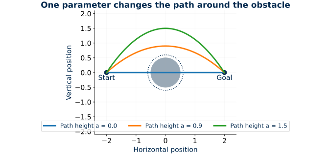
:::
:::

Minimize path length, subject to clearance from the obstacle. Each sampled value of $a$ produces one path to evaluate.

Teaching example only. The monitoring method will instead optimize a nominal policy parameter vector.

## MBD: prefer lower-cost decisions, then smooth the density {.notation-slide data-section="2 · Preliminaries"}

Let $y$ denote a decision vector. In the path example, $y=a$ is a scalar path height. The model evaluates its cost $J(y)$.

$$p_0(y)\propto\mathbf1_{\mathcal Y}(y)\exp\!\left(-\frac{J(y)}{\lambda}\right).$$

$p_0$: target probability density over decisions. $\mathcal Y$: feasible decision domain. $\mathbf1_{\mathcal Y}(y)$: 1 if $y\in\mathcal Y$; 0 otherwise.

$\lambda>0$: temperature, in cost units. Smaller $\lambda$ favors lower costs more strongly. $\propto$: proportional; density is normalized to integrate to 1.

<b>Example</b> $J(a)$ is path length. $\mathcal Y$ contains heights in $[-2,2]$ whose paths satisfy the clearance requirement.

<b>Why introduce noise?</b> The target can have separated high-density regions. Gaussian smoothing produces a sequence of less concentrated densities.

MBD estimates the direction toward higher density using model evaluations, without training a score network.

Pan et al., MBD, Eq. (2). A valid target requires a finite, positive normalizing integral.

## MBD noise schedule: what alpha controls {.notation-slide data-section="2 · Preliminaries"}

Forward noise defines the densities that MBD will traverse in reverse:

$$y_i=\sqrt{\bar\alpha_i}\,y+\sqrt{1-\bar\alpha_i}\,\epsilon,
\qquad \epsilon\sim\mathcal N(0,I),\qquad
\bar\alpha_i=\prod_{j=1}^{i}\alpha_j.$$

$y$: clean decision; $y_i$: noisy decision at level $i$. $i=1,\ldots,N$: diffusion level; $N$: total levels. $p_i$: probability density of $y_i$.

$0<\alpha_i<1$: signal-variance retention per forward step. $\bar\alpha_i$: cumulative signal-variance retention. $\bar\alpha_0=1$: the clean, zero-noise endpoint.

$\epsilon$: standard Gaussian noise vector. $I$: identity matrix of the decision dimension. $j$: index in the product defining $\bar\alpha_i$.

$\sqrt{\bar\alpha_i}$ scales the clean decision. $\sqrt{1-\bar\alpha_i}$ scales the added noise. Example: $\bar\alpha_i=0.25$ gives scales $0.5$ and $\sqrt{0.75}$.

Forward: $0\rightarrow N$, more noise. MBD optimization: $N\rightarrow0$, less noise. Diffusion level is not physical time.

Pan et al., Eqs. (3)–(4). The controller coefficient is denoted $\kappa$ here, separately from diffusion $\alpha_i$.

## One MBD iteration: sample, evaluate and weight {.notation-slide data-section="2 · Preliminaries"}

At level $i$, draw $K$ decision vectors around the current noisy vector $y_i$:

$$y^{[k]}\sim\mathcal N\!\left(\frac{y_i}{\sqrt{\bar\alpha_i}},\frac{1-\bar\alpha_i}{\bar\alpha_i}I\right),
\qquad k=1,\ldots,K.$$

$K$: number of sampled decisions per level. $[k]$: sample index; $y^{[k]}$: one sampled decision. These samples are in clean decision coordinates.

Proposal mean: $y_i/\sqrt{\bar\alpha_i}$. Proposal covariance: $[(1-\bar\alpha_i)/\bar\alpha_i]I$. In the scalar example, $y^{[k]}=a^{[k]}$.

Evaluate each sampled decision with the model. Then normalize its target-density weight:

$$w_k=\frac{p_0(y^{[k]})}{\sum_{j=1}^{K}p_0(y^{[j]})},
\qquad \bar y=\sum_{k=1}^{K}w_k y^{[k]}.$$

$w_k$: nonnegative cost weight, with $\sum_k w_k=1$. $j$: summation index over the same $K$ samples.

$\bar y$: cost-weighted decision mean. Infeasible decisions have zero weight. The mean itself need not be feasible.

Pan et al., Eqs. (8)–(9). $K$ counts decisions; POAM's covariance matrix is $K_{ZZ}$. If all weights vanish, recovery is required before normalization.

## Use the weighted mean to refine the noisy vector {.notation-slide data-section="2 · Preliminaries"}

The **score** $s_i(y_i)=\nabla_{y_i}\log p_i(y_i)$ points toward increasing log density. Here $\nabla_{y_i}$ means a gradient with respect to the noisy decision vector.

$$\widehat s_i=\frac{-y_i+\sqrt{\bar\alpha_i}\,\bar y}{1-\bar\alpha_i},\qquad
y_{i-1}=\frac{y_i+(1-\bar\alpha_i)\widehat s_i}{\sqrt{\alpha_i}}.$$

$\widehat s_i$: score estimate from the $K$ model evaluations. The hat denotes an estimate, not the exact score. $y_{i-1}$: updated noisy decision at the next level.

First add the score correction to $y_i$. Then divide by $\sqrt{\alpha_i}$ to change levels. No derivative of the rollout cost is required.

**Substituting the score reveals exactly what this update does:**

$$y_i+(1-\bar\alpha_i)\widehat s_i=\sqrt{\bar\alpha_i}\,\bar y
\quad\Longrightarrow\quad
\boxed{y_{i-1}=\sqrt{\bar\alpha_{i-1}}\,\bar y}.$$

The next sampling mean is $y_{i-1}/\sqrt{\bar\alpha_{i-1}}=\bar y$. Its covariance decreases to $[(1-\bar\alpha_{i-1})/\bar\alpha_{i-1}]I$.

Pan et al., MCSA Eq. (6) and score Eq. (9). At $i=1$, $y_0=\bar y$ and reverse iterations end. This deterministic update does not guarantee a feasible mean.

::: {.notes}
The equivalence follows by direct substitution and alpha_bar_i = alpha_i alpha_bar_(i-1). It applies to this MCSA update and its displayed score, not to every diffusion sampler. The paper's printed Algorithm 2 has an alpha-bar index discrepancy in line 3; the Gaussian proposal here consistently uses Eq. (8). The model-free forward-noise equation describes a density construction, not physical robot motion.
:::

## Watch MBD refine paths in a simple environment {.replay #watch-mbd-refine-paths-in-a-simple-environment data-section="2 · Preliminaries"}

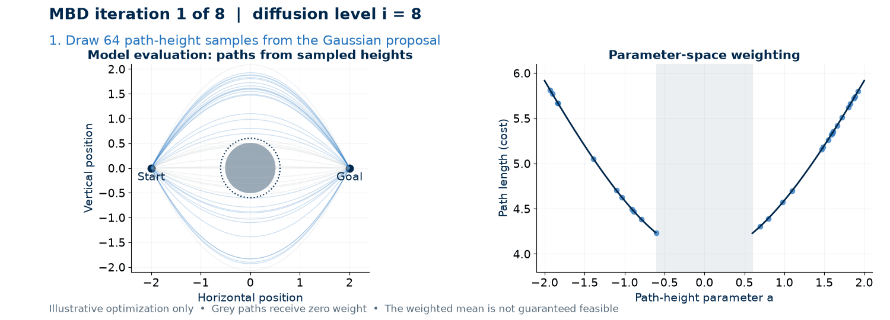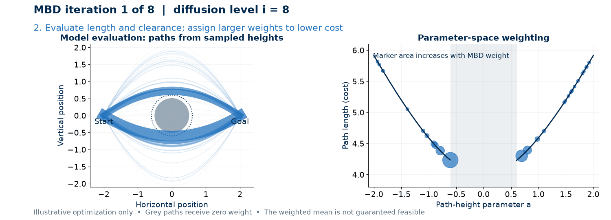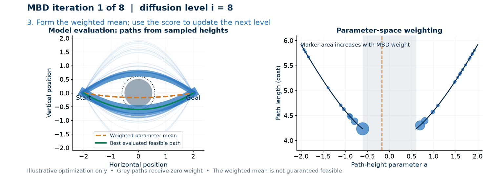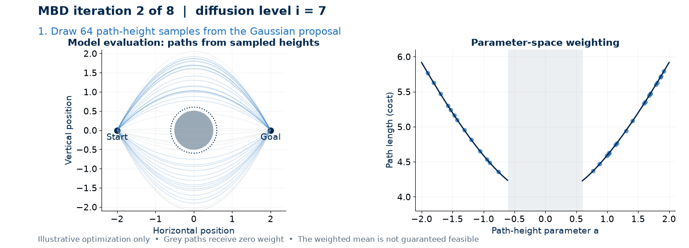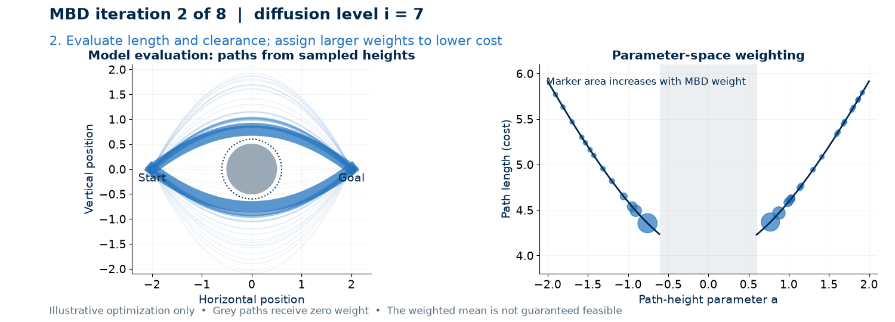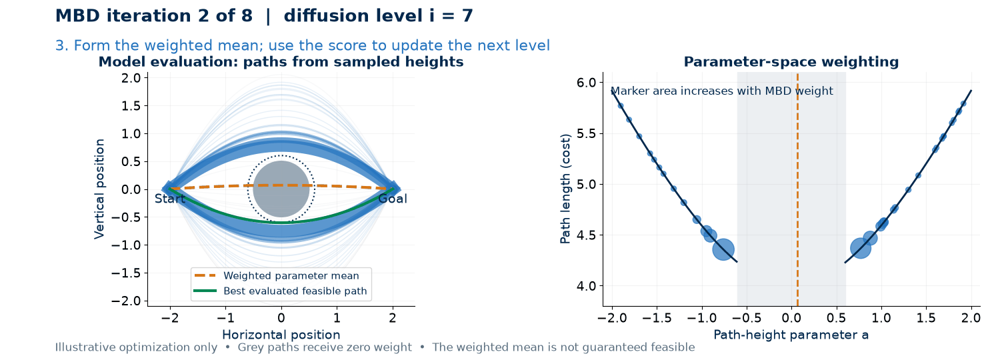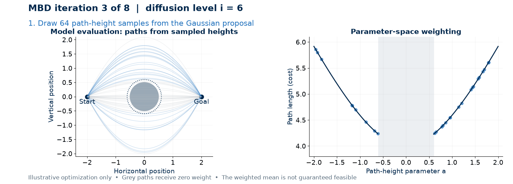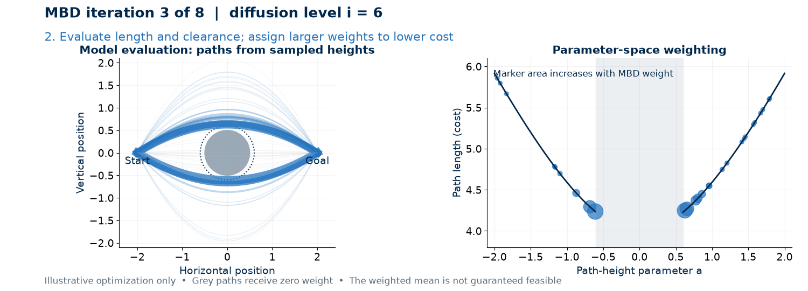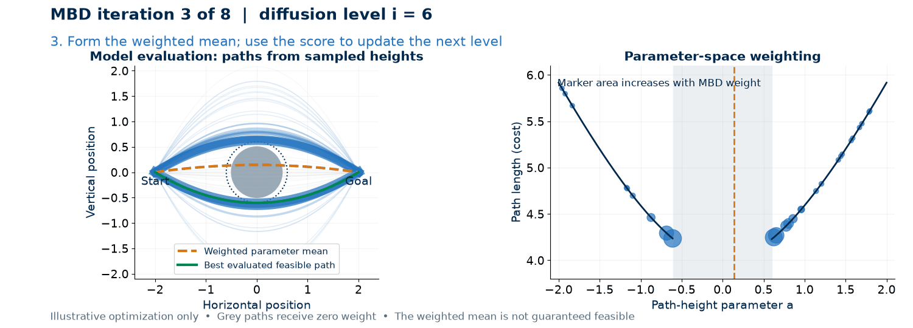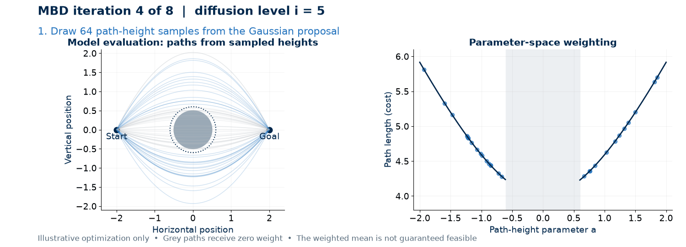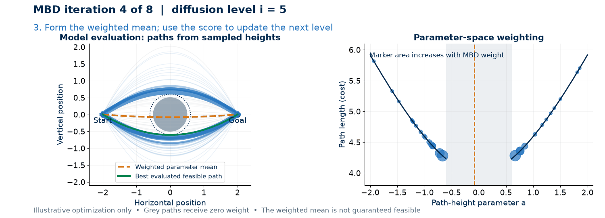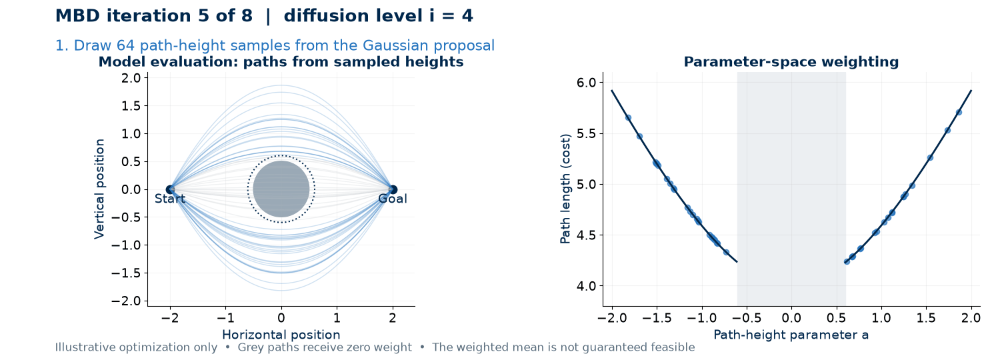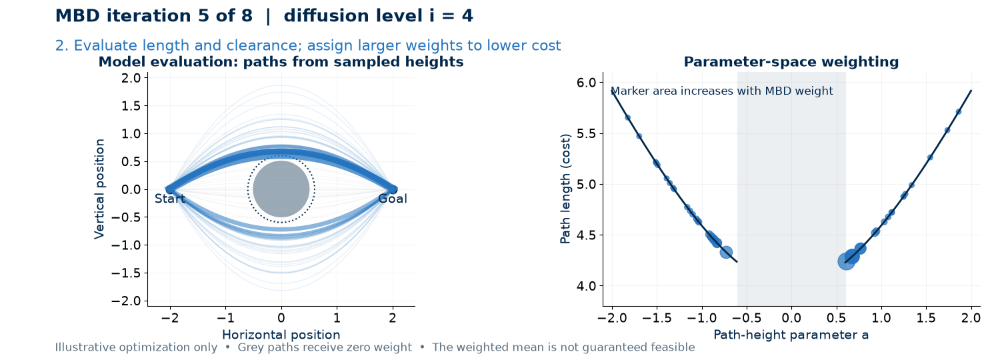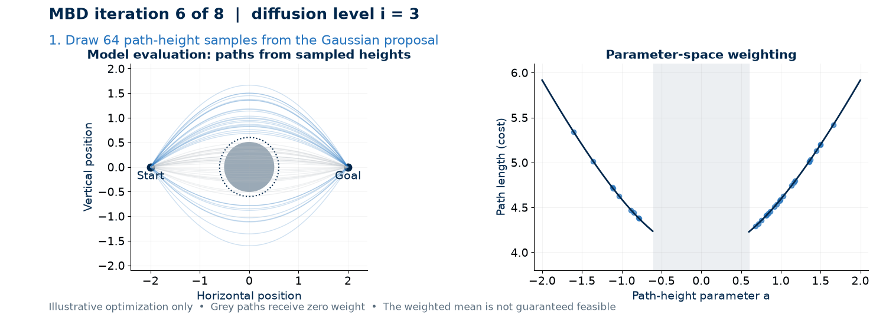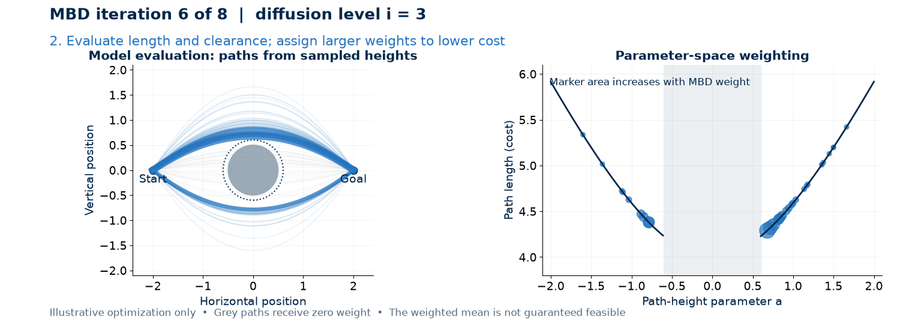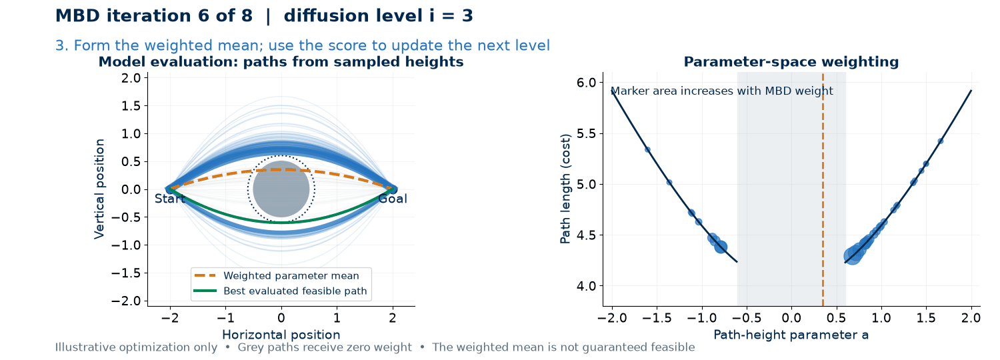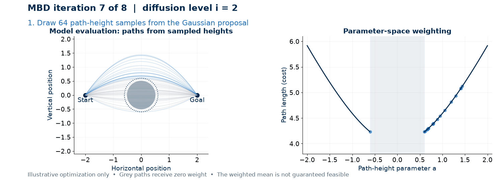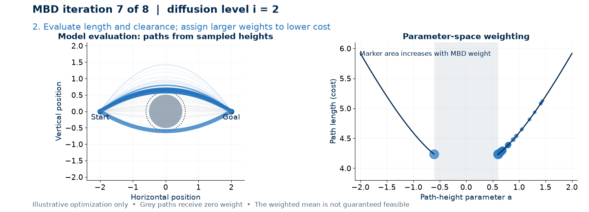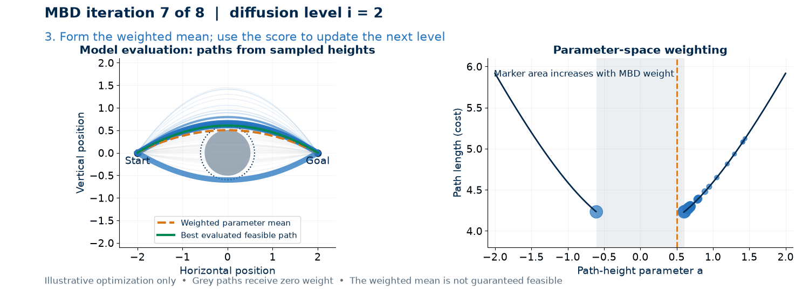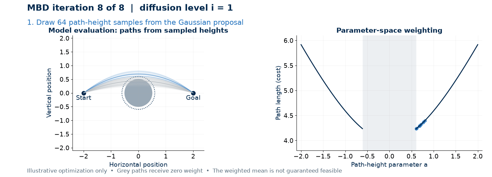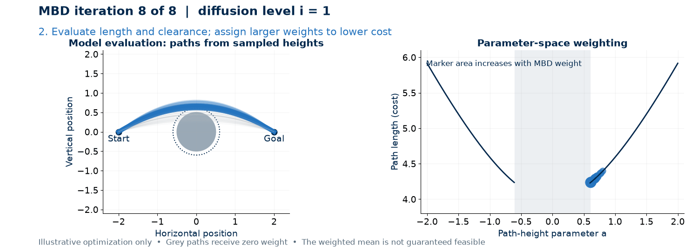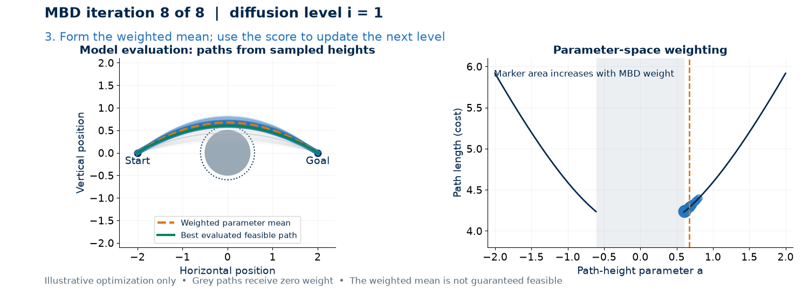

<button type="button" data-action="reset">Restart</button><button type="button" data-action="prev">Previous</button><button type="button" data-action="play" aria-pressed="false">Play</button><button type="button" data-action="next">Next step</button>
<input type="range" min="0" max="23" value="0" step="1" aria-label="Animation frame" />
<output aria-live="polite"></output>

Starts paused. Use Next step or the timeline to move through all eight iterations. Blue: evaluated paths · Orange dashed: weighted parameter mean · Green: best evaluated feasible path.

::: {.notes}
The original 24 animation frames are preserved exactly as decoded from mbd_toy.gif. The player starts paused, pauses on leaving the slide, and never advances the presentation itself. The underlying example uses eight reverse levels, 64 proposals per level, temperature 0.12, seed 19, a bounded height domain [-2,2] and center clearance at least 0.6 around a radius-0.5 obstacle. It is a numerical teaching example, not an additional monitoring experiment. All original numerical records remain in assets/mbd_toy_data.json. The following slide expands one iteration into eight algorithm steps, including four denoising frames.
:::

## One MBD iteration, step by step {.mbd-detail-slide #mbd-one-iteration data-section="2 · Preliminaries"}

<label>Choose an iteration <select aria-label="MBD iteration"><option value="0">1 of 8 · diffusion level 8</option><option value="1">2 of 8 · diffusion level 7</option><option value="2">3 of 8 · diffusion level 6</option><option value="3">4 of 8 · diffusion level 5</option><option value="4">5 of 8 · diffusion level 4</option><option value="5">6 of 8 · diffusion level 3</option><option value="6" selected>7 of 8 · diffusion level 2</option><option value="7">8 of 8 · diffusion level 1</option></select></label><button type="button" data-action="continue">Continue to next iteration</button>

<svg class="mbd-stage" viewBox="0 0 850 425" role="img" aria-label="Path model and parameter-space calculation for the selected algorithm step"></svg>
<ol class="mbd-algorithm"><li class="algorithm-step" data-step="0">1<b>Read the current noisy vector</b></li><li class="algorithm-step" data-step="1">2<b>Sample 64 path-height values</b></li><li class="algorithm-step" data-step="2">3<b>Construct each path</b></li><li class="algorithm-step" data-step="3">4<b>Evaluate length and clearance</b></li><li class="algorithm-step" data-step="4">5<b>Normalize cost weights</b></li><li class="algorithm-step" data-step="5">6<b>Compute the weighted mean</b></li><li class="algorithm-step" data-step="6">7<b>Estimate the score</b></li><li class="algorithm-step" data-step="7">8<b>Denoise: move → rescale → resample</b></li></ol>

<button type="button" data-action="reset">Restart</button><button type="button" data-action="prev">Previous</button><button type="button" data-action="play" aria-pressed="false">Play</button><button type="button" data-action="next">Next step</button>
<input type="range" min="0" max="10" value="0" step="1" aria-label="Algorithm animation frame" />
<output aria-live="polite"></output>

Step 8 has four frames: score correction, rescaling, next sampling distribution, and new paths. Nothing here is physical robot motion.

::: {.notes}
The player opens at iteration 7, level 2, to show the substantial narrowing before the last level. All eight saved iterations are selectable. The final algorithm line spans frames 8–11: score correction, change of noise scale, the next proposal, and the actual next saved sample bank. The next iteration button starts its full cost evaluation; it is enabled only after the transition and never after the final level. Gray path clouds in the last frame are prior proposals; blue paths are fresh proposals, not morphed versions of the same samples. All data come from the original saved teaching example. The noisy coordinate and clean path-height coordinate are labeled separately. The final level explicitly has no next Gaussian or sample bank. PDF export uses the before/after proposal view at level 2.
:::

## Problem formulation {.section-break #optimistic-problem data-section="3 · Problem formulation"}

3

Predict the monitoring delivered by a trajectory under spatial disturbance.

The decision, its execution, and the cost being minimized

## The trajectory decision {#optimistic-decision data-section="3 · Problem formulation"}

At replanning time $t_k$, the inputs are the attained robot state $x_k$, clarity vector $q_k$, disturbance belief $\mathcal B_k^d$, and known environment geometry.

Choose $\theta\in\Theta$, a vector that specifies a **nominal reference trajectory** over a prediction horizon $T$.

The tracking controller requests an input along that reference:

$$u_{\mathrm{nom}}(\tau)=\pi^{\mathrm{nom}}(\tau,x(\tau);\theta,\mathcal B_k^d),\qquad 0\leq\tau\leq T.$$

$k$: physical replanning index. $\theta$: trajectory parameters. $\Theta$: bounded parameter domain.

$\tau$: elapsed time within a prediction. $\pi^{\mathrm{nom}}$: reference tracking law. $u_{\mathrm{nom}}$: requested input.

The reference representation and vehicle model are specified later, in **Implementation**.

## Motion, monitoring, and soft planning constraints {#optimistic-task data-section="3 · Problem formulation"}

For a possible spatial disturbance field $d$, predict

$$\dot x=f_d(x,u,d(\Psi(x))),\qquad x(0)=x_k,\qquad q(0)=q_k.$$

The clarity model from the preliminaries gives $q(\tau)$ from the predicted sensing positions. The monitoring cost is

$$J(\theta;d)=\int_0^T D(q(\tau))\,d\tau,\qquad
D(q)=\frac1{N_p}\sum_{j=1}^{N_p}[\bar q_j-q_j]_+.$$

State and environment limits enter through a soft penalty:

$$P(\theta;d)=\int_0^T\sum_a\omega_a[h_a(x(\tau))]_+^2\,d\tau.$$

$D$: mean positive clarity deficit. $N_p$: number of monitored cells. $[z]_+=\max(z,0)$.

$h_a>0$: violation of constraint $a$. $\omega_a\geq0$: its penalty weight. Applied inputs remain in actuator set $\mathcal U$.

Planning accounts for tracking and constraint effects. It does not require every predicted execution to be safe.

## Average performance and optimistic performance {#optimistic-two-criteria data-section="3 · Problem formulation"}

**Disturbance-aware planning:** minimize average predicted monitoring cost, including average constraint penalties.

**Proposed planning:** prefer a favorable fraction of predicted monitoring outcomes, while retaining the average constraint penalty over all sampled fields.

$$\boxed{\mathcal B^d(\tau)=\mathcal B_k^d\qquad 0\leq\tau\leq T}$$

<b>During a planning call</b> The disturbance belief stays fixed. The controller responds to each predicted state.

<b>During physical execution</b> Actual measurements update the belief. The next planning call uses that updated belief.

This method uses optimism and real online learning. It does not predict hypothetical belief updates or a value of learning.

## Method {.section-break #optimistic-method data-section="4 · Method"}

4

The complete algorithm, followed by its components.

All equations in this section are independent of the chosen vehicle and time discretization

## Proposed algorithm {#current-algorithm .algorithm-wide data-section="4 · Method · Algorithm"}

**Input:** attained state and clarity, current disturbance belief, environment, and previous trajectory continuation.

1. Draw spatial disturbance fields from the current belief. Keep them fixed for this planning call.
2. Evaluate initial nominal trajectories and initialize the noisy trajectory parameter vector.
3. At each diffusion level, sample trajectory parameters and predict the resulting controlled motion and sensing in every performance field.
4. Score each trajectory using favorable monitoring outcomes plus average constraint penalties. Retain its evaluated parameters and costs.
5. Use the retained evaluations to form the next sampling distribution. Correct the sample weights and perform the MBD denoising update. Repeat while levels remain.
6. After the last level, reevaluate the final choices in fresh shared fields and select the lowest-scoring evaluated trajectory.
7. Execute for one replanning interval, collect real measurements, update the disturbance belief, and return to step 1 from the attained state and clarity.

::: {.notes}
Algorithm overview of the currently implemented optimistic planner. Each of steps 1–7 is expanded next. The finite search budget does not guarantee the optimum or discovery of every passage. A sampled trajectory is always a parameter vector evaluated through the execution model; it is not an imposed geometric route. Constraint penalties are soft. A numerical failure or a parameter outside the bounded domain has zero optimization weight.
:::

## Architecture and the two loops {#optimistic-architecture data-section="4 · Method · Algorithm"}

<b>Current state, clarity, and disturbance belief</b>

↓

<b>MBD search:</b> sample trajectory parameters → predict controlled motion and sensing → score → denoise

Repeat only this search while diffusion levels remain

↓ after the last level

<b>Fresh-field comparison and trajectory selection</b>

↓

<b>Physical execution → real measurements → updated state, clarity, and belief</b>

The next physical replanning time returns to the first line

The inner search changes the trajectory parameters. Physical execution changes the information available to the next planning call.

## Step 1: spatial fields for prediction and control {#two-field-banks data-section="4 · Method · Step 1"}

The current belief defines a distribution $\mathcal P_k^d$ over spatial disturbance fields.

| Field set | Definition | Purpose |
|---|---|---|
| Performance fields | $d^{[s]}\sim\mathcal P_k^d$, $s=1,\ldots,S$ | Predict the monitoring and penalty for one possible execution |
| Controller construction fields | $\widetilde d^{[\ell]}$, $\ell=1,\ldots,L$ | Evaluate how the controller responds to possible disturbances |

Each field is one coherent spatial function. A trajectory queries that same function at its changing position.

$S$: performance-field count. $L$: construction-field count.

$[s]$, $[\ell]$: field indices. Construction fields use the same rule as the runtime controller.

All trajectory decisions are compared using shared fields. A new independent field set is used for final selection.

## Steps 2–3: a nominal trajectory produces several executions {#two-policy-roles data-section="4 · Method · Steps 2–3"}

For each sampled parameter vector $\theta$, keep the reference fixed and predict one execution per performance field:

$$\begin{aligned}
u_{\mathrm{nom}}^{[s]}(\tau)&=\pi^{\mathrm{nom}}(\tau,x^{[s]}(\tau);\theta,\mathcal B_k^d),\\
u^{[s]}(\tau)&=\Gamma_k\!\left(x^{[s]}(\tau),u_{\mathrm{nom}}^{[s]}(\tau)\right),\\
\dot x^{[s]}&=f_d\!\left(x^{[s]},u^{[s]},d^{[s]}(\Psi(x^{[s]}))\right).
\end{aligned}$$

$x^{[s]}$: predicted executed state in field $s$. $u^{[s]}$: input applied in that prediction.

$\Gamma_k$: runtime input filter reconstructed from the fixed belief and current queried state.

All executions start from $x_k,q_k$. Their positions, inputs, arrival times, and sensing can differ.

The planner scores the motion produced by the controller and disturbance. It does not assume perfect reference tracking.

## Step 3: the controller evaluates a continuation {#state-dependent-value data-section="4 · Method · Step 3"}

At a queried state $x$, the controller tests a specified **design policy** $\pi_D$: the continuation used to evaluate constraint consequences, such as braking.

$$\dot z^{[\ell]}=f_d\!\left(z^{[\ell]},\pi_D(z^{[\ell]};\mathcal B_k^d),
\widetilde d^{[\ell]}(\Psi(z^{[\ell]}))\right),\qquad z^{[\ell]}(0)=x.$$

Let $s_{a\ell}(\sigma;x)$ interpolate constraint values $h_a(z^{[\ell]}(\sigma))$. Define

$$V_{a,k}(x)=\max_{\ell=1,\ldots,L}\ \max_{0\leq\sigma\leq T_B}s_{a\ell}(\sigma;x).$$

$z^{[\ell]}$: design-policy trajectory. $T_B$: continuation evaluation horizon. $\sigma$: time along that continuation.

$V_{a,k}$: largest tested constraint value. $s_{a\ell}$: interpolated value for constraint $a$ and field $\ell$.

A reference that is easy to track in calm conditions can trigger a different controller response in disturbance.

Policy-value construction inspired by RPCBF. This is a component of the execution prediction, not a planner safety guarantee.

## Step 3: the filter changes the requested input when needed {#state-dependent-filter data-section="4 · Method · Step 3"}

For dynamics affine in the input, write $f_d(x,v,\delta)=f_0(x,\delta)+G(x,\delta)v$. The tested disturbance at $x$ is $\delta_\ell=\widetilde d^{[\ell]}(\Psi(x))$.

The filter first seeks the closest admissible input satisfying all tested value-rate conditions:

$$\begin{aligned}
\Gamma_k(x,u_{\mathrm{nom}})\in\underset{v\in\mathcal U}{\arg\min}\;&\tfrac12\|v-u_{\mathrm{nom}}\|_2^2\\
\text{subject to }\;&\nabla_xV_{a,k}^{\mathsf T}[f_0(x,\delta_\ell)+G(x,\delta_\ell)v]
\leq-\kappa V_{a,k},\quad\forall a,\ell.
\end{aligned}$$

$v$: trial control; $f_0$: drift; $G$: input matrix. $\nabla_xV_{a,k}$: sensitivity to the queried state.

$\kappa>0$: value-rate coefficient. $\mathcal U$: hard actuator limits.

If these conditions cannot all be met, the declared fallback permits value-rate slack while preserving the actuator limits.

The planner reproduces that fallback and its motion. It does not reject a trajectory solely because the filter used slack.

## Step 3: propagate motion before crediting sensing {#fixed-belief-changing-control data-section="4 · Method · Step 3"}

For every performance field, repeat the following along the prediction:

1. Query the tracking law at the reached state and reference time.
2. Recompute the controller values and their state derivatives there; obtain the applied input.
3. Propagate the disturbed dynamics with that input.
4. Compute sensing at the reached position, evolve clarity, and accumulate costs.

$$\dot q_j^{[s]}=\frac{C_j(x^{[s]})^2}{R}(1-q_j^{[s]})^2-Q_j(q_j^{[s]})^2.$$

$C_j$: sensing quality at cell $j$. $R>0$: measurement-noise level.

$Q_j\geq0$: monitored-process noise. $q_j^{[s]}$: clarity in that execution.

A fixed belief does not imply a fixed controller correction or a fixed disturbance vector along the path.

## Step 4: monitoring and constraint costs {#performance-costs data-section="4 · Method · Step 4"}

Each performance field produces a monitoring cost and a penalty:

$$J_s(\theta)=\int_0^T D(q^{[s]}(\tau))\,d\tau,\qquad
P_s(\theta)=\int_0^T\sum_a\omega_a[h_a(x^{[s]}(\tau))]_+^2\,d\tau.$$

Compute their sample means:

$$\overline J(\theta)=\frac1S\sum_{s=1}^S J_s(\theta),\qquad
\overline P(\theta)=\frac1S\sum_{s=1}^S P_s(\theta).$$

$J_s$: delivered monitoring cost in field $s$. $P_s$: constraint penalty in that field.

$\overline J$: average monitoring cost. $\overline P$: average constraint penalty.

Wind and controller intervention affect cost through the resulting motion and sensing. Uncertainty reduction receives no separate reward.

## Step 4: favorable monitoring outcomes, all constraint penalties {#optimistic-tail-cost data-section="4 · Method · Step 4"}

Sort the monitoring costs: $J_{(1)}\leq\cdots\leq J_{(S)}$. Choose a favorable fraction $\eta\in(0,1]$.

$$c_s=\min\{1,\max\{\eta S-s+1,0\}\},\qquad
J_\eta(\theta)=\frac1{\eta S}\sum_{s=1}^S c_sJ_{(s)}(\theta).$$

The score optimized by MBD is

$$\boxed{F_k(\theta)=J_\eta(\theta)+\overline P(\theta).}$$

$c_s$: weight on sorted outcome $s$. $\eta=1$: average monitoring cost. $\eta=0.5$: favorable half of the costs.

$F_k$: complete planning score. $\overline P$: mean penalty from every field, including unfavorable outcomes.

Optimism applies to monitoring performance. It does not discard unfavorable constraint penalties.

## Step 4: an arithmetic example {#optimism-cost-example data-section="4 · Method · Step 4"}

**Illustrative values only.** Four performance fields and $\eta=0.5$. Lower cost is better.

| Reference trajectory | Sorted monitoring costs | Mean monitoring | Favorable half | Mean penalty | Score $F_k$ |
|---|---|---:|---:|---:|---:|
| Established route | $9,10,10,11$ | 10 | 9.5 | 0 | 9.5 |
| Uncertain alternative | $6,8,14,20$ | 12 | 7 | 1 | **8** |
| Constrained alternative | $6,8,14,20$ | 12 | 7 | 5 | 12 |

The uncertain alternative can be chosen despite its worse average monitoring. A large mean constraint penalty can reverse that preference.

This example explains the decision criterion. It is not evidence that early exploration improves a later mission.

## Step 5: the target and the ordinary MBD proposal {#optimistic-target data-section="4 · Method · Step 5"}

The clean decision is $y_0=\theta$. Define the target density

$$p_{0,k}(\theta)=Z_k^{-1}\mathbf1_\Theta(\theta)\,\chi_k(\theta)
\exp[-F_k(\theta)/\lambda].$$

$Z_k$: normalizing integral. $\chi_k=1$: numerical evaluation is finite. $\chi_k=0$: numerical failure.

$\lambda>0$: cost temperature. $\mathbf1_\Theta$: bounded-domain indicator. Constraint slack alone does not set $\chi_k=0$.

At reverse diffusion level $i$, ordinary MBD samples clean parameters from

$$\phi_i(\theta)=\mathcal N\!\left(\theta;\frac{y_i}{\sqrt{\bar\alpha_i}},\sigma_i^2I\right),
\qquad \sigma_i^2=\bar\alpha_i^{-1}-1.$$

$y_i$, $\alpha_i$, $\bar\alpha_i=\prod_{j=1}^i\alpha_j$, and identity matrix $I$ are the diffusion quantities defined in the preliminaries. $i$ is a diffusion level, not physical time.

## Step 5: which evaluated trajectories receive more samples? {#optimistic-archive-priority data-section="4 · Method · Step 5"}

The archive $\mathcal A_k$ contains evaluated trajectory parameters and their costs. Its average-cost incumbent is

$$\theta_{\mathrm{inc}}\in\underset{\theta\in\mathcal A_k}{\arg\min}
\{\overline J(\theta)+\overline P(\theta)\}.$$

For archive entry $a$, define

$$b_a=\overline J(\theta_a)-J_\eta(\theta_a),\qquad
a_a=[F_k(\theta_{\mathrm{inc}})-F_k(\theta_a)]_+\,\mathbf1\{b_a>0\}.$$

$\theta_a$: parameters of archive entry $a$. $b_a$: difference between average and favorable monitoring cost.

$a_a$: priority for additional sampling. Only finite, in-domain evaluations enter this calculation.

Positive priority requires a better optimistic score than the average-cost incumbent and a positive monitoring-cost difference $b_a$.

This priority is a search rule. It does not estimate future information or the value of learning.

## Step 5: draw a new batch and correct its weights {#optimistic-mixture data-section="4 · Method · Step 5"}

Normalize positive priorities: $\nu_a=a_a/\sum_ba_b$. Form

$$q_i^{\mathrm{prop}}(\theta)=(1-\rho)\phi_i(\theta)
+\rho\sum_a\nu_a\mathcal N(\theta;\theta_a,\sigma_i^2I),\qquad 0\leq\rho<1.$$

Draw $K$ fresh parameter vectors $\theta_n\sim q_i^{\mathrm{prop}}$. Their weights are

$$\widetilde w_n=\mathbf1_\Theta(\theta_n)\chi_k(\theta_n)e^{-F_k(\theta_n)/\lambda}
\frac{\phi_i(\theta_n)}{q_i^{\mathrm{prop}}(\theta_n)},\qquad
w_n=\frac{\widetilde w_n}{\sum_{m=1}^K\widetilde w_m}.$$

$\rho$: sampling fraction assigned to archive entries. $\nu_a$: normalized priority; $K$: batch size. $n,m$: indices within the new batch.

$q_i^{\mathrm{prop}}$: full sampling density. $\phi_i/q_i^{\mathrm{prop}}$: importance correction. No positive priorities: use $q_i^{\mathrm{prop}}=\phi_i$.

Use the full mixture density in the denominator. Retained old evaluations are not treated as fresh samples.

## Step 5: denoise and decide whether to repeat {#optimistic-denoising data-section="4 · Method · Step 5"}

Compute the weighted trajectory parameters and apply the MBD update:

$$\bar\theta=\sum_{n=1}^K w_n\theta_n,\qquad
\widehat s_i=\frac{-y_i+\sqrt{\bar\alpha_i}\bar\theta}{1-\bar\alpha_i},$$
$$y_{i-1}=\frac{y_i+(1-\bar\alpha_i)\widehat s_i}{\sqrt{\alpha_i}}
=\sqrt{\bar\alpha_{i-1}}\bar\theta.$$

$\bar\theta$: weighted parameter mean. $\widehat s_i$: estimated score of the noisy target.

$\bar\alpha_0=1$: clean endpoint. The next ordinary proposal is centered at $\bar\theta$ with less noise.

**More levels remain:** draw and evaluate a new batch at the next noise level. 
**Last level completed:** evaluate the final vector and proceed to selection.

A parameter mean need not produce a good trajectory. It must be evaluated. An empty-weight batch triggers the declared recovery using an evaluated trajectory.

## Step 6: compare final choices in fresh fields {#optimistic-selection data-section="4 · Method · Step 6"}

Compare the leading evaluated parameters, the average-cost incumbent, previous-plan continuation, initial trajectories, and final denoised vector.

For each, recompute the same score in a **fresh shared performance-field set**:

$$\theta_k^\star\in\underset{\theta\in\mathcal C_k}{\arg\min}
\left\{J_\eta^{\mathrm{val}}(\theta)+\overline P^{\mathrm{val}}(\theta)\right\}.$$

$\mathcal C_k$: finite, in-domain parameter vectors being compared. $\mathrm{val}$: costs recomputed in the independent selection fields.

$\theta_k^\star$: selected trajectory parameters. Use the same controller construction fields and fallback rule.

The final choice is an evaluated trajectory. Fresh-field selection still uses the optimistic criterion.

This comparison reduces reuse of the search fields. It is not an independent mission test or a safety certificate.

## Step 7: execute, observe, and replan {#optimistic-real-learning data-section="4 · Method · Step 7"}

Execute the selected reference for a replanning interval $\Delta\leq T$. The runtime controller responds to the attained state and currently available belief.

Actual disturbance measurements form the data set $\mathcal D_k^{d,\mathrm{real}}$. Update the belief:

$$\mathcal B_{k+1}^d=\operatorname{POAMUpdate}(\mathcal B_k^d,\mathcal D_k^{d,\mathrm{real}}).$$

The next call starts from attained $x_{k+1}$ and $q_{k+1}$, the updated belief, and a shifted continuation of the previous reference.

$\Delta$: physical time between planning calls. $\mathcal D_k^{d,\mathrm{real}}$: measurement locations and values.

$x_{k+1},q_{k+1}$: attained state and clarity. Real measurements may update the runtime controller before the next replan.

Future learning is a consequence of real execution. It is not simulated inside the current planning score.

## Proposed method, step by step {.optimistic-walk-slide #optimistic-walkthrough data-section="4 · Method · Interactive explanation"}

<ol class="optimistic-steps"><li>Read attained state, clarity, and posterior</li><li>Predict controlled motion and sensing</li><li>Score monitoring and constraint penalties</li><li>Choose where to draw the next batch</li><li>Correct weights and denoise</li><li>Compare final choices in fresh fields</li><li>Execute, observe, and update the posterior</li></ol>

<button type="button" data-action="reset">Restart</button><button type="button" data-action="prev">Previous</button><button type="button" data-action="play" aria-pressed="false">Play</button><button type="button" data-action="next">Next step</button><input type="range" min="0" max="6" value="0" step="1" aria-label="Proposed method step"/><output></output>

Illustrative arithmetic and process explanation. This is not a simulation result.

## Method scope and the long-mission hypothesis {#optimistic-long-mission data-section="4 · Method · Scope"}

Optimism can encourage an early visit whose average predicted monitoring is worse but whose favorable outcomes are useful. Real observations from that visit can change later decisions.

The benefit requires a persistent spatial disturbance, informative observations, useful generalization, and enough remaining mission time to recover the early monitoring loss.

**The score does not predict those later belief changes.** It therefore does not guarantee informative exploration or a long-term improvement.

The method ends here. The next section compares its algorithm with MBD. All numerical and code choices follow in Implementation.

## Comparison with MBD {.section-break #optimistic-mbd-comparison data-section="5 · Comparison with MBD"}

5

The MBD update is retained; the execution model, score, and sampling rule are specified for this task.

## Algorithm comparison {#optimistic-algorithm-comparison data-section="5 · Comparison with MBD"}

<h3>Model-based diffusion</h3><ol><li>Define a decision vector, model-evaluated cost, and target density.</li><li>Initialize a noisy decision vector.</li><li>Draw a Gaussian batch at each diffusion level.</li><li>Evaluate each decision through the model.</li><li>Compute weighted decisions, estimate the score, and denoise.</li><li>Evaluate the final decision for the task.</li></ol>

<h3>Current proposed method</h3><ol><li>Use nominal trajectory parameters as the decision.</li><li>Evaluate controlled motion and sensing in spatial disturbance fields.</li><li>Score favorable monitoring outcomes plus all mean constraint penalties.</li><li>Adapt the Gaussian proposal using retained evaluations.</li><li>Include the proposal-density ratio and apply the same score and denoising equations.</li><li>Compare final choices in fresh fields; execute and learn from actual measurements.</li></ol>

Pan et al., Model-Based Diffusion for Trajectory Optimization, Algorithm 2 and Eqs. (6), (8)–(9). Optimistic scoring and the corrected archive mixture are additions.

## What is optimized, predicted, and learned {#optimistic-mbd-components data-section="5 · Comparison with MBD"}

| Quantity | Role in the current method |
|---|---|
| Nominal trajectory parameters $\theta$ | Optimized by MBD |
| Controlled states, applied inputs, clarity | Outputs of prediction for each sampled field |
| Design policy and controller rule | Specified components; not optimized by MBD |
| Disturbance belief during prediction | Fixed for that planning call |
| Disturbance belief during execution | Updated from actual measurements |
| Future monitoring benefit of learning | Experimental hypothesis; not a separate term in the score |

The following implementation uses a particular planar reference model and nonlinear quadrotor execution. Those choices are not part of the generic formulation above.

## Implementation {.section-break #current-implementation data-section="6 · Implementation"}

6

The exact numerical choices used by the current corrected experiments.

Reference trajectories, quadrotor execution, disturbance inference, search budget, and measured computation

## Experiment and clock settings {#implementation-clocks data-section="6 · Implementation · Configuration"}

| Quantity | Current corrected two-region configuration |
|---|---|
| Mission duration | 300 s |
| Prediction horizon $T$ | 45 s |
| Planning time step $\delta t$ | 0.2 s; 225 intervals |
| Replanning interval $\Delta$ | 5 s; execute 25 reference intervals |
| Nonlinear physics step | 0.01 s; 100 Hz |
| Runtime outer-control/filter period | 0.05 s; 20 Hz |
| Actual disturbance-observation period | 1 s; runtime belief updates between replans |

These are offline simulations. The recorded mission clock does not wait for the measured planning wall time.

The requested 10 s horizon and ≤2 s planning target has not been demonstrated. Runtime tuning was stopped for this review.

::: {.notes}
Configuration source: output/european_quarter/planner_investigation/supported_forward_reverse300/experiment_proposed_forward.json. Runner: scripts/run_full_control_quarter.py, run. All following implementation slides describe this configuration unless explicitly labeled otherwise. Prediction control updates every 0.2 s, unlike the runtime filter's 0.05 s period. The filter equations and margin match; the numerical control rates do not.
:::

## The nominal trajectory has 450 independent parameters {#implementation-reference data-section="6 · Implementation · Reference"}

Use a planar double-integrator reference with state $z_n^{\mathrm{ref}}=(p_n^{\mathrm{ref}},v_n^{\mathrm{ref}})$:

$$a_n=a_{\max}\tanh(\theta_n),\qquad
p_{n+1}^{\mathrm{ref}}=p_n^{\mathrm{ref}}+\delta t\,v_n^{\mathrm{ref}}+\tfrac12\delta t^2a_n,$$
$$v_{n+1}^{\mathrm{ref}}=v_n^{\mathrm{ref}}+\delta t\,a_n,\qquad n=0,\ldots,224.$$

$p_n^{\mathrm{ref}},v_n^{\mathrm{ref}}\in\mathbb R^2$: reference position and velocity. $a_n\in\mathbb R^2$: nominal acceleration held over one interval.

$\theta_n\in\mathbb R^2$: two independent decision entries. $a_{\max}=2.2\ \mathrm{m/s^2}$ per axis. $\theta=(\theta_0,\ldots,\theta_{224})\in[-12,12]^{450}$.

Every acceleration interval can change during MBD. There is no temporal basis, fixed route selector, or reduced set of control knots.

quarter/continuous.py: controls, nominal_reference, continuation

## Tracking and wind compensation inside prediction {#implementation-tracker data-section="6 · Implementation · Tracking"}

The predicted planar executed state is $z=(p,v)$. The tracking request is

$$u_{\mathrm{nom}}=a_n+k_p(p^{\mathrm{ref}}-p)+k_v(v^{\mathrm{ref}}-v)
-a_{\mathrm{drag}}(v,\mu_k(p)).$$

For performance field $d^{[s]}$, the planner propagates

$$\dot p=v,\qquad \dot v=\Gamma_k(z,u_{\mathrm{nom}})+a_{\mathrm{drag}}(v,d^{[s]}(p)).$$

$\mu_k(p)$: current posterior wind mean. $a_{\mathrm{drag}}$: known acceleration from relative air velocity. $k_p=4.412\ \mathrm{s^{-2}}$, $k_v=7.353\ \mathrm{s^{-1}}$.

$p^{\mathrm{ref}},v^{\mathrm{ref}},a_n$: reference at that time. Wind is air velocity in m/s, not an unknown vehicle parameter.

The prediction uses RK4 and recomputes the filter every 0.2 s. The actual quadrotor has nonlinear attitude and motor dynamics.

quarter/continuous.py: rollout · quadrotor/aerodynamics.py: acceleration

## Controller values and the braking continuation {#implementation-values data-section="6 · Implementation · Controller"}

The design policy brakes and compensates the posterior mean wind:

$$\pi_D(z)=\operatorname{clip}\!\left(-k_Bv-a_{\mathrm{drag}}(v,\mu_k(p)),\,-a_{\max},a_{\max}\right).$$

$k_B=2\ \mathrm{s^{-1}}$: braking gain. $a_{\max}=2.2\ \mathrm{m/s^2}$: per-axis actuator limit.

Two construction fields. Eight RK4 steps of 0.25 s. Continuation horizon $T_B=2$ s.

For each constraint and field, a cubic spline interpolates the nine constraint values, including the starting state. Its maximum includes interior extrema and endpoints.

`jax.jacfwd` differentiates the resulting values with respect to the four queried state entries $(p_x,p_y,v_x,v_y)$.

This short continuation and its derivative are rebuilt inside every filtered prediction step.

safety/flow_policy_value.py: design_policy, values, filter_control · safety/spline.py

## The implemented filter and its slack fallback {#implementation-fallback data-section="6 · Implementation · Controller"}

After computing the values and gradients, assemble inequalities $Au\leq b$. The ordinary case projects the tracking request onto those inequalities and $|u_i|\leq a_{\max}$.

If infeasible, first compute the smallest common slack:

$$s^\star=\min_{u,s\geq0}s\quad\text{subject to }Au\leq b+s\mathbf1,\quad |u_i|\leq a_{\max}.$$

Then choose the input closest to the braking policy within the relaxed inequalities.

$A$: value-gradient coefficients. $b$: value-rate bounds including worst tested drift.

$s^\star$: minimum common inequality relaxation. $\mathbf1$: vector of ones.

Two buildings and four boundary constraints give six value inequalities. With four actuator bounds, the 2D projection checks 56 input candidates; the slack LP checks 165 triples of active planes.

safety/qp.py: project, solve, minimum_slack. The fallback preserves actuator limits; it is not declared safe.

## Numerical penalties and contact handling {#implementation-penalties data-section="6 · Implementation · Costs"}

The per-step soft penalty uses center clearance $c(z)$ and speed:

$$\ell_P(z)=[0.6-c(z)]_+^2+2[\|v\|_2-3.1]_+^2.$$

$c(z)$: signed distance to the closest building or boundary, in m. $0.6$ m: preferred planning clearance.

$3.1$ m/s: speed threshold. Both terms are integrated in time and averaged over fields.

The filter uses a 0.55 m center margin. The physical quadrotor radius is 0.275 m.

A predicted physical contact stops the predicted motion and subsequent sensing. Clarity then deteriorates for the remaining horizon; no monitoring after contact is credited.

Filter slack and soft-margin violations do not automatically reject a finite trajectory. Numerical failures and parameters outside the domain receive zero weight.

quarter/continuous.py: segment_contact, rollout, aggregate_costs

## Disturbance belief and field generation {#implementation-poam data-section="6 · Implementation · POAM"}

| Component | Current choice |
|---|---|
| Sparse posterior | 36 inducing positions; relocate after actual observations |
| Kernel | Attentive kernel; fixed parameters in these experiments |
| Base correlation lengths | 1.75 m and 4.55 m |
| Initial wind standard deviation | 1.2 m/s per component |
| Observation noise | 0.25 m/s per component |
| Continuous field sampling | 16 spectral features plus a $25\times25$ prior-support grid |
| Field lookup | $80\times91$ spatial grid; bicubic interpolation; two wind components |

The support grid corrects sampled prior covariance. It is not an extra set of observations or a change to posterior inference.

quarter/environment.py: initial_belief, table_sampler · wind/poam_belief.py

## RRT provides initial trajectories, not enforced paths {#implementation-rrt data-section="6 · Implementation · Initialization"}

RRT-Connect uses only known geometry and the attained state. Geometric diversity checks retain routes around different sides of obstacles.

For two inspection regions, the configured maximum gives

$$2\text{ goal regions}\times3\text{ path choices}\times3\text{ visit counts}\times2\text{ speeds}=36\text{ initial trajectories}.$$

Add zero acceleration, braking, and the shifted previous trajectory: **39 initial parameter vectors** are scored.

Each RRT path is time-parameterized using quintic segments, with zero velocity at geometric corners. Cruise settings are 1.8 and 2.8 m/s.

MBD can change all 450 parameters. The current weights use model cost only; the optional demonstration-likelihood term is off.

Stops at RRT corners are initialization choices and can bias a small local search. They are not constraints on the optimized trajectory.

quarter/rrt.py: diverse_connections, parameterize, demonstrations · continuous.py: optimizer

## Diffusion settings in the recorded experiments {#implementation-diffusion data-section="6 · Implementation · MBD"}

| Setting | Value |
|---|---|
| Reverse levels and batch size | 6 levels; 16 new parameter vectors per level |
| Performance and selection fields | 4 during search; 8 fresh fields for selection |
| Optimistic fraction and temperature | $\eta=0.5$; $\lambda=0.3$ |
| Archive proposal | Up to 8 entries; mixture fraction $\rho=0.35$ |
| Cosine schedule | Offset 0.008; finite schedule interval $[0,0.05]$ |
| Parallel layout | One search chain; trajectory batch size 16 |

The largest proposal standard deviation is **0.090 per parameter**. The initial noisy vector is formed around the best evaluated initialization.

This is a small local search around evaluated trajectories. It is not evidence of convergence or exhaustive passage discovery.

quarter/diffusion.py: cosine_schedule · quarter/mbd_core.py: search

## How one planning call becomes 912 trajectory rollouts {#implementation-work-count data-section="6 · Implementation · Work count"}

| Stage | Parameter vectors | Fields per vector | Executed-motion predictions |
|---|---:|---:|---:|
| Initial comparisons | 39 | 4 | 156 |
| Six diffusion batches | $6\times16=96$ | 4 | 384 |
| Final denoised vector | 1 | 4 | 4 |
| Fresh-field selection | 46 entries | 8 | 368 |
| **Total** | **182 evaluations** | | **912** |

Selection contains seven search outputs plus all 39 initial entries. Some entries can duplicate the same vector; they are still evaluated again.

$$912\times225=205{,}200\text{ forecast filter calls per planning call}.$$

Each filter call includes two eight-step design-policy continuations and state derivatives: **3,283,200 continuation steps before counting derivative work**.

Counts follow the actual array shapes in mbd_core.search and continuous.optimizer. Construction fields are nested inside these predictions.

## Nonlinear execution and monitoring {#implementation-execution data-section="6 · Implementation · Execution"}

The selected planar reference is flown at 3.2 m altitude using the full rigid-body quadrotor and motor model.

- Differential-flatness mapping supplies attitude and thrust references; geometric attitude control produces motor commands.
- RK4 advances the 22-state model at 100 Hz. Rotation is projected back to a valid rotation matrix after each step.
- The outer tracking/filter command is recomputed at 20 Hz using the actual state. Every second, a measured wind residual updates POAM without restarting the reference clock.
- A finite nadir sensing footprint, Gaussian quality, and building occlusion determine clarity at 84 monitored cells.

The 45° footprint has radius 3.2 m at the nominal altitude. The sensing quality scale is 2.2 m; target clarity is 0.75 and monitored-process noise is 0.014.

quarter/execution.py: executor · quarter/sensing.py · scripts/run_full_control_quarter.py: monitoring and online execution loop

## Baselines and the shared execution controller {#implementation-baselines data-section="6 · Implementation · Baselines"}

| Method | During planning | During physical execution |
|---|---|---|
| Proposed | Sampled spatial disturbance, predicted filter response, optimistic monitoring plus mean penalties | Learned wind compensation and runtime filter |
| Disturbance-blind planning | Zero disturbance and no predicted filter response | Learned wind compensation; no added constraint filter |
| Disturbance-blind planning with filter | Same nominal planning as the blind baseline | Same learned compensation and runtime filter as proposed |

The vehicle, actuator limits, task, sensing, estimator, and reference tracking gains are shared.

Proposed versus filtered blind planning isolates the effect of planning with the disturbance and controller response.

An average-cost disturbance-aware ablation uses the same disturbed execution model with $\eta=1$ and an ordinary Gaussian proposal. A collision is a failure to report, not a performance advantage to claim.

## Where JAX parallelism is used {#implementation-jax data-section="6 · Implementation · JAX"}

| Operation | Current implementation |
|---|---|
| Complete optimizer | `jax.jit` compiles search and final selection |
| Trajectory evaluations | `lax.map`, batch size 16 |
| Performance fields and construction fields | Nested `vmap` |
| Prediction over 225 time intervals | `lax.scan` |
| Eight-step controller continuation | A second `lax.scan`, inside each prediction step |
| Constraint-value derivatives | `jax.jacfwd` with respect to four state entries |
| Diffusion levels | `lax.scan`; each level depends on the preceding update |

Vectorization reduces dispatch overhead. It does not remove the nested prediction and derivative work.

Current backend: JAX 0.4.38, CPU on macOS arm64. MBD needs no task-cost gradient, but its controller model still computes state derivatives.

## Compute-time investigation {.section-break #compute-time data-section="7 · Compute time"}

7

Measured wall time, work counts, and the expensive nested calculation.

Current 45 s configuration; no runtime parameter tuning in this revision

## What was measured {#compute-measurement data-section="7 · Compute time · Protocol"}

Use the recorded forward-wind state and learned posterior at **mission time 100 s**, with the unchanged configuration above.

- Time the complete optimizer directly and synchronize its JAX outputs before stopping the clock.
- Time the complete planning path: posterior field generation, RRT, diffusion, and fresh-field selection.
- Compile and time search and selection separately for diagnosis. Verify that their selected parameters and score match the complete optimizer.
- Time nested controller and rollout components with dynamic inputs; do not compile a constant-answer benchmark.

Cold calls, warm calls, and nested measurements are reported separately.

Three warm repetitions for large stages; more repetitions for small components. One recorded state, one CPU machine. These measurements do not establish a mission-wide worst-case deadline.

scripts/profile_current_quarter.py · docs/compute_review/current45_dynamic.json

## Complete planning time {#compute-overview data-section="7 · Compute time · Complete call"}

| Timed operation | Warm median | Warm maximum |
|---|---:|---:|
| Complete planning call | **10.75 s** | **10.79 s** |
| Compiled optimizer: search plus selection | 9.30 s | 9.33 s |
| RRT initialization generation | 1.12 s | 1.12 s |
| One posterior field-bank generation | 32.07 ms | 47.94 ms |

The current runner generates two 14-field banks per planning call. Fourteen of those 28 fields are used: two construction fields, four search fields, and eight selection fields.

The optimizer dominates. Field generation is much smaller; removing it alone cannot deliver a 2 s planning call.

Complete-call times are measured directly. The other rows are separate synchronized measurements; their medians are not an exact additive decomposition.

## Search and final selection both cost seconds {#compute-search-selection data-section="7 · Compute time · Search and selection"}

| Separately compiled stage | Warm median | Work represented |
|---|---:|---|
| Training search, including initial evaluations | **5.71 s** | 136 trajectory vectors × 4 fields |
| Fresh-field selection | **3.64 s** | 46 entries × 8 fields |
| Initial evaluations alone | 1.65 s | 39 vectors × 4 fields |
| One diffusion batch alone | 0.69 s | 16 vectors × 4 fields |

The last two rows are **parts of the search**, not additional costs to add to the first row. Six batches repeat the same expensive prediction pattern.

Fresh-field selection is substantial because it reevaluates all initial entries, including duplicates, under twice as many fields.

Separate compilation changes fusion and scheduling. The split result matches the complete optimizer, but its component times are diagnostic rather than an exact partition.

## The controller prediction is the main added rollout cost {#compute-controller data-section="7 · Compute time · Controller"}

For the same optimized trajectory and the same four physical fields:

| Diagnostic evaluation | Warm median |
|---|---:|
| Full 45 s motion and clarity prediction with filter | **57.09 ms** |
| Same prediction with the filter disabled | 10.60 ms |
| Ratio | **5.4×** |

At one queried state, separate nested measurements give:

| Nested component | Warm median |
|---|---:|
| Constraint values from design-policy continuations | 44.8 µs |
| Constraint values and state derivatives | 112.0 µs |
| Complete filter call, including projection/fallback logic | 124.7 µs |

Disabling the filter changes the trajectory and is a diagnostic ablation, not a valid substitute for the method. Nested times overlap and are not added together.

## Other measured costs and what the old timer omitted {#compute-other data-section="7 · Compute time · Other costs"}

| Operation | Warm median | Frequency |
|---|---:|---|
| One actual POAM update | 0.24 ms | Every 1 s of simulated flight |
| One second of nonlinear quadrotor execution | 2.31 ms | 100 physics steps |
| First optimizer invocation | 25.19 s | Includes compilation and the first execution |

Existing mission logs record optimizer time in `plans[].seconds`. Their `total_planning_seconds` adds RRT, but excludes field construction and report generation.

Neither log timer includes execution, belief-map plotting, raw NPZ audit compression, or JSON serialization. The new complete-call measurement includes field construction and RRT, and excludes those reporting tasks.

Compilation is a startup cost. The roughly 10.75 s warm call remains too slow for a 5 s replanning deadline.

## Current compute diagnosis {#compute-conclusion data-section="7 · Compute time · Diagnosis"}

1. **Long repeated predictions:** 912 trajectory-field predictions, each with 225 time intervals.
2. **Controller reconstruction inside each interval:** braking continuations, spline maxima, and state derivatives occur about 205,200 times per call.
3. **Large final comparison:** 46 entries are reevaluated in eight fields; duplicate entries are not removed.
4. **Additional RRT work:** geometry search and time parameterization add approximately 1.12 s.

The nominal decision dimension is 450. The immediate expense comes from repeatedly evaluating those decisions through the controller and sensing model.

A 10 s horizon may reduce prediction work. No ≤2 s result is claimed; that experiment was stopped for review.

## Configuration fields that do not affect the current path {#implementation-inactive data-section="7 · Compute time · Code inspection"}

| Configuration entry | Effect in this configuration |
|---|---|
| `slack_weight = 50` | Unused by the hard projection/minimum-slack fallback; this is not a weighted soft QP |
| `safety_margin = 0.4` | Replaced by `execution_margin = 0.55` in the hard prediction filter |
| `guidance_sigma = 1` | Inactive because `guidance_mode = off` |
| `jerk_limit = 12` | No jerk cost because `jerk_penalty = 0` |

The numerical filter is evaluated every 0.2 s in prediction and every 0.05 s in execution. Matching its equations does not make these discretizations identical.

These are current code facts, not proposed algorithm components. They are listed so parameter changes can be interpreted correctly.

## Files for independent investigation {#implementation-source-map data-section="7 · Compute time · Reproduction"}

| Topic | Repository file and entry point |
|---|---|
| Experiment configuration and complete call | `scripts/run_full_control_quarter.py`: `run` |
| Prediction, penalties, and final selection | `src/voi_diffusion_ipp/quarter/continuous.py` |
| MBD proposal, archive, and reverse update | `src/voi_diffusion_ipp/quarter/mbd_core.py`: `search` |
| Controller values and derivatives | `src/voi_diffusion_ipp/safety/flow_policy_value.py` |
| Projection and slack fallback | `src/voi_diffusion_ipp/safety/qp.py` |
| Initialization and nonlinear execution | `quarter/rrt.py`; `quarter/execution.py` |
| Measured timings and exact configuration | `docs/compute_review/current45_dynamic.json` |
| Profiling script and reproduction notes | `scripts/profile_current_quarter.py`; `docs/compute_review/README.md` |

The following final archive preserves the earlier anticipated-learning formulation and its historical results. It is not the current method.

## Archived method {.section-break #archived-method data-section="Archived method"}

A

Previous anticipated-learning and value-of-learning formulation.

Original equations, interactive explanations, A/B results and implementation notes retained for reference

::: {.notes}
Everything after this divider belongs to the earlier method. Its hypothetical posterior updates and signed value-of-learning decomposition are not used by the revised optimistic method. Its recorded A/B results have not been recomputed and must not be attributed to the new proposal. The word proposed inside these archived figures and animations denotes the earlier anticipated-learning planner. Numerical implementation details here are historical only.
:::

## Archived problem formulation {.section-break data-section="Archived method" .archived-method data-archived="true"}

3

Two planning problems with the same monitoring objective.

Define the decision variable → hold the wind belief fixed → anticipate observations

## Define the decision and the planning horizon {data-section="Archived method" .archived-method data-archived="true"}

At time $t$, the planner knows the robot state $x_t$, clarity vector $q_t$, wind belief $\mathcal B_t^d$, environment geometry and target clarity $\bar q$.

**Decision:** choose parameters $\theta\in\Theta$ of a nominal control policy:

$$u_{\mathrm{nom}}(\tau)=\pi_\theta\big(x(\tau),\mathcal B^d(\tau),\tau\big),
\qquad 0\leq\tau\leq T.$$

$\Theta$: policy parameter domain. $T$: planning horizon. $\tau$: elapsed time from the start of this prediction.

$u_{\mathrm{nom}}$: input requested by the task policy. $u$: input applied by the execution controller. $x(0)=x_t$, $q(0)=q_t$.

The decision is a nominal policy. Its predicted motion and sensing determine the monitoring cost.

::: {.notes}
A reference trajectory is one possible implementation of pi_theta, not an additional decision object required by the generic formulation. It is introduced only in the implementation appendix. The same parameter vector defines the policy's response to state and belief throughout a prediction.
State, input and clarity depend on theta through that policy; repeated theta subscripts are omitted for readability.
:::

## Shared motion constraints and execution controller {data-section="Archived method" .archived-method data-archived="true"}

Both problems require admissible policy parameters, actuator inputs and predicted states:

$$\theta\in\Theta,\qquad u(\tau)\in\mathcal U,\qquad
h_a(x(\tau))\leq0\quad\text{for every constraint }a.$$

$h_a$ encodes an environment or state constraint. For example, outside a circular exclusion region, $h_a(x)=R_a^2-\|\Psi(x)-c_a\|^2$, with center $c_a$ and radius $R_a$.

**The controller from the preliminaries determines the applied input:**

$$u=\underset{v\in\mathcal U}{\arg\min}\ \frac12\|v-u_{\mathrm{nom}}\|^2
\quad\text{s.t.}\quad \nabla_x V_a^{\mathsf T}f_d(x,v,d)+\kappa V_a\leq0.$$

The value $V_a$ and tested wind values $d$ depend on the available wind belief. The inequality is imposed for each constraint and tested wind value. Here $v$ is the trial input; $u$ is the selected input.

The planner evaluates the motion produced by this controller. It cannot choose the nominal route and assume that route is executed.

The numerical method uses finite field samples and time checks. If the controller's inequalities are infeasible, its prescribed relaxation must be included in prediction. These tests do not establish safety for every possible wind field.

::: {.notes}
The state and input constraints state the intended admissibility requirements. The policy-value inequality is an execution-controller rule; it is not a replacement for checking the resulting trajectory against h_a. The ideal requirements are separate from their finite numerical enforcement. The implementation can relax controller value-rate inequalities, and recorded results retain and report those interventions. Controller feasibility is therefore not silently equated with satisfaction of all continuous-time geometric constraints. The subsequent method derives the finite sampled value and controller in detail. All numerical feasibility choices belong in the implementation appendix.
:::

## Problem 1: wind-aware planning with a fixed predicted belief {data-section="Archived method" .archived-method data-archived="true"}

**Choose a nominal policy that minimizes the monitoring deficit of its predicted execution under uncertain wind.**

$$\min_{\theta\in\Theta}\ \mathbb E_{d\mid\mathcal B_t^d}
\!\left[\int_0^Tq_d(q(\tau))\,d\tau\right]$$

subject to the dynamics, initial conditions and admissibility requirements:

$$\begin{aligned}
\dot x&=f_d(x,u,d(\Psi(x))), & x(0)&=x_t,\\
\dot q_j&=\frac{C_j(x)^2}{R}(1-q_j)^2-Q_jq_j^2, & q(0)&=q_t,\\
u&\in\mathcal U, &h_a(x)&\leq0\quad\forall a.
\end{aligned}$$

The controller on the preceding slide chooses $u$ from the request $u_{\mathrm{nom}}=\pi_\theta(x,\mathcal B_t^d,\tau)$.

$$\boxed{\mathcal B^d(\tau)=\mathcal B_t^d\quad\text{for }0\leq\tau\leq T}$$

A possible physical field $d$ is drawn from the current belief. Requirements apply to predicted executions; numerical enforcement checks the sampled fields and times. Real measurements still update the belief between planning calls.

## Problem 2: wind-aware planning with anticipated learning {data-section="Archived method" .archived-method data-archived="true"}

**Choose the policy while predicting how future observations change later inputs, motion and monitoring.**

$$\min_{\theta\in\Theta}\ \mathbb E_{d,\varepsilon^d\mid\mathcal B_t^d}
\!\left[\int_0^Tq_d(q(\tau))\,d\tau\right]$$

**Retain all motion and sensing constraints from Problem 1:**

$$\dot x=f_d(x,u,d(\Psi(x))),\quad
\dot q_j=\frac{C_j(x)^2}{R}(1-q_j)^2-Q_jq_j^2,$$
$$x(0)=x_t,\quad q(0)=q_t,\quad u\in\mathcal U,\quad h_a(x)\leq0\ \ \forall a.$$

The same controller chooses $u$, now from $u_{\mathrm{nom}}=\pi_\theta(x,\mathcal B^d,\tau)$. At a sensing time, $r_m=\Psi(x)$ and

$$y_m^d=d(r_m)+\varepsilon_m^d,\qquad
\boxed{\mathcal B^{d,+}=\operatorname{POAMUpdate}(\mathcal B^d;r_m,y_m^d)}.$$

Continue from the reached $x,q$ using the updated belief. The objective and admissibility requirements are unchanged.

$\varepsilon_m^d\sim\mathcal N(0,R_d)$ is measurement noise. The belief starts at $\mathcal B_t^d$ and is retained between updates. The expectation includes fields and observation noise; there is no separate learning reward.

## Method: from policy parameters to delivered monitoring {data-section="Archived method" .archived-method data-archived="true"}

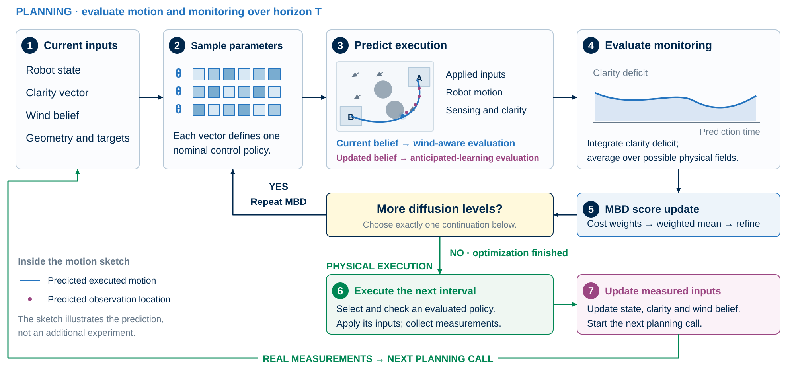

::: {.notes}
The top row evaluates sampled policy parameter vectors, not physical commands sent to the robot. The decision below refinement has two exclusive exits: continue optimization while diffusion levels remain; execute only once the optimization has finished. The green return path is a different loop: new real measurements start the next planning call. The following slides expand the prediction and cost blocks in order.
:::

## First distinguish the requested input from the applied input {data-section="Archived method" .archived-method data-archived="true"}

For a given parameter vector $\theta$, the nominal policy requests

$$u_{\mathrm{nom}}=\pi_\theta(x,\mathcal B^d,\tau).$$

The execution controller chooses $u\in\mathcal U$ using that request, the current state and the wind belief. The robot then evolves according to

$$\dot x=f_d(x,u,d(\Psi(x))).$$

<b>Example</b> The task policy requests motion toward a monitored region. Near an obstacle, wind and current velocity may require braking or turning.

<b>Planning consequence</b> The robot may arrive later or sense different cells. Predicting only the requested motion misses that cost.

Next we construct the execution controller's wind-dependent constraint test, then use its chosen input in the motion prediction.

Here $d$ is a possible physical wind field. The controller receives the belief, not privileged knowledge of that field.

## Predict future constraint values under a fixed policy {data-section="Archived method" .archived-method data-archived="true"}

Use the constraint functions $h_a$ and a fixed design policy $\pi_b$ from the preliminaries. MBD optimizes $\theta$, the parameters of the nominal task policy $\pi_\theta$; $\pi_b$ is fixed.

Draw $L$ wind fields $\widetilde d^{[\ell]}$ from the belief. Starting at $x$, follow $\pi_b$ under each field. Denote the resulting state trajectory by $\phi_b^{[\ell]}(\sigma)$.

**Take the largest constraint value over time, then over fields:**

$$\widehat V_a(x;\mathcal B^d)=\max_{\ell=1,\ldots,L}\;\max_{0\leq\sigma\leq H}
 h_a\!\left(\phi_b^{[\ell]}(\sigma)\right).$$

::: {.columns}
::: {.column width="58%"}
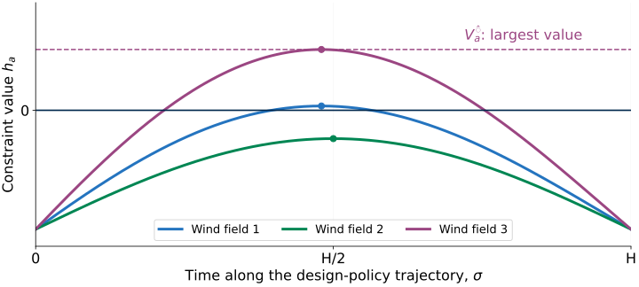
:::
::: {.column width="42%"}
$H$: design-policy evaluation horizon. $\sigma$: time within that prediction. $\ell$: wind-field index.

The belief changes the tested trajectories and their largest constraint value.
:::
:::

Illustrative traces. Finite sampled policy-value construction inspired by Knoedler et al.; spline maxima approximate the time maximum.

## Predict which input the execution controller will apply {data-section="Archived method" .archived-method data-archived="true"}

At the predicted state, choose the input closest to the nominal request:

$$u=\underset{v\in\mathcal U}{\arg\min}\ \frac12\|v-u_{\mathrm{nom}}\|^2$$

subject to, for every constraint $a$,

$$\max_{\ell=1,\ldots,L}\nabla_x\widehat V_a^{\mathsf T}
 f_d(x,v,\widetilde d^{[\ell]}(\Psi(x)))+\kappa\widehat V_a\leq0.$$

$v$ is the trial control input in this optimization; $u$ is its selected value. The belief is held fixed when taking the state gradient $\nabla_x\widehat V_a$.

<b>If the nominal input satisfies every inequality:</b> $u=u_{\mathrm{nom}}$. <b>Otherwise:</b> the controller changes the input to meet the tested conditions, when feasible.

Wind affects both the value $\widehat V_a$ and the predicted rate of change. It can therefore change the applied input even for the same nominal request.

Control-affine dynamics give a quadratic program. If the inequalities are infeasible, the execution model must reproduce the controller's constraint relaxation; the planner does not assert safety.

## Propagate the applied input, then compute sensing {data-section="Archived method" .archived-method data-archived="true"}

The chosen input $u$ and the possible physical wind field $d$ determine the next robot state:

$$\dot x=f_d(x,u,d(\Psi(x))),\qquad x(0)=x_t.$$

That state determines sensing quality and the clarity evolution:

$$\dot q_j=\frac{C_j(x)^2}{R}(1-q_j)^2-Q_jq_j^2,
\qquad q(0)=q_t.$$

<b>At each prediction step:</b> recompute the nominal request and the execution controller's response at the reached state.

<b>Accumulate monitoring cost:</b> integrate the mean clarity deficit $q_d(q)$ along this predicted motion.

The constraint value is part of the execution model. The objective is monitoring quality, not the size of the controller's intervention.

## Wind-aware evaluation: average costs across possible fields {data-section="Archived method" .archived-method data-archived="true"}

One possible physical field gives one predicted trajectory and one monitoring cost. Use $S$ coherent fields $d^{[1]},\ldots,d^{[S]}$ drawn from the current belief.

$$J_s(\theta)=\int_0^T q_d(q^{[s]}(\tau))\,d\tau,
\qquad \widehat J^{\mathrm{fixed}}(\theta)=\frac1S\sum_{s=1}^{S}J_s(\theta).$$

$s$ indexes a possible physical field. $q^{[s]}$ is the clarity predicted in that field. Every evaluation starts from the same $x_t,q_t$.

The physical field stays fixed along its trajectory. The controller uses the current belief throughout: $\mathcal B^d(\tau)=\mathcal B_t^d$.

A short nominal route can have a higher cost if wind and controller intervention reduce its delivered sensing.

The $S$ physical-field predictions evaluate monitoring. The $L$ short design-policy predictions on the previous slides construct the controller's constraint test; these have different roles.

## Anticipated learning: update, then continue {data-section="Archived method" .archived-method data-archived="true"}

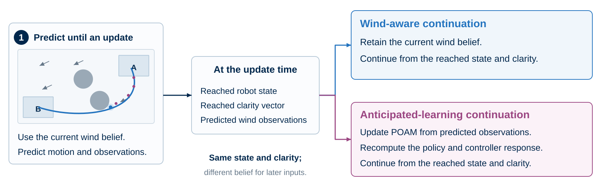

A predicted observation changes only the continuation after it becomes available. The robot state and clarity are carried forward.

::: {.notes}
This diagram isolates the difference for a matched parameter vector and possible physical field. It is a conceptual explanation, not an assertion that the updated continuation always has lower cost. The observation schedule is part of the sensing model; the generic method does not depend on the particular two-second cadence used in the simulations.
:::

## Predict one observation and its belief update {data-section="Archived method" .archived-method data-archived="true"}

At a scheduled sensing time, the predicted robot reaches position $r_m$. In the chosen possible physical field $d$, generate

$$y_m^d=d(r_m)+\varepsilon_m^d,\qquad
\varepsilon_m^d\sim\mathcal N(0,R_d).$$

Use that location and measurement in the same POAM update used during execution:

$$\mathcal B^{d,+}=\operatorname{POAMUpdate}\!\left(\mathcal B^d;\,r_m,y_m^d\right).$$

$m$: observation index. $y_m^d$: predicted noisy wind observation. $R_d$: measurement-noise covariance.

$\mathcal B^d$: belief before the observation. $\mathcal B^{d,+}$: belief after the observation. A batch is handled using all locations observed since the last update.

Example: an observation can reveal stronger crosswind than expected. Later predicted inputs then respond to that updated estimate.

The observation is generated from the possible field used for this trajectory. The controller learns about it only through the predicted measurement.

## What changes after a predicted observation? {data-section="Archived method" .archived-method data-archived="true"}

From the reached state $x$, recompute the nominal request with the updated belief:

$$u_{\mathrm{nom}}=\pi_\theta(x,\mathcal B^{d,+},\tau).$$

<b>Nominal policy:</b> wind compensation and other belief-dependent control decisions respond to $\mathcal B^{d,+}$.

<b>Execution controller:</b> recompute the design-policy value and input inequalities from $\mathcal B^{d,+}$.

<b>Continuation:</b> propagate the selected input under the same physical field, evolve clarity and predict later observations.

Keep the same policy parameters $\theta$. The policy responds to new information; there is no nested MBD solve at each predicted update.

The anticipated-learning cost includes the initial motion, sensing and later continuation. The following slides express its benefit through matched predictions.

## Two matched predictions define the value of learning {#paired-predictions data-section="Archived method" .archived-method data-archived="true"}

Fix one policy parameter vector $\theta$. Each draw $s$ contains a physical field and an observation-noise stream. Both predictions use that field and the same initial state and clarity.

$$J_s^{\mathrm{fixed}}=\int_0^T q_d(q_s^{\mathrm{fixed}}(\tau))\,d\tau,
\qquad J_s^{\mathrm{learn}}=\int_0^T q_d(q_s^{\mathrm{learn}}(\tau))\,d\tau.$$

<b>Fixed belief:</b> retain $\mathcal B_t^d$ throughout the prediction.

<b>Anticipated learning:</b> assimilate observations when available and continue from the reached state and clarity.

$$\Delta_s=J_s^{\mathrm{fixed}}-J_s^{\mathrm{learn}}.$$

$\Delta_s>0$: learning reduces monitoring cost.

$\Delta_s<0$: learning increases monitoring cost.

Both costs cover the same full horizon, including the motion used to obtain information.

::: {.notes}
S counts the sampled field and observation-noise pairs. s indexes one pair. Each field stays fixed within both predictions. Match the noise stream and schedule, while generating each measurement at its own prediction's reached position. Controls respond to each branch's own state and available belief. The paths may diverge after the first learning update. Neither branch restarts after an observation. This comparison holds theta fixed and differs from comparing two independently optimized methods. The following slides suppress theta arguments for readability.
:::

## How often and how much does learning help? {#probability-and-magnitude data-section="Archived method" .archived-method data-archived="true"}

Among the $S$ matched predictions, let $n_+$ count those with $\Delta_s>0$.

$$\widehat p=\frac{n_+}{S},\qquad
\widehat g=\frac{1}{n_+}\sum_{s:\,\Delta_s>0}\Delta_s.$$

$\widehat p$: estimated probability that learning helps.

$\widehat g$: mean cost reduction among the predictions where learning helps. Set it to zero if $n_+=0$.

$$\widehat V^+=\widehat p\,\widehat g
=\frac1S\sum_{s=1}^{S}\max(\Delta_s,0).$$

Probability times conditional improvement gives the expected positive benefit.

These quantities describe one policy. They do not yet account for outcomes where its learning-dependent execution performs worse.

::: {.notes}
All quantities refer to the fixed policy theta from the preceding slide. The formula for g applies for n_+>0. The zero convention avoids division by zero. V+ has the same units as monitoring cost. The scalar probability p here differs from the MBD density p_0. Separately optimized mission costs cannot estimate this same-policy probability or conditional gain.
:::

## Signed learning value includes deterioration {#signed-learning-value data-section="Archived method" .archived-method data-archived="true"}

The expected deterioration is

$$\widehat D=\frac1S\sum_{s=1}^{S}\max(-\Delta_s,0).$$

Subtract it from the positive benefit:

$$\boxed{\widehat V^{\mathrm{net}}=\widehat p\,\widehat g-\widehat D
=\frac1S\sum_{s=1}^{S}\Delta_s}.$$

| Illustrative cost differences $\Delta_s$ | $+2$ | $+1$ | $-1$ | $0$ |
|---|---:|---:|---:|---:|
| Interpretation | Helps | Helps | Harms | No change |

Here $\widehat p=0.5$, $\widehat g=1.5$, $\widehat D=0.25$, so $\widehat V^{\mathrm{net}}=0.50$.

A policy receives credit for beneficial outcomes and a penalty for deterioration.

::: {.notes}
These four numbers are an arithmetic illustration, not A/B results. Vnet measures a signed difference in monitoring cost and differs from the constraint-policy value V_a in the execution controller. Ignoring deterioration gives 0.75 rather than 0.50. Zero differences are neither helpful nor harmful. Every matched prediction remains in the estimate.
:::

## Complete task cost with anticipated learning {#learning-cost-in-mbd data-section="Archived method" .archived-method data-archived="true"}

Average the two matched full-horizon costs:

$$\widehat J^{\mathrm{fixed}}=\frac1S\sum_s J_s^{\mathrm{fixed}},
\qquad \widehat J^{\mathrm{learn}}=\frac1S\sum_s J_s^{\mathrm{learn}}.$$

$$\boxed{\widehat J^{\mathrm{fixed}}-\widehat V^{\mathrm{net}}
=\widehat J^{\mathrm{learn}}}.$$

**MBD minimizes $\widehat J^{\mathrm{learn}}$.** This includes the information-gathering motion and its later payoff.

| Illustrative policy | $\widehat J^{\mathrm{fixed}}$ | $\widehat V^{\mathrm{net}}$ | $\widehat J^{\mathrm{learn}}$ |
|---|---:|---:|---:|
| Direct route | 10 | 1 | **9** |
| Detour to learn | 14 | 4 | 10 |

Choose the direct route here. The detour has a larger learning value but a higher complete task cost.

Do not subtract learning value again from $\widehat J^{\mathrm{learn}}$. That would count the benefit twice.

::: {.notes}
The table is illustrative. For matching sample sets, Jfixed - Vnet equals Jlearn exactly. This decomposes the chronological learning objective without introducing a second reward or tuning coefficient. MBD can evaluate Jlearn directly and compute Jfixed when attribution is needed. A detour wins only when its complete predicted monitoring cost is lower. The horizon must cover enough later execution to capture that payoff.
:::

## MBD now optimizes the complete monitoring prediction {data-section="Archived method" .archived-method data-archived="true"}

The MBD decision is the nominal policy parameter vector: $y=\theta$.
A **sampled policy parameter vector** $\theta^{[k]}$ defines one policy whose cost is evaluated by the preceding prediction.

$$w_k\propto \mathbf1_{\Theta_{\mathrm{eval}}}(\theta^{[k]})
\exp\!\left(-\frac{\widehat J(\theta^{[k]})}{\lambda}\right).$$

Here $\Theta_{\mathrm{eval}}\subseteq\Theta$ contains evaluable policy parameters satisfying the specified numerical feasibility checks. Normalize the weights to sum to one.

$$\bar\theta=\sum_k w_k\theta^{[k]}.$$

<b>Wind-aware:</b> $\widehat J=\widehat J^{\mathrm{fixed}}$ uses the fixed-belief execution prediction.

<b>Anticipated learning:</b> $\widehat J=\widehat J^{\mathrm{learn}}$ includes chronological belief updates.

Use $\bar\theta$ in the MBD score update from the preliminaries. Average costs across physical fields before exponentiating.

Weights act on nominal parameters. Executed trajectories supply the costs; they do not replace parameters in the weighted mean.

## Follow one policy's predicted execution {.walk-slide #proposed-policy-walkthrough data-section="Archived method" .archived-method data-archived="true"}

<svg class="walk-stage" viewBox="0 0 880 430" role="img" aria-label="rollout visual walkthrough"></svg><ol class="walk-algorithm"><li class="walk-step">1<b>Begin at the measured state</b></li><li class="walk-step">2<b>Fix one sampled policy vector</b></li><li class="walk-step">3<b>Predict the applied input</b></li><li class="walk-step">4<b>Advance motion and clarity</b></li><li class="walk-step">5<b>Generate a predicted observation</b></li><li class="walk-step">6<b>Update the predicted wind belief</b></li><li class="walk-step">7<b>Continue with the same parameters</b></li><li class="walk-step">8<b>Complete the monitoring prediction</b></li></ol>

<button type="button" data-action="reset">Restart</button><button type="button" data-action="prev">Previous</button><button type="button" data-action="play" aria-pressed="false">Play</button><button type="button" data-action="next">Next step</button>
<input type="range" min="0" max="7" value="0" step="1" aria-label="Walkthrough step"/><output aria-live="polite"></output>

Schematic explanation of the algorithm, not a new mission result. Orange: nominal motion · Blue: predicted execution · Purple: predicted observation.

::: {.notes}
The diagram intentionally does not invent numerical monitoring gains. Each path and belief profile is schematic. Step 2 fixes one sampled nominal policy parameter vector and one possible physical wind field. Step 3 invokes the controller optimization and sampled design-policy value defined on the preceding slides; the smaller internal wind-field set constructs the value-rate constraints. The physical field for this trajectory remains coherent. Steps 3–4 recur at every propagation step. At scheduled update times, steps 5–7 assimilate observations from the predicted reached positions and continue from the reached robot and clarity states, with the same policy parameters. Future measurement values are generated from this trajectory's fixed physical field, not from a new independent wind value at every location. The controller receives the predicted belief, not privileged access to that field. Frozen-belief continuation is shown only to explain the difference; no ordering of costs is asserted. The integral uses the whole trajectory, including the prefix before learning. Actual physical execution occurs only after MBD finishes, as shown on the next walkthrough slide.
:::

## Turn predicted monitoring costs into the next action {.walk-slide #proposed-mbd-walkthrough data-section="Archived method" .archived-method data-archived="true"}

<svg class="walk-stage" viewBox="0 0 880 430" role="img" aria-label="cycle visual walkthrough"></svg><ol class="walk-algorithm"><li class="walk-step">1<b>Evaluate every sampled policy vector</b></li><li class="walk-step">2<b>Average across possible wind fields</b></li><li class="walk-step">3<b>Normalize the policy weights</b></li><li class="walk-step">4<b>Compute the score and denoise</b></li><li class="walk-step">5<b>Repeat while diffusion levels remain</b></li><li class="walk-step">6<b>Execute, observe and start a new call</b></li></ol>

<button type="button" data-action="reset">Restart</button><button type="button" data-action="prev">Previous</button><button type="button" data-action="play" aria-pressed="false">Play</button><button type="button" data-action="next">Next step</button>
<input type="range" min="0" max="5" value="0" step="1" aria-label="Walkthrough step"/><output aria-live="polite"></output>

Schematic algorithm walkthrough. The weighted mean updates MBD parameters; the selected evaluated policy is used for physical execution.

::: {.notes}
The first walkthrough expands the expensive policy evaluation used here. The diagram uses indexed labels rather than invented cost values or fictitious measured improvements. Costs are averaged before exponentiation. Reusing common sampled physical fields and observation-noise draws across policy evaluations gives a consistent sampled objective. Feasibility and parameter-domain checks determine zero weights; execution-model relaxation must be reproduced as described in the method. Each denoising update returns to parameter sampling only if reverse levels remain. After the final level, select and check the best evaluated policy; the parameter weighted mean is not automatically an admissible executed trajectory. Execute only the next interval, assimilate real observations, and replan from the newly measured state. The real measurement update is separate from hypothetical learning inside the planner.
:::

## Finish optimization before physical execution {data-section="Archived method" .archived-method data-archived="true"}

<ol>
<li><b>Read current information:</b> robot state, clarity, wind belief, geometry and target clarity.</li>
<li><b>At each diffusion level:</b> sample nominal policy parameter vectors.</li>
<li><b>Evaluate each vector:</b> predict applied inputs, motion and clarity in possible wind fields. For anticipated learning, update the predicted belief when observations become available.</li>
<li><b>Refine:</b> average complete learning-updated monitoring costs, compute parameter weights and apply the MBD score update. Repeat only while diffusion levels remain.</li>
<li><b>Execute:</b> after the final level, select and check the lowest-cost evaluated vector; apply its policy for the next execution interval.</li>
<li><b>Replan:</b> assimilate real measurements and start a new planning call from the measured state and belief.</li>
</ol>

End of method. The following comparison concerns MBD; concrete vehicle models and numerical settings are in the appendix.

## Comparison with MBD {.section-break data-section="Archived method" .archived-method data-archived="true"}

5

Retain the model-based score estimator; change what the model evaluates.

Algorithm comparison → unchanged components and method-specific components

## Algorithm comparison: what changes inside MBD? {data-section="Archived method" .archived-method data-archived="true"}

<h3>Pan et al.: trajectory optimization</h3>
<ol>
<li>Initialize noisy trajectory vector $Y_N\sim\mathcal N(0,I)$.</li>
<li>For $i=N,\ldots,1$, draw Gaussian decision-vector samples using the Gaussian proposal defined in the MBD preliminaries.</li>
<li>Roll out the control component to obtain dynamically feasible trajectories.</li>
<li>Compute task cost $J$ and constraint indicator $p_g$.</li>
<li>Weight decision-vector samples by $p_g\exp(-J/\lambda)$.</li>
<li>Estimate the score and update $Y_i\mapsto Y_{i-1}$.</li>
</ol>

<h3>Wind-aware / anticipated-learning MBD</h3>
<ol>
<li>Initialize by adding forward-process noise to an evaluated initial policy parameter vector $\theta_{\mathrm{init}}$.</li>
<li>For $i=N,\ldots,1$, sample policy parameter vectors using the same Gaussian rule.</li>
<li><b>Predict the applied inputs, motion and clarity under wind. Proposed also updates the belief.</b></li>
<li>Average complete learning-updated costs: $\widehat J^{\mathrm{learn}}=\widehat J^{\mathrm{fixed}}-\widehat V^{\mathrm{net}}$.</li>
<li>Weight valid, in-domain <b>nominal parameters</b> by $\exp(-\widehat J/\lambda)$.</li>
<li>Apply the same score update; retain the lowest-cost evaluated vector for checking and execution.</li>
</ol>

Adapted from Pan et al., Algorithm 2 with the proposal written consistently with Eq. (8). $N$ is the number of reverse levels; $Y$ is the paper's trajectory variable.

::: {.notes}
The left column is mathematical pseudocode, not a claim to reproduce every detail of the reference code. The paper's Algorithm 2 has the alpha-bar index discrepancy noted on the score slide. For trajectory optimization its decision contains states and controls, and dynamics rollout enforces feasibility by shooting. Our decision is theta throughout; the composed rollout supplies task cost. Both are based on the same Gaussian-convolution score construction. Our practical warm start, finite support, short schedule and best-incumbent execution are implementation choices. Seven common geometric initial policy parameter vectors and 4 reverse levels with 8 proposals are used in the routine budget. No fresh optimizer is run at hypothetical belief boundaries.
:::

## Relationship to the MBD paper {data-section="Archived method" .archived-method data-archived="true"}

| Component | Pan et al.: MBD | This method |
|---|---|---|
| Decision being optimized | Trajectory / control representation | Parameters of a nominal control policy |
| What the model predicts | Dynamically feasible trajectory | Wind-dependent executed motion and sensing |
| Cost used by the score | Task cost; feasibility factors enter the density | Cumulative executed clarity deficit |
| Information inside the rollout | Task-dependent model state | Robot state, clarity and current or predicted wind belief |
| Reverse refinement | Model-based score and MCSA | Same construction applied to nominal parameters |

The first contribution is disturbance-aware task evaluation. Anticipated learning extends that evaluation to changing beliefs.

Pan et al., Sections 4.1–4.2. The short numerical search is an approximation, not a new convergence guarantee.

::: {.notes}
MCSA denotes Monte Carlo score ascent and was defined in the MBD preliminaries. This comparison concerns the mathematics, not unrelated shielded diffusion algorithms. The nominal-to-executed mapping can be many-to-one without invalidating a density over nominal parameters. A covariance-only anticipated variant is discussed separately in the appendix. Main evidence uses the realization-based proposed method, current-belief wind-aware method and historical wind-blind baseline.
:::

## Results {.section-break data-section="Archived method" .archived-method data-archived="true"}

6

Compare delivered monitoring in matched physical environments.

Wind-blind → wind-aware → wind-aware with anticipated learning

## Three levels of planning awareness {data-section="Archived method" .archived-method data-archived="true"}

| Question asked during planning | Wind-blind | Wind-aware | Proposed |
|---|---|---|---|
| What motion is nominally informative? | Yes | Yes | Yes |
| How will wind and the execution controller alter that motion? | Not predicted | Predicted from current wind belief | Predicted from current wind belief |
| How will future observations change later motion? | Not predicted | Belief held fixed | Belief updated during prediction |

<b>First contribution:</b> evaluate monitoring on predicted executed motion.

<b>Extension:</b> account for observations that change later execution.

All three use the wind-informed controller during real execution. The archived wind-blind baseline also omits nominal wind compensation.

::: {.notes}
Here the execution controller includes nominal tracking and the control modification used near constraints. Wind-aware means the objective predicts both. The runtime controller is not removed from the wind-blind experiment. The historical blind baseline differs in nominal wind compensation as well as its rollout model, so the broader comparison combines these effects. Proposed versus current_belief is the closer comparison for anticipated learning.
:::

## Two environments with opposite wind directions {data-section="Archived method" .archived-method data-archived="true"}

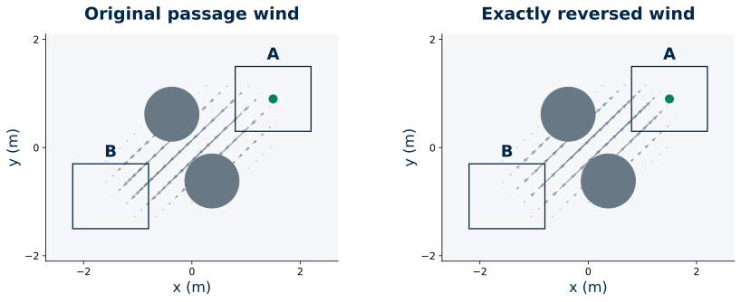

<b>120 s</b> missions · <b>10 s</b> planning horizon · <b>2 s</b> replanning

Matched initial state, clarity, task, survey and physical wind within each environment. Archived development runs; these predate the revised bounded MBD target. The signed-value equations decompose the chronological objective; no new mission is implied.

::: {.notes}
The original and reversed fields are exact negatives at every archived grid cell. All compared methods within each environment share geometry, targets, initial x and q, and initial survey measurements. Reversal changes the measured wind values but preserves survey locations. Run identifier 8101 is recorded in the provenance manifest. One development replicate per displayed environment does not establish population performance. The displayed evidence predates subsequent optimizer refinements. The images' internal labels say original and reversed wind; no new environment simulation was run for this slide revision.
:::

## Environment 1: original A/B-region wind {.replay data-section="Archived method" .archived-method data-archived="true"}

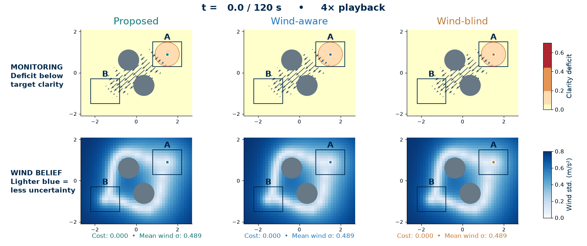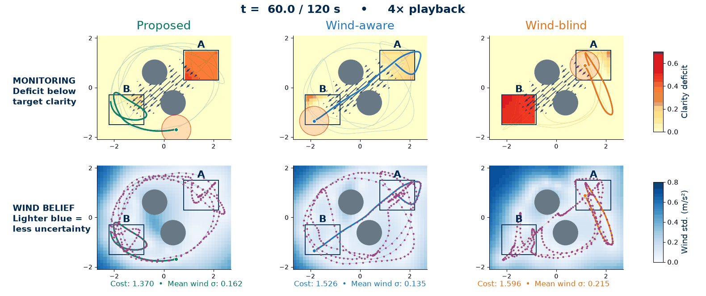

Proposed: <b>18.8% lower cost</b> than wind-blind; <b>3.9% lower</b> than wind-aware.

Top: monitoring deficit and wind arrows. Bottom: recorded wind uncertainty and observed locations. Fixed scales throughout.

::: {.notes}
All six panels share the physical time index. The top color bar is clarity deficit on [0,0.7], unitless. The bottom is POAM wind standard deviation on [0,0.8] m/s^2, shared across all methods and frames. Current archived belief snapshots are held until the next 2-second update; the map is not interpolated or artificially forced to decrease. Purple points mark real observed locations assimilated by that boundary. Path colors identify methods. The red footprint marks the 50%-weight sensing contour. True wind arrows are explanatory overlays, not an input provided to the planner. The cost contrasts use the full 120-second runs. Source paths and hashes are in results_manifest.json. Click to restart; leaving and re-entering also restarts.
:::

## Original wind: compare delivered monitoring {data-section="Archived method" .archived-method data-archived="true"}

::: {.columns}
::: {.column width="68%"}
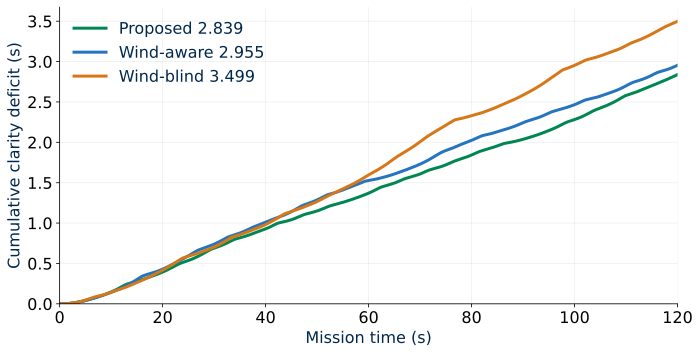
:::
::: {.column width="32%"}

Integrated clarity deficit

2.839 Proposed

2.955 Wind-aware

3.499 Wind-blind

**Completed A/B transfers** 16 · 14 · 8, respectively

No physical contact in these three archived runs' dense audits.

:::
:::

::: {.notes}
Audited integrated whole-grid deficits are 2.8393294811, 2.9549088478 and 3.4986467361. Trapezoidal reconstruction from recorded q agrees within 3e-5. Wind-aware improves 15.5% over wind-blind. Minimum dense clearances are 0.08991, 0.12724 and 0.11087 m. Do not interpret one replicate as a statistical safety or performance guarantee. Counts use completed transfers between the two monitored regions.
:::

## Environment 2: reversed wind {.replay data-section="Archived method" .archived-method data-archived="true"}

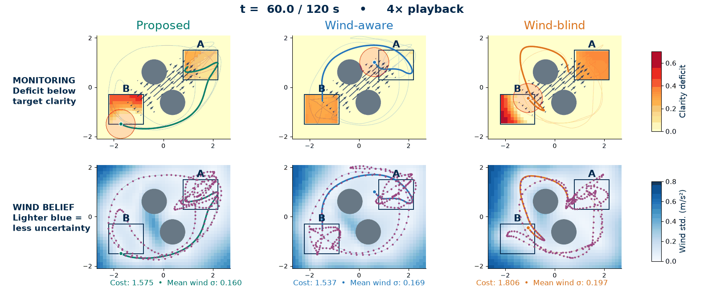

Proposed: <b>21.1% lower cost</b> than wind-blind; <b>1.3% lower</b> than wind-aware.

The entire physical wind field is reversed. Both color scales match Environment 1.

::: {.notes}
All three files are in results/budgeted_missions/reversed_wind_01. Costs are 3.0204606056, 3.0597779751 and 3.8264155388. Methods share initial state, clarity and the reversed environment's measured survey. The uncertainty maps are recorded estimator outputs. They show learning as it actually occurred, including any local variance increases due to model adaptation. The main broad effect is disturbance-aware execution prediction; the additional anticipated-learning contrast is small here.
:::

## Reversed wind: the additional learning gain is smaller {data-section="Archived method" .archived-method data-archived="true"}

::: {.columns}
::: {.column width="66%"}
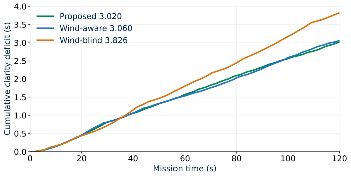
:::
::: {.column width="34%"}
**Proposed passage use**

- Original wind: one middle crossing, A to B.
- Reversed wind: one middle crossing, B to A.
- Fifteen other transfers use bypasses in each run.

The observed direction changes. Consistent exploitation of the middle passage is not established.

:::
:::

::: {.notes}
Route counts use the dense geometry-aware audit. There are sixteen transfers in each proposed mission. Do not present the single directional middle crossing as evidence of globally optimal route choice. Independent diagnostics did not establish a robust route-choice value-of-information mechanism across tested states. The results support a descriptive comparison of these archived environments.
:::

## Separate the wind-aware gain from the learning gain {data-section="Archived method" .archived-method data-archived="true"}

| Recorded cost reduction | Original wind | Reversed wind |
|---|---:|---:|
| **Wind-aware vs wind-blind** | **15.5%** | **20.0%** |
| Proposed vs wind-aware | 3.9% | 1.3% |
| Proposed vs wind-blind | 18.8% | 21.1% |

<b>First contribution:</b> predicting wind-dependent execution gives the larger contrast in these environments.

<b>Extension:</b> anticipating learning adds a smaller improvement in the displayed runs.

Descriptive comparisons from archived development runs. The wind-blind contrast also includes nominal wind compensation.

::: {.notes}
Percentages are relative reductions of whole-grid integrated monitoring cost. They are not confidence bounds. The proper interpretation prioritizes the wind-aware contribution, and then isolates the smaller anticipation contrast with current_belief. Results were not generated by the updated bounded-target implementation described earlier. No new mission is claimed in this presentation revision.
:::

## What the current evidence establishes {data-section="Archived method" .archived-method data-archived="true"}

<h3>Supported by these runs</h3>
<ul><li>Wind-aware planning improves recorded monitoring over the historical wind-blind baseline.</li><li>Anticipated learning adds a smaller improvement in both primary environments.</li><li>These two archived missions do not establish a general learning advantage.</li></ul>

<h3>Still to establish</h3>
<ul><li>A consistent anticipation advantage across independent physical environments.</li><li>Full-mission performance of the revised numerical implementation.</li><li>Reliability across larger search budgets and richer policy parameterizations.</li></ul>

Method correctness, optimizer quality and experimental performance are separate questions.

::: {.notes}
The deck does not claim global optimality, universal safety, real-time feasibility or an experimentally isolated value of information. The selected archived evidence remains limited. Between-method differences are not the same-policy signed learning value defined in the method. The first contribution is nevertheless clearly stated and tested descriptively: expected nominal informativeness can differ from executed monitoring performance under wind.
:::

## Takeaways {data-section="Archived method" .archived-method data-archived="true"}

1<b>Plan for delivered monitoring.</b> Use wind and the execution controller to predict where the robot can sense.

2<b>Anticipate information through its effect on later motion.</b> Update the predicted belief at scheduled observation times and continue the rollout.

3<b>MBD optimizes this composed task model.</b> The core score construction is retained; the policy evaluation becomes wind- and belief-aware.

::: {.notes}
Lead the discussion with the wind-aware planning contribution. Learning is a second layer that requires further evidence. Both optimize the same cumulative clarity-deficit task. The system diagram, algorithm comparison and the two MBD explanation slides are intended to make this distinction understandable without prior knowledge of RPCBF or MBD.
:::

## Implementation appendix {.section-break data-section="Archived method" .archived-method data-archived="true"}

A

Concrete simulation choices, kept separate from the generic method.

Policy representation → planar controller → numerical budgets → covariance-only variant

## Implementation: the 18-dimensional policy representation {data-section="Archived method" .archived-method data-archived="true"}

A reference trajectory specifies desired positions for the tracking controller. The implementation uses $\theta=(a_0,a_1,\xi_1,\ldots,\xi_4,\operatorname{vec}G)\in\mathbb R^{18}$.

<b>4</b>$a_0,a_1\in\mathbb R^2$ Initial acceleration parameters

<b>8</b>$\xi_1,\ldots,\xi_4\in\mathbb R^2$ Future reference-position parameters

<b>6</b>$G\in\mathbb R^{2\times3}$ Belief-response coefficients

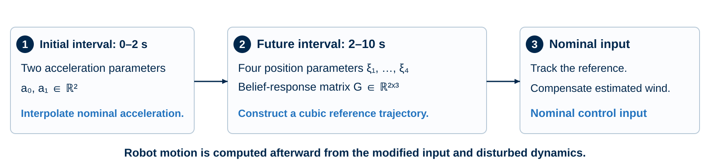

Bounded mappings convert the parameters to accelerations and reference positions. $G$ modifies future reference positions using wind-belief features, defined below.

::: {.notes}
The policy parameterization is a finite-dimensional search family. The first interval interpolates two acceleration values. Four future position knots define a cubic reference anchored to the first interval's terminal position and velocity, with zero terminal reference velocity. These quantities do not specify the executed path: that path is obtained from disturbed dynamics and input modification. The domain and parameter-density weights are specified at the end of the method section.
:::

## Implementation: a planar tracking controller {data-section="Archived method" .archived-method data-archived="true"}

The planar simulation specializes the generic robot model to

$$x=(r,v),\qquad \dot r=v,\qquad \dot v=u-\gamma v+d(r).$$

For the future reference $r_{\mathrm{ref}}$:

$$u_{\mathrm{nom}}=\operatorname{clip}_{\mathcal U}\!\left(
\ddot r_{\mathrm{ref}}+k_p(r_{\mathrm{ref}}-r)+k_v(\dot r_{\mathrm{ref}}-v)
+\gamma v-\mu_d(r)\right).$$

$r,v\in\mathbb R^2$: position and velocity. $\gamma$: known linear drag coefficient. $k_p,k_v>0$: tracking gains. Dots on $r_{\mathrm{ref}}$ denote time derivatives.

$\mu_d(r)$: mean of the available wind belief. $\operatorname{clip}_{\mathcal U}$: componentwise actuator saturation. $\gamma v-\mu_d(r)$ compensates drag and estimated wind.

Nominal wind compensation uses the estimated field. Predicted robot motion uses a possible physical field drawn from that belief.

The initial 2 s use the interpolated acceleration parameters instead of the reference-tracking terms. Defaults: $\gamma=1$, $k_p=1.2$, $k_v=1.8$.

## Implementation: the velocity-damping design policy {data-section="Archived method" .archived-method data-archived="true"}

To predict the implemented control modification, use the geometric constraint $h_a$ from the preliminaries and a fixed velocity-damping design policy:

$$\pi_b(x;\mathcal B^d)=\operatorname{clip}_{\mathcal U}
\big((\gamma-k_b)v-\mu_d(r)\big),\qquad k_b>0.$$

$\pi_b$: design policy used to evaluate future constraint values. $k_b$: velocity-damping gain; $k_b=2$ here.

$\pi_\theta$: nominal policy optimized for monitoring. $\pi_b$ is fixed and is not optimized by MBD.

Under mean wind and without saturation,

$$\dot v=(\gamma-k_b)v-\mu_d(r)-\gamma v+\mu_d(r)=-k_bv.$$

The design-policy prediction measures how current velocity and uncertain wind affect future constraint violation.

Construction inspired by Knoedler et al.'s policy-value approach. It supplies an approximate execution model within our planning objective.

## Implementation: the planar input inequality {data-section="Archived method" .archived-method data-archived="true"}

For $x=(r,v)$, partition the value gradient into

$$g_{r,a}=\nabla_r\widehat V_a,\qquad g_{v,a}=\nabla_v\widehat V_a.$$

The implemented inequality for obstacle or boundary $a$ becomes

$$g_{v,a}^{\mathsf T}u\leq
-g_{r,a}^{\mathsf T}v+\gamma g_{v,a}^{\mathsf T}v
-\max_{\ell}g_{v,a}^{\mathsf T}\widetilde d^{[\ell]}(r)
-\kappa\widehat V_a.$$

<b>Through the design-policy prediction:</b> The wind belief changes the sampled trajectories, their largest constraint values $\widehat V_a$, and the gradients $g_{r,a},g_{v,a}$.

<b>Through instantaneous acceleration:</b> The largest projected wind acceleration among the inner samples changes the right-hand side of the input inequality.

These changes alter the predicted control input, motion and sensing. The monitoring objective accounts for all three effects.

This row is obtained by substituting $\dot r=v$ and $\dot v=u-\gamma v+\widetilde d^{[\ell]}(r)$ into the preceding rate condition.

## Implementation: belief-dependent reference positions {data-section="Archived method" .archived-method data-archived="true"}

The matrix $G$ in the policy parameter vector maps wind-belief features to a reference-position adjustment.

$$z(\mathcal B^d)=\frac1{s_d}
\begin{bmatrix}\mu_{d,1}(r_*)\\\mu_{d,2}(r_*)\\\sigma_{d,1}(r_*)\end{bmatrix},
\qquad \Delta r(\mathcal B^d)=\delta_{\max}\tanh\big(Gz(\mathcal B^d)\big)$$

$r_*$: fixed central probe location. $\mu_{d,1},\mu_{d,2}$: two predicted wind components. $\sigma_{d,1}=\sqrt{[\Sigma_d(r_*,r_*)]_{11}}$: wind standard deviation.

$s_d$: wind scale used to normalize features. $\delta_{\max}=0.6\,\mathrm m$: maximum reference shift. The shift deforms future knots; cubic interpolation creates a reference trajectory.

This parameterization can deform the reference trajectory. It does not represent every possible future route switch.

::: {.notes}
The exact future knots are workspace-scaled tanh coordinates plus sin(j*pi/4) times Delta r, j=1,...,4, then clipped to workspace margins. The cubic reference is anchored at the first-stage terminal position and velocity and has zero final reference velocity. At later hypothetical boundaries the global 2–10 s reference is recomputed using the updated posterior; only its current and future part is used, while actual state and clarity continue. The two wind outputs share the covariance structure in this implementation, and code uses the first diagonal predictive variance. No hidden wind realization enters z. Source: budgeted.py::split_vector, future_reference.
:::

## Implementation: a bounded target for parameter search {data-section="Archived method" .archived-method data-archived="true"}

Set the unperturbed decision vector to $y=\theta$ and evaluate its **cumulative clarity deficit** $\widehat J(\theta)$.

$$p_0(\theta)=\frac1{Z_\lambda}\,
\mathbf1_{\Theta}(\theta)\,\mathbf1_{\mathcal V}(\theta)
\exp\!\left(-\frac{\widehat J(\theta)}{\lambda}\right)$$

$\Theta=[-6,6]^{18}$: policy parameter domain in the revised implementation. $\mathcal V$: policy parameter vectors with finite cost and no detected sampled contact.

$\mathbf1_A$: one when its argument belongs to set $A$, zero otherwise. $Z_\lambda$: integral of the numerator; positive when valid finite-cost support has positive volume.

$$\widehat J(\theta)=\frac1S\sum_{s=1}^{S}J_s(\theta)
\quad\Longrightarrow\quad w_k\propto\exp\!\left(-\frac{\widehat J(\theta^{[k]})}{\lambda}\right)$$

Average physical-field costs first. Use those costs to weight nominal parameters.

The executed controls and paths are outputs of the rollout. They are not substituted for $\theta^{[k]}$ in the weighted mean.

::: {.notes}
A bounded physical input through tanh is not a bounded latent parameter domain. The revised explicit box makes the nonnegative task-cost target normalizable if the valid subset has positive measure. Gaussian proposals are not clipped to the box; out-of-domain proposals receive zero weight. The original archived mission profiles predate these numerical revisions. The density is over theta, so the control-modification mapping need not be invertible and no Jacobian of the executed path is required. Realization-level costs are averaged before exponentiation. Positive QP relaxation is not automatically excluded by the sampled contact/finite-cost validity check.
:::

## Appendix: covariance-only anticipation {data-section="Archived method" .archived-method data-archived="true"}

For fixed sensing locations $\mathcal R$ and fixed GP hyperparameters, one can predict covariance reduction:

$$\Sigma_d^+(r,r')=\Sigma_d(r,r')-
\Sigma_d(r,\mathcal R)\big[\Sigma_d(\mathcal R,\mathcal R)+R_{\mathcal R}\big]^{-1}\Sigma_d(\mathcal R,r').$$

$\mathcal R$: predicted executed measurement locations. $R_{\mathcal R}$: observation-noise covariance for that batch. $\Sigma_d^+$: covariance after the hypothetical batch.

Keep the predicted mean at $\mu_d$ and rebuild the execution model using $\Sigma_d^+$. This approximates learning without drawing measurement values.

The mean-fixed approximation captures changing uncertainty, but omits adaptation to different observed wind means.

This is a separate implementation mode. The result animations show the realization-based proposed method.

::: {.notes}
The expression is exact Gaussian conditioning for fixed locations, kernel and predictive covariance, with the usual invertibility conditions and numerical stabilization. Full sparse POAM refitting with inducing relocation is not automatically identical to it. The cost at the expected posterior mean is generally not the expected cost over random posterior means. This alternative is kept separate from the method represented by the archived proposed GIFs. It does not add a raw variance reward.
:::

## Appendix: sources and reproducibility {data-section="Archived method" .archived-method data-archived="true"}

**Problem and method**

- Naveed, *Informative Planning with Task-Aware Spatial Disturbance Estimation*: supplied manuscript, problem notation and clarity.
- Pan et al., *Model-Based Diffusion for Trajectory Optimization* (2024), Eqs. (6), (8)–(10), Algorithm 2. [Paper](https://arxiv.org/abs/2407.01573)
- Chen, Liu and Khardon, *POAM* (RSS 2024). [Paper](https://www.roboticsproceedings.org/rss20/p019.html)
- Knoedler et al., *Safety on the Fly* (RA-L 2025): robust policy control barrier functions.

**Reproducible presentation**

- Exact archived run paths and hashes: `results_manifest.json`.
- GIFs use recorded motion, clarity and wind-belief histories with fixed color scales.
- Editable Quarto source, LaTeX math, local KaTeX fonts and vector architecture are included.

::: {.notes}
The supplied Disturbance_aware_ipp.pdf is an earlier manuscript. Its Stein optimizer and same-start two-pass counterfactual information-value score are not the causal MBD algorithm shown here. Robot, clarity and belief notation are adapted explicitly; fd is used to distinguish nominal and disturbed dynamics. The implementation references are planning/budgeted.py, planning/mbd.py, safety/rpcbf.py, safety/spline.py, wind/poam.py and clarity.py. Teaching plots and architecture miniatures are labeled illustrative; animated mission paths are archived data. 
:::

